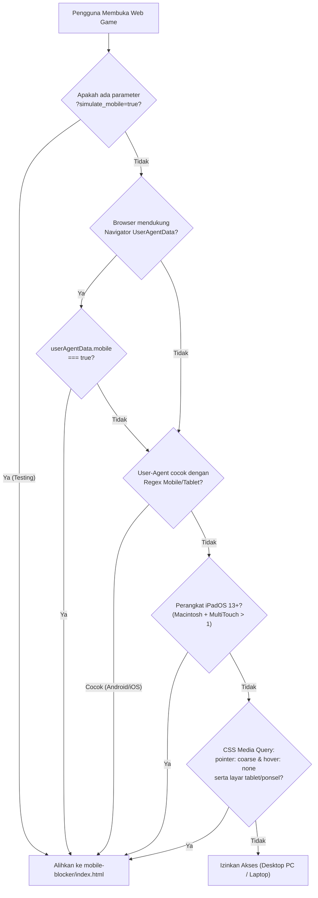

# 🛡️ Mobile Access Guard & Blocker (`mobile-blocker/`)

Modul proteksi perangkat independen untuk mendeteksi dan membatasi akses pengguna dari perangkat seluler (**Smartphone & Tablet**) ke game 3D *Meteor Defense 3D*. Sistem permainan memerlukan terminal komputer desktop dengan **Mouse Presisi & Keyboard Fisik** serta akselerasi grafis GPU WebGL.

---

## 🗂️ Struktur Berkas

```text
mobile-blocker/
├── 📄 detector.js     # Script deteksi multi-layer (User-Agent, Client Hints, Touch & Pointer)
├── 📄 index.html      # Halaman blokir bertema Sci-Fi cyberpunk dengan diagnosa hardware
├── 📄 style.css       # Desain antarmuka mandiri responsif dengan tema hologram alert
└── 📄 README.md       # Panduan teknis, integrasi, dan pengujian modul
```

---

## 🔄 Alur Logika Deteksi Perangkat (`detector.js`)

Modul ini mengimplementasikan pendekatan **Multi-Layer Detection** untuk memastikan deteksi akurat tanpa *false positive* pada komputer PC/laptop yang dilengkapi layar sentuh (*touchscreen laptop*):



---

## ⚖️ Mengapa Desktop Wajib Diperlukan?

| Kebutuhan Game | Terminal Desktop / PC | Perangkat Mobile / Layar Sentuh |
| :--- | :--- | :--- |
| **Kontrol Kamera 360°** | ✅ Klik kanan drag mouse & tombol panah halus | ❌ Gestur pinch/swipe bertabrakan dengan navigasi peramban |
| **Bidikan Proyektil Tepat** | ✅ Kursor mouse presisi tinggi via `Raycaster` | ❌ Jari menutupi area pandang dan akurasi rendah |
| **Input Persenjataan Taktis** | ✅ Tombol fisik keyboard `[1-3]`, `[WASD]`, `[Q/E/F/G]`, `[R]` | ❌ Tidak tersedia tombol fisik, layar sentuh terbatas |
| **Kinerja Rendering WebGL** | ✅ GPU desktop menangani ribuan partikel & bayangan PBR | ❌ Keterbatasan daya baterai, thermal throttling, & memori mobile |

---

## 🚀 Cara Integrasi ke Game Utama ([`index.html`](file:///c:/GitHub/Praktikum-Grafika-Komputer/ETS/index.html))

Proteksi ini aktif secara otomatis pada game utama dengan menyisipkan script deteksi di dalam tag `<head>` pada file [`index.html`](file:///c:/GitHub/Praktikum-Grafika-Komputer/ETS/index.html):

```html
<head>
  <!-- Mobile Access Restriction Guard -->
  <script src="mobile-blocker/detector.js"></script>
  <script>
    if (window.MobileDetector) {
      MobileDetector.guardOrRedirect('mobile-blocker/index.html');
    }
  </script>

  <!-- Pustaka Three.js & Skrip Game Selanjutnya -->
  ...
</head>
```

> [!NOTE]
> Jika pengguna membuka link game di ponsel, `guardOrRedirect()` secara otomatis mencatat URL asli dan mengalihkan halaman ke [mobile-blocker/index.html](file:///c:/GitHub/Praktikum-Grafika-Komputer/ETS/mobile-blocker/index.html).

---

## 🧪 Panduan Pengujian (Testing)

### 1. Simulasi Cepat di Browser Desktop
Buka URL game di browser dengan menambahkan parameter uji:
```text
http://localhost:8000/index.html?simulate_mobile=true
```
Sistem akan otomatis memperlakukan browser seolah-olah adalah perangkat smartphone dan langsung mengalihkan ke halaman pemblokir.

### 2. Pengujian via Mode Emulasi Perangkat (DevTools)
1. Buka peramban Google Chrome atau Microsoft Edge di PC.
2. Buka DevTools dengan menekan **`F12`** atau **`Ctrl + Shift + I`**.
3. Aktifkan mode responsif dengan menekan **`Ctrl + Shift + M`** (ikon tablet/ponsel).
4. Pilih profil perangkat (misal: *iPhone 14 Pro Max* atau *Samsung Galaxy S20*).
5. Segarkan halaman (**`F5`**). Sistem akan mendeteksi pointer *coarse* dan mengalihkan ke antarmuka pemblokir.

---

## 💡 Fitur Utama Halaman Pemblokir ([`index.html`](file:///c:/GitHub/Praktikum-Grafika-Komputer/ETS/mobile-blocker/index.html))

* **Desain Sci-Fi Futuristik**: Mengusung estetika hologram antariksa dengan aksen neon peringatan (*pulsing alert beacon*).
* **Live Hardware Diagnostics**: Menampilkan informasi diagnostik perangkat secara transparan kepada pengguna:
  * Tipe perangkat terdeteksi (*Smartphone* / *Tablet*).
  * Resolusi layar dan dimensi viewport.
  * Tipe kursor pointer (*Coarse* vs *Fine*).
  * Jumlah titik multitouch aktif.
* **Tombol Salin Link Instan**: Memungkinkan pemain di ponsel menyalin alamat URL game dengan satu klik untuk dikirimkan ke PC/laptop mereka melalui aplikasi pesan instan.
* **Periksa Ulang Real-time**: Memungkinkan verifikasi ulang jika pengguna menghubungkan mouse eksternal atau berganti mode.
