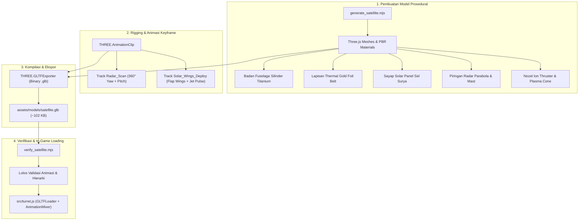

# 🛠️ 3D Asset Generation & Validation Pipeline (`scripts/`)

Direktori ini memuat skrip otomasi berbasis **Node.js** dan **Three.js** untuk merakit, menganimasikan, mengekspor, serta memvalidasi model 3D biner **GLTF/GLB** ([`satellite.glb`](file:///c:/GitHub/Praktikum-Grafika-Komputer/ETS/assets/models/satellite.glb)) secara mandiri dan prosedural tanpa perlu bergantung pada perangkat lunak eksternal seperti Blender.

---

## 🗂️ Struktur Berkas

```text
scripts/
├── 📄 generate_satellite.mjs   # Pembangkit geometri prosedural, rigging animasi, & eksportir GLB
├── 📄 verify_satellite.mjs     # Skrip diagnostik & pengujian integritas file 3D GLB
└── 📄 README.md                # Dokumentasi panduan pipeline aset 3D
```

---

## 🔄 Alur Pipeline Pembangkitan Aset



---

## 📑 Penjelasan Rinci Skrip

### 1. [`generate_satellite.mjs`](file:///c:/GitHub/Praktikum-Grafika-Komputer/ETS/scripts/generate_satellite.mjs)

Skrip ini merakit seluruh komponen fisik satelit menggunakan primitif geometri Three.js dengan material berbasis fisik (*Physically Based Rendering* - PBR) dan melengkapinya dengan 2 set animasi *keyframe* sebelum diekspor ke format standar industri `.glb`.

#### Komponen Geometri yang Dibuat:
* **Fuselage Inti**: Prisma heksagonal titanium bertingkat dengan sabuk isolasi termal emas MLI (*Multi-Layer Insulation*).
* **Sayap Surya (Solar Panels)**: Rangka karbon ganda dengan 8 sel surya silikon fotovoltaik dan engsel putar.
* **Sistem Radar Komunikasi**: Piringan antena parabola (*parabolic dish*) dengan sub-reflektor dan umpan tiang sensor (*feed horn*).
* **Propulsi Ion Elektrik**: Nozel pendorong ion xenon dengan corong plasma emisi biru bercahaya (*glow*).

#### Klip Animasi yang Ditanamkan (*Embedded Keyframe Tracks*):
| Nama Animasi | Durasi | Komponen yang Bergerak | Karakteristik Gerakan |
| :--- | :--- | :--- | :--- |
| **`Radar_Scan`** | 4.0 detik | Antena Piringan & Sensor Mast | Rotasi kontinu 360° pada sumbu *Yaw* disertai anggukan sudut elevasi (*Pitch*) $\pm 15^\circ$. |
| **`Solar_Wings_Deploy`** | 3.0 detik | Sayap Surya Kiri/Kanan & Ion Jet | Gerakan fleksing kepakan panel surya secara sinkron disertai denyut skala semburan plasma jet. |

---

### 2. [`verify_satellite.mjs`](file:///c:/GitHub/Praktikum-Grafika-Komputer/ETS/scripts/verify_satellite.mjs)

Skrip pengujian otomatis yang memuat kembali file biner [satellite.glb](file:///c:/GitHub/Praktikum-Grafika-Komputer/ETS/assets/models/satellite.glb) menggunakan `GLTFLoader` di lingkungan Node.js untuk memastikan model siap digunakan di game tanpa *runtime error*.

#### Poin-Poin Validasi:
1. **Integritas Berkas**: Memverifikasi ukuran file berada pada rentang ideal (< 250 KB untuk pemuatan web instan).
2. **Ketersediaan Animasi**: Memastikan klip animasi `Radar_Scan` dan `Solar_Wings_Deploy` terdaftar dan memiliki jumlah *track* yang lengkap.
3. **Pohon Hierarki Mesh**: Memeriksa bahwa struktur *parent-child* node (Root, Fuselage, Wings, Radar, Thruster) tidak mengalami deformasi transformasi.

---

## 🚀 Panduan Eksekusi Skrip

Jalankan perintah berikut di terminal dari direktori utama proyek (`ETS/`):

### Membuat Ulang Model 3D:
```bash
node scripts/generate_satellite.mjs
```
> [!NOTE]
> Perintah di atas akan mengompilasi dan menimpa file [`assets/models/satellite.glb`](file:///c:/GitHub/Praktikum-Grafika-Komputer/ETS/assets/models/satellite.glb) dengan model satelit terbaru.

### Menjalankan Uji Integritas Model:
```bash
node scripts/verify_satellite.mjs
```

#### Contoh Output Verifikasi yang Sukses:
```text
=== GLB VALIDATION REPORT ===
✓ File Path      : assets/models/satellite.glb
✓ File Size      : 102.7 KB (Memenuhi standar aset web ringan)
✓ Total Meshes   : 14 node geometri terpasang
✓ Total Clipart  : 2 Animasi Terdaftar
   [1] Radar_Scan           (Durasi: 4.0s, 3 Tracks)
   [2] Solar_Wings_Deploy   (Durasi: 3.0s, 4 Tracks)
✓ Status         : SIAP DIGUNAKAN DI GAME (PASS)
```

---

## 💡 Keunggulan Metode Prosedural
* **Reproducible**: Seluruh bentuk geometri dan warna material didefinisikan 100% dalam kode, sehingga mudah di-*version control* menggunakan Git.
* **Ukuran Sangat Ringan**: File biner `.glb` yang dihasilkan hanya berbobot ~102 KB, memungkinkan waktu unduh instan saat game dibuka di peramban web.
* **Bebas Ketergantungan Eksternal**: Tidak memerlukan instalasi Blender atau alat pemodelan 3D terpisah untuk mengubah bentuk satelit.
