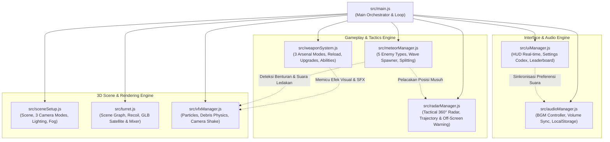
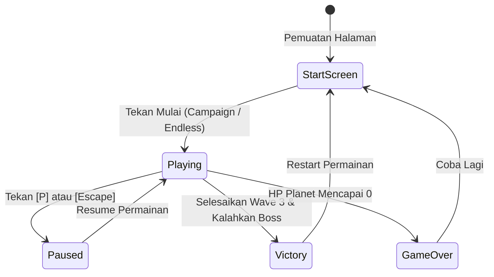

# 🏗️ Modular Game Architecture (`src/`)

Direktori ini memuat seluruh kode logika, subsistem grafika 3D, dan engine permainan **Meteor Defense 3D**. Proyek ini menerapkan arsitektur modular modern berbasis **JavaScript ES6 Modules** dengan prinsip *Single Responsibility Principle* (SRP) dan *Clean Architecture* tanpa *bundler* eksternal (100% *native browser imports*).

---

## 🗺️ Diagram Arsitektur Subsistem

Diagram di bawah mengilustrasikan bagaimana modul orkestrator [`main.js`](file:///c:/GitHub/Praktikum-Grafika-Komputer/ETS/src/main.js) mengoordinasikan interaksi antara subsistem grafika, logika permainan, antarmuka, dan audio:



---

## 🗂️ Rangkuman Modul & Tanggung Jawab

| File Modul | Peran Utama | Fitur Utama yang Dikelola |
| :--- | :--- | :--- |
| **[`main.js`](file:///c:/GitHub/Praktikum-Grafika-Komputer/ETS/src/main.js)** | **Master Orchestrator** | Game loop (`requestAnimationFrame`), event input mouse/keyboard, kalkulasi `delta time`, dan *state machine* permainan. |
| **[`sceneSetup.js`](file:///c:/GitHub/Praktikum-Grafika-Komputer/ETS/src/sceneSetup.js)** | **Scene & Atmosphere** | 3 Mode Kamera 360° (*Third-Person*, *First-Person Turret*, *Top-Down*), pencahayaan PBR, kabut atmosfer, dan 5 tema planet. |
| **[`turret.js`](file:///c:/GitHub/Praktikum-Grafika-Komputer/ETS/src/turret.js)** | **Turret & Satellite** | Hierarki *Scene Graph* meriam (Yaw/Pitch/Recoil), pemuatan model [satellite.glb](file:///c:/GitHub/Praktikum-Grafika-Komputer/ETS/assets/models/satellite.glb), serta pemutaran 2 animasi `AnimationMixer`. |
| **[`meteorManager.js`](file:///c:/GitHub/Praktikum-Grafika-Komputer/ETS/src/meteorManager.js)** | **Enemies & Spawning** | Generasi prosedural 5 varian meteor, algoritma pemecahan Cluster Shard, pergerakan trajektori, dan deteksi benturan planet. |
| **[`weaponSystem.js`](file:///c:/GitHub/Praktikum-Grafika-Komputer/ETS/src/weaponSystem.js)** | **Arsenal & Taktik** | Mekanik 3 senjata (Laser, Missile AOE, Railgun Pierce), sistem cooldown reload, 4 upgrade turret, dan 4 abilities khusus. |
| **[`radarManager.js`](file:///c:/GitHub/Praktikum-Grafika-Komputer/ETS/src/radarManager.js)** | **Tactical Minimap** | Render canvas radar 360° (160x160 px), kompas mata angin dinamis, garis trajektori meteor asal, dan panah peringatan bahaya layar. |
| **[`audioManager.js`](file:///c:/GitHub/Praktikum-Grafika-Komputer/ETS/src/audioManager.js)** | **Audio & BGM Controller** | Trek musik latar [music.mp3](file:///c:/GitHub/Praktikum-Grafika-Komputer/ETS/assets/music/music.mp3), slider volume terpadu, tombol mute keyboard, dan sinkronisasi `localStorage`. |
| **[`vfxManager.js`](file:///c:/GitHub/Praktikum-Grafika-Komputer/ETS/src/vfxManager.js)** | **VFX & Audio Synthesizer** | Semburan partikel ledakan, puing batuan debris gravitasi, efek kubah perisai, *screen shake*, dan synthesizer suara prosedural Web Audio API. |
| **[`uiManager.js`](file:///c:/GitHub/Praktikum-Grafika-Komputer/ETS/src/uiManager.js)** | **HUD & User Interface** | Layar awal *Start Screen*, HUD status amunisi & HP, papan peringkat lokal *Leaderboard Top 5*, modal *Pause*, dan *Victory/Defeat*. |

---

## 🔍 Penjelasan Mendalam Tiap Modul

### 1. [`main.js`](file:///c:/GitHub/Praktikum-Grafika-Komputer/ETS/src/main.js)
* **Game Loop**: Menghitung `delta time` dengan `THREE.Clock` untuk memastikan seluruh kalkulasi fisika, perputaran, dan animasi berjalan konsisten pada tingkat refresh monitor berapapun (60Hz, 120Hz, 144Hz).
* **Raycaster Aiming**: Memproyeksikan sinar `THREE.Raycaster` dari posisi kursor mouse ke ruang 3D untuk menentukan orientasi rotasi meriam pangkalan (*turret traversal*).
* **State Lifecycle**: Mengontrol transisi antar-fase permainan:



---

### 2. [`sceneSetup.js`](file:///c:/GitHub/Praktikum-Grafika-Komputer/ETS/src/sceneSetup.js)
* **Sistem Kamera Fleksibel**:
  * *Third-Person Orbit*: Mengitari pangkalan dengan kontrol mouse klik-kanan drag atau tombol panah keyboard.
  * *First-Person Cockpit*: Pandangan langsung dari sudut pandang laras meriam dengan kebebasan toleh 360°.
  * *Top-Down Isometric*: Sudut pandang strategis dari atas untuk pemantauan medan secara menyeluruh.
* **Pencahayaan Bertingkat**:
  * `THREE.DirectionalLight`: Menyimulasikan cahaya bintang kosmik dengan kalkulasi bayangan beresolusi tinggi (*Shadow Map* 2048x2048).
  * `THREE.AmbientLight`: Memberikan pencahayaan lingkungan dasar agar bagian gelap tetap terbaca secara visual.
  * `THREE.PointLight`: Menghasilkan kilatan cahaya dinamis saat meriam menembak (*muzzle flash*).
* **5 Tema Planet Dinamis**: Memungkinkan pergantian instan visual tanah, kabut atmosfer (`THREE.FogExp2`), dan warna langit kosmik (Lunar Slate, Mars Red, Ice Europa, Toxic Alien, dan Volcanic Ash) dengan menekan tombol **`[B]`**.

---

### 3. [`turret.js`](file:///c:/GitHub/Praktikum-Grafika-Komputer/ETS/src/turret.js)
* **Hierarki Scene Graph**:
  ```text
  turretGroup (Root)
  └── baseMesh (Pondasi Pangkalan)
      └── headGroup (Rotasi Horizontal - Yaw)
          ├── bodyMesh (Kokpit & Armor)
          └── cannonGroup (Rotasi Vertikal - Pitch & Animasi Recoil Laras)
  ```
* **Integrasi Satelit GLB**: Memuat file model biner [`satellite.glb`](file:///c:/GitHub/Praktikum-Grafika-Komputer/ETS/assets/models/satellite.glb) via `GLTFLoader`. Model ditempatkan pada lintasan orbit lingkaran di atas pangkalan dan digerakkan oleh `THREE.AnimationMixer` untuk memutar klip animasi `Radar_Scan` dan `Solar_Wings_Deploy`.

---

### 4. [`meteorManager.js`](file:///c:/GitHub/Praktikum-Grafika-Komputer/ETS/src/meteorManager.js)
* **5 Varian Meteor Kosmik**:
  * **Standard**: Karakteristik kecepatan dan ketahanan seimbang.
  * **Speedy**: Berukuran ramping dengan akselerasi tinggi berwarna keemasan.
  * **Armored**: Berlapis batuan magma tebal dengan HP tinggi.
  * **Cluster**: Kristal hijau yang saat hancur memecah menjadi 3 anak serpihan (*shards*).
  * **Boss Asteroid**: Asteroid raksasa berkawah dengan diameter 3x lipat dan bar HP khusus di HUD.
* **Vektor Lintasan Asal**: Merekam koordinat awal pemunculan (*spawn origin coordinates*) setiap meteor untuk disuplai ke modul radar taktis.

---

### 5. [`weaponSystem.js`](file:///c:/GitHub/Praktikum-Grafika-Komputer/ETS/src/weaponSystem.js)
* **Persenjataan**:
  * **[1] Meriam Laser**: Tembakan hitscan instan pinpoint tanpa jeda reload ($\infty$ amunisi).
  * **[2] Peluru Kendali Missile**: Roket berpemandu dengan radius ledakan area (AOE blast), kapasitas 7 peluru.
  * **[3] Railgun**: Berkas energi magnetik tebal yang menembus (*pierce*) banyak asteroid dalam satu garis lurus, kapasitas 3 peluru.
* **Sistem Upgrade Turret**: Peningkatan bertingkat menggunakan koin pertempuran untuk Damage (`[Z]`), Fire Rate (`[X]`), Max Ammo (`[C]`), dan Kecepatan Rotasi (`[V]`).
* **Abilities Taktis**: Pelindung Planet (`[Q]`), Nuklir EMP (`[E]`), Time Slow (`[F]`), dan Double Score (`[G]`).

---

### 6. [`radarManager.js`](file:///c:/GitHub/Praktikum-Grafika-Komputer/ETS/src/radarManager.js)
* **Radar Minimap Canvas 2D (160x160 px)**: Memproyeksikan posisi 3D seluruh meteor ke bidang radar 2D horizontal secara real-time.
* **Kompas Arah Dinamis**: Menampilkan jarum mata angin (`U`, `T`, `S`, `B`) yang berputar mengikuti sudut hadap kamera.
* **Off-Screen Threat Indicators**: Menampilkan indikator panah merah berkedip di tepi layar browser jika ada meteor yang mendekat di luar bidang pandang kamera pemain.

---

### 7. [`vfxManager.js`](file:///c:/GitHub/Praktikum-Grafika-Komputer/ETS/src/vfxManager.js)
* **Sistem Partikel & Fisika Debris**: Menghasilkan hamburan batu 3D acak yang mengalami gravitasi ke bawah, perlambatan udara, dan rotasi tumbling saat meteor hancur.
* **Synthesizer Web Audio API Prosedural**: Membangkitkan frekuensi audio tembakan laser, desis roket, ledakan railgun, dan alarm peringatan secara matematis menggunakan osilator audio (`OscillatorNode` & `GainNode`) langsung di peramban tanpa membebani bandwidth jaringan.

---

### 8. [`audioManager.js`](file:///c:/GitHub/Praktikum-Grafika-Komputer/ETS/src/audioManager.js)
* **Pengendali Musik BGM**: Memutar trek musik latar berformat MP3 secara looping dengan transisi halus (*fade-in / fade-out*).
* **Sinkronisasi Pengaturan**: Menyimpan preferensi volume musik, volume SFX, dan status mute ke `localStorage` agar pengaturan pemain tetap tersimpan saat halaman dimuat ulang.

---

### 9. [`uiManager.js`](file:///c:/GitHub/Praktikum-Grafika-Komputer/ETS/src/uiManager.js)
* **Tampilan HUD Real-time**: Mengelola indikator visual HP pangkalan, amunisi sekunder, indikator reload berputar, perolehan skor, pengganda combo (*combo streak*), dan bar HP Boss.
* **Settings & Intel Codex**: Dialog informatif yang menyajikan informasi taktik musuh, panduan persenjataan, serta pengaturan audio dan kontrol.
* **Leaderboard Lokal**: Menyimpan dan menampilkan 5 skor rekor tertinggi di peramban web.
