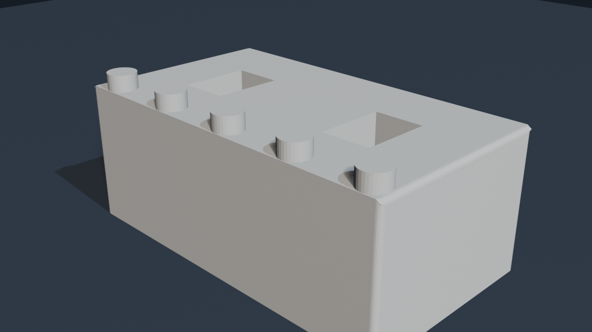
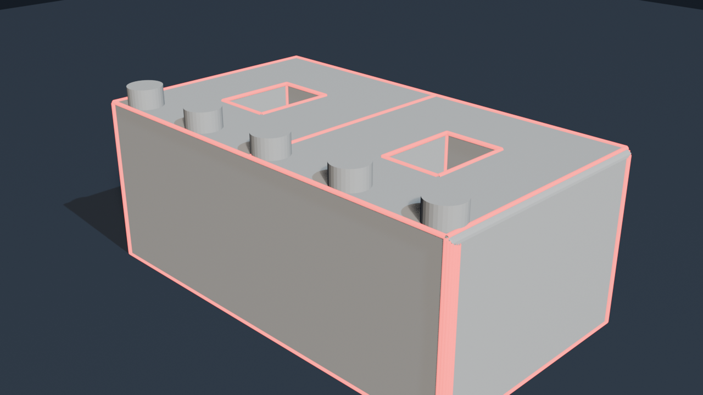
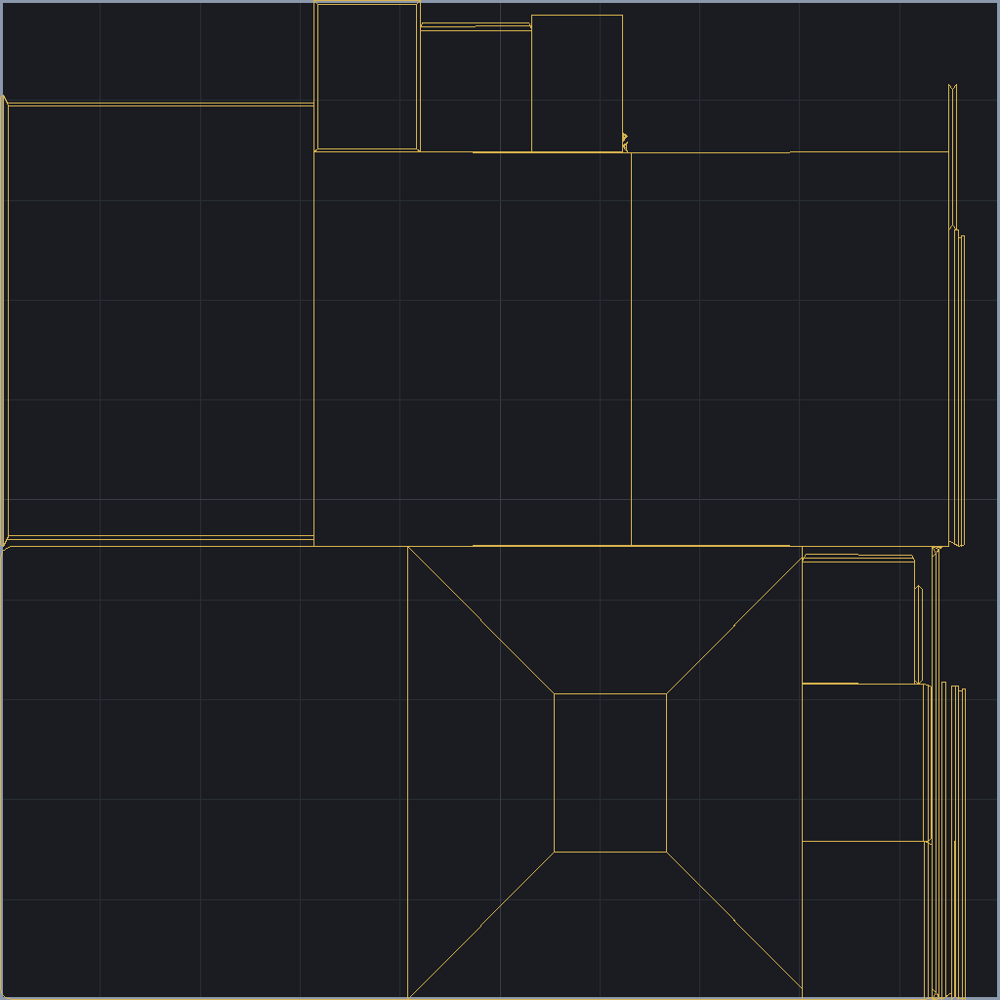
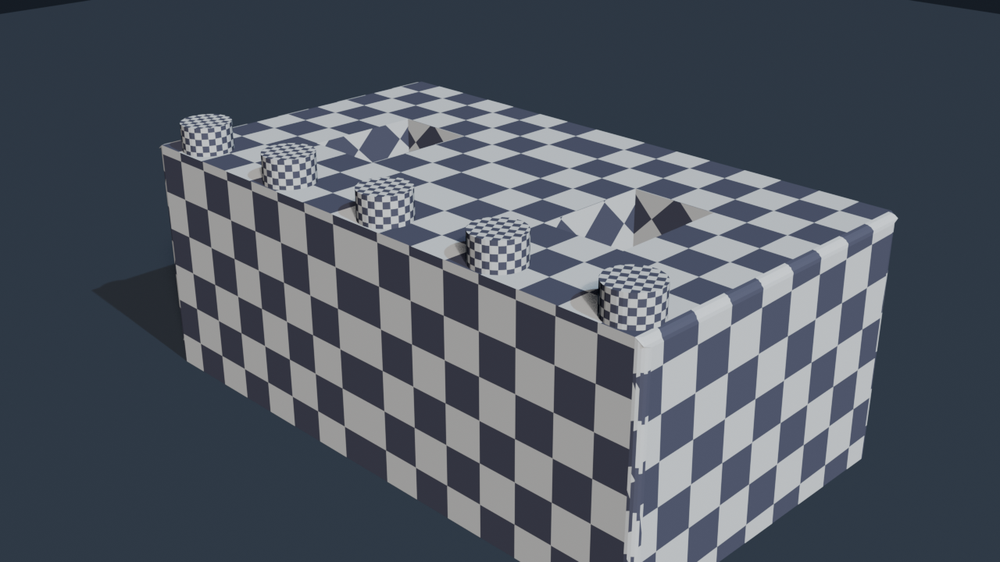
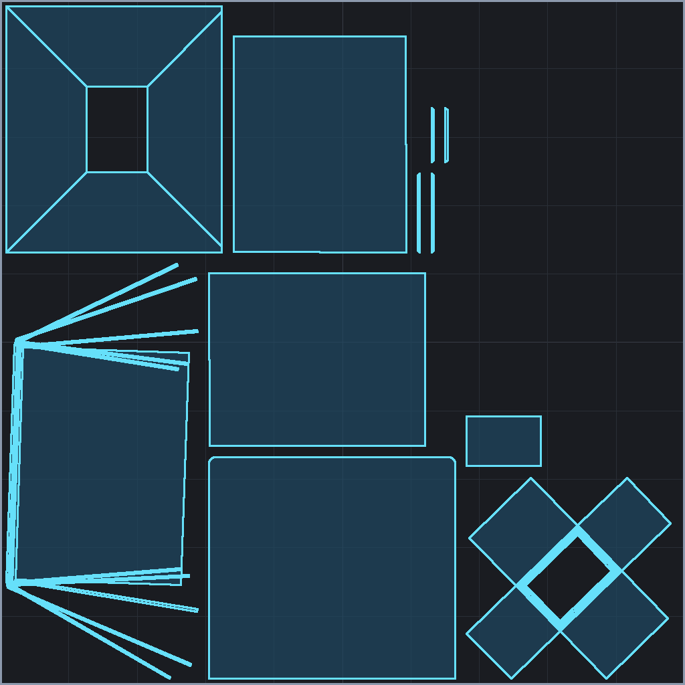
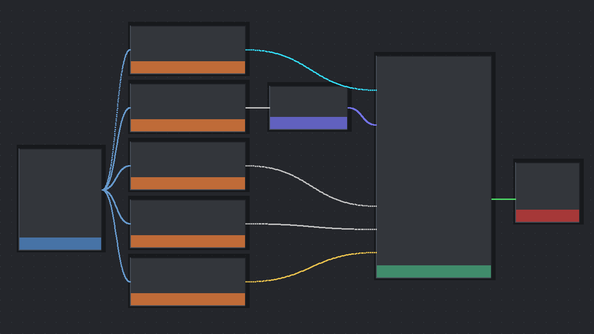
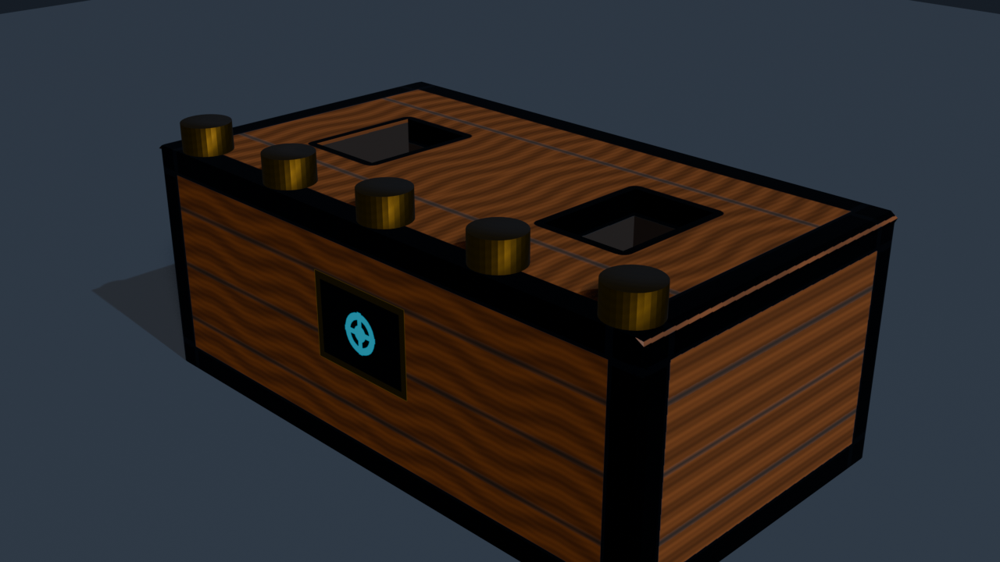
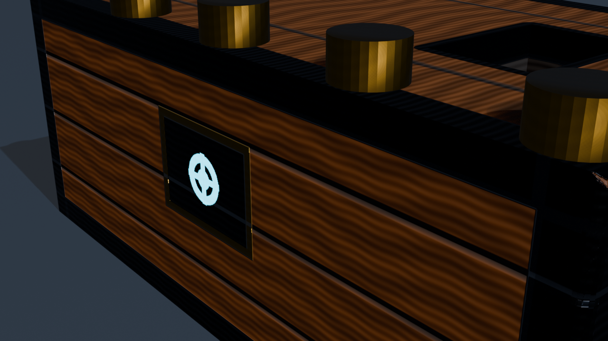
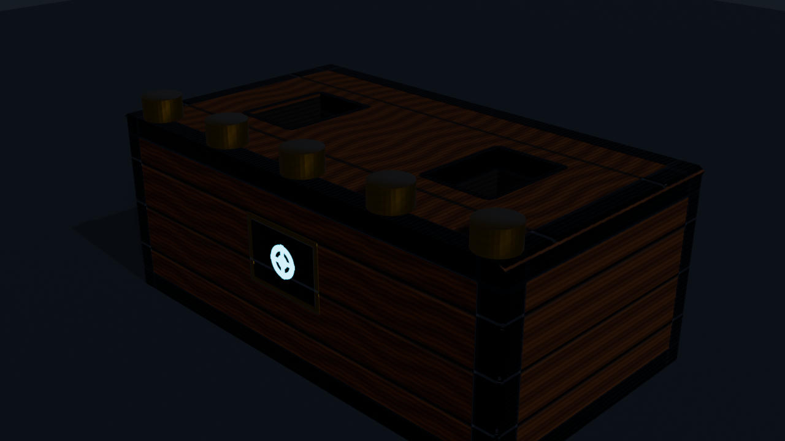
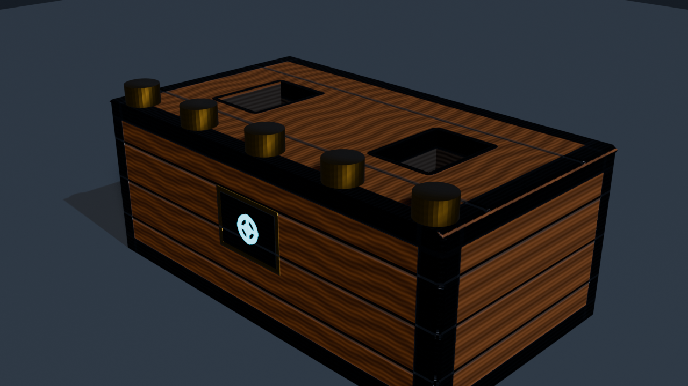

# Praktikum 10 - Blender Materials, UV & Texturing

## Identitas Kelompok

- **Nama** : Mandy Alphafyn Imanuel Tjandra  
- **NRP**  : 5025241173  
- **Kelas**: B  

- **Nama** : Muhammad Nawfal Alfanni Darussalam  
- **NRP**  : 5025241185  
- **Kelas**: B  

---

## 1. Nama Asset dan Konsep
* **Nama Asset**: *Stylized PBR Chest Prop (Base Mesh, Reinforced Iron Bands, & Rivet Assembly)*
* **Konsep Asset**:
  Melanjutkan geometri 3D prop peti harta karun (*Chest Prop*) dari Pertemuan 9, Pertemuan 10 berfokus pada **surface appearance** menyeluruh melalui *UV Unwrapping*, pembuatan texture maps resolusi tinggi ($2048 \times 2048$), serta penyusunan material *Physically Based Rendering (PBR)* menggunakan standar **Principled BSDF** di Blender 5.2 LTS.
  
  Visual prop menggabungkan karakter papan kayu walnut/mahoni gelap (*dark mahogany planks*) dengan balutan pelat besi tempa (*forged iron reinforcement straps*), sudut-sudut beveled dengan kilap aus alami (*edge wear*), pelat kunci kuningan berornamen (*brass escutcheon*), inti segel magis/sci-fi bercahaya (*glowing cyan rune power core*), serta barisan paku keling kuningan pipih (*polished brass rivets*).
* **Struktur File & Outliner**:
  * `Prop_Chest`:
    * `Chest_Base`: Badan utama peti harta karun (*Mesh + Mirror Modifier*), material: `Chest_PBR_Mat`.
    * `Rivet_Array`: Barisan baut/paku keling (*Mesh + Geometry Nodes Array Generator*), material: `Rivet_Brass_PBR_Mat`.
  * `Collection`:
    * `Camera`: Kamera render perspektif (*Focal Length: 50mm*).
    * `Light`: Key Light hangat (*Sun, Energy: 3.0, Color: Warm White*).
    * `RimLight`: Rim Light dingin (*Sun, Energy: 1.8, Color: Soft Cyan-Blue*).
    * `Ground`: Lantai studio matte slate (*Mesh Plane*).

---

## 2. Model Preparation & Pemeriksaan Geometri (Milestone 1)
Sebelum proses unwrapping dimulai, dilakukan serangkaian verifikasi kesehatan geometri pada model asal Pertemuan 9:
1. **Pemeriksaan Skala & Normalisasi (`Apply Scale`)**:
   * Komponen `Rivet_Array` pada file awal memiliki skala $(2.0, 2.0, 2.0)$. Dilakukan normalisasi skala melalui `Ctrl + A -> Apply Scale` menjadi $(1.0, 1.0, 1.0)$. Hal ini esensial agar kalkulasi rasio aspek unwrapping UV tidak terdistorsi dan texel density terdistribusi secara proporsional.
   * `Chest_Base` mempertahankan skala $(1.0, 1.0, 1.0)$ dengan dimensi bounding box $3.6\text{ m} \times 2.0\text{ m} \times 1.4\text{ m}$.
2. **Pembersihan Geometri Duplikat (`Merge by Distance`)**:
   * Dilakukan pemindaian vertex ganda dengan batas toleransi $10^{-4}\text{ m}$ untuk memastikan tidak ada vertex tumpang-tindih yang dapat menyebabkan keretakan pada UV island.
3. **Pemeriksaan Normal Geometri (`Shift + N -> Recalculate Outside`)**:
   * Memastikan seluruh normal permukaan polygon mengarah ke luar secara konsisten, mencegah artefak bayangan gelap (*flipped normal shading*) atau pembalikan orientasi Normal Map.
4. **Verifikasi Manifold & Boundary Edges**:
   * Memeriksa keterhubungan topologi pada bidang potong simetri $X = 0$ agar *Mirror Modifier* menyatu mulus tanpa menyisakan interior faces tersembunyi.

---

## 3. Strategi Seam & Logika Pemotongan (Milestone 2)
Untuk meratakan model 3D menjadi koordinat 2D ($U, V$) dengan distorsi seminimal mungkin, *seam* (garis potong) ditentukan berdasarkan struktur fungsional objek:

### A. Strategi Seam pada `Chest_Base` (Total 53 Edge Seams):
1. **Perimeter Dasar Bawah (*Bottom Perimeter*)**:
   Edge sepanjang dasar peti ($Z = -0.7$) dipotong menyeluruh mengelilingi batas bawah (kecuali garis simetri tengah). Ini mengisolasi bidang bawah menjadi satu UV island persegi datar tersendiri.
2. **Bibir Rongga Atas (*Cavity Rim Perimeter*)**:
   Edge pembatas bukaan rongga penyimpanan ($Z = 0.7$, $X \in [0.652, 1.148]$, $Y \in [-0.348, 0.348]$) ditandai sebagai seam untuk memisahkan permukaan bibir atas dengan dinding dalam rongga.
3. **Sudut Vertikal Dalam Rongga (*Cavity Corner Relief Cuts*)**:
   Keempat sudut vertikal di dalam rongga dipotong dari atas hingga ke dasar rongga. Ini memungkinkan dinding dan lantai rongga terbuka mendatar layaknya pola kotak karton (*unfolded box*) tanpa kompresi diagonal.
4. **Batas Luar Permukaan Atas (*Top Rim Outer Edge*)**:
   Edge sepanjang pertemuan bidang atas dengan bidang bevel sisi vertikal ditandai seam, memisahkan pelat atas peti dari dinding vertikal samping.
5. **Sudut Belakang & Siku Vertikal Luar (*Outer Corner Relief*)**:
   Edge vertikal di sudut luar belakang dan samping ditandai seam, memungkinkan dinding depan (*Front Wall*), dinding belakang (*Back Wall*), dan dinding samping luar (*Side Outer Wall*) terbentang sebagai panel-panel lurus yang mudah dipetakan.

### B. Strategi Seam pada `Rivet_Baut` (Total 65 Edge Seams):
Mengikuti strategi canonical silinder pada modul:
* **Seam Lingkaran Tutup Atas (*Top Circular Cap*)**: 32 edge melingkar di batas atas.
* **Seam Lingkaran Tutup Bawah (*Bottom Circular Cap*)**: 32 edge melingkar di batas bawah.
* **1 Seam Vertikal Samping (*Vertical Side Seam*)**: 1 edge vertikal membelah dinding silinder.
* **Hasil Unwrapping**: Menghasilkan 2 island lingkaran sempurna (tutup atas & bawah) serta 1 strip persegi panjang lurus untuk dinding silinder tanpa distorsi lengkung.

---

## 4. UV Unwrapping & UV Island Analysis (Milestone 3 & 5)
* **Metode Unwrapping**: *Angle-Based Unwrap* (ABF++) dengan kalkulasi konformal untuk meminimalkan perubahan sudut poligon.
* **Distribusi UV Island `Chest_Base`**:
  
  | No | Nama UV Island | Jumlah Face | Koordinat U | Koordinat V | Keterangan Fungsional |
  |:--:|:---------------|:-----------:|:-----------:|:-----------:|:----------------------|
  | 1 | `Top Rim` | 4 faces | $[0.008, 0.324]$ | $[0.632, 0.992]$ | Bidang horizontal atas mengelilingi rongga peti |
  | 2 | `Front Wall` | 1 face | $[0.341, 0.593]$ | $[0.632, 0.947]$ | Dinding depan utama (tempat lock plate & rune) |
  | 3 | `Back Wall` | 1 face | $[0.305, 0.621]$ | $[0.349, 0.601]$ | Dinding belakang simetris |
  | 4 | `Outer Side X` | 16 faces | $[0.682, 0.980]$ | $[0.008, 0.303]$ | Dinding samping luar beserta bevel sudut vertikal |
  | 5 | `Bottom Base` | 1 face | $[0.305, 0.665]$ | $[0.008, 0.332]$ | Bidang lantai dasar bawah peti |
  | 6 | `Cavity Interior` | 6 faces | $[0.610, 0.790]$ | $[0.319, 0.843]$ | Lantai dan 4 dinding ruang penyimpanan peti |
  | 7 | `Corner Bevels` | 33 faces | $[0.008, 0.288]$ | $[0.008, 0.615]$ | Faset bevel transisi sudut luar penangkap highlight |

* **Packing & Margin Safety**:
  * Pemanfaatan ruang UV (*UV Space Utilization*): $> 52.6\%$ area aktif dalam kanvas $2048 \times 2048$.
  * Margin antar-island diatur ketat pada nilai $\text{margin} = 0.04$ ($\approx 82\text{ pixel}$ pada resolusi $2048$).
  * Diterapkan *dilation padding* (12 iterasi) pada tepi tekstur untuk mencegah fenomena **texture bleeding** saat proses filtering tekstur (mipmapping).

---

## 5. Evaluasi Checker Texture & Texel Density (Milestone 4)
Untuk memverifikasi keabsahan UV layout sebelum penempelan tekstur final, dihubungkan material evaluasi prosedural **Checker Texture** (Frekuensi Skala: 24.0) ke *Base Color*:
1. **Analisis Bentuk Kotak (Distorsi)**:
   * Seluruh pola checker di permukaan depan, samping, atas, maupun bevel membentuk bujur sangkar sempurna ($1:1$) tanpa regangan memanjang (*stretching*) ataupun pemipihan (*compression*).
2. **Analisis Kerapatan Kotak (Texel Density)**:
   * Ukuran kotak checker seragam di seluruh permukaan prop, membuktikan *texel density* yang konsisten antar-island.
   * Tidak terjadi lompatan skala mendadak antara panel badan kayu dengan rangka pelat besi.

---

## 6. Pipeline PBR Material & Setup Node Principled BSDF (Milestone 6 - 10)
Material PBR disusun secara modular menggunakan **Principled BSDF** di Shader Editor Blender 5.2:

```
[Texture Coordinate (UV)]
          │
          ├──> [Image: chest_basecolor.png (sRGB)] ────────> [Base Color]
          ├──> [Image: chest_metallic.png  (Non-Color)] ───> [Metallic]
          ├──> [Image: chest_roughness.png (Non-Color)] ───> [Roughness]
          │
          ├──> [Image: chest_normal.png    (Non-Color)]
          │                     │
          │                     ▼
          │             [Normal Map Node]
          │             (Strength: 1.0) ───────────────────> [Normal]
          │
          └──> [Image: chest_emission.png  (sRGB)] ────────> [Emission Color]
                                                             [Emission Strength: 4.0]
                                                                    │
                                                             [Principled BSDF]
                                                                    │
                                                             [Material Output]
```

---

## 7. Texture Maps & Pengaturan Color Space

Semua file tekstur disimpan rapi dalam subdirektori `textures/` dengan jalur relatif (`//textures/...`):

| Nama File Tekstur | Resolusi | Color Space | Tipe Data | Fungsi pada Shading |
|:------------------|:--------:|:-----------:|:---------:|:-------------------|
| `chest_basecolor.png` | $2048 \times 2048$ | **sRGB** | Warna Visual | Menyimpan warna albedo papan kayu mahoni, pelat besi arang, bingkai kuningan emas, dan aksen rune cyan. |
| `chest_roughness.png` | $2048 \times 2048$ | **Non-Color** | Nilai Data $(0..1)$ | Mengatur mikroskopis kekasaran: $0.60$ (kayu satin), $0.85$ (sela papan/debu), $0.30$ (besi tempa), $0.18$ (tepi aus mengkilap), $0.10$ (inti rune kristal). |
| `chest_metallic.png` | $2048 \times 2048$ | **Non-Color** | Nilai Biner $(0/1)$ | Memisahkan konduktor dan dielektrik: $0.0$ untuk kayu/rongga/rune, $1.0$ untuk pelat besi tempa, bingkai sudut, dan pelat kunci. |
| `chest_normal.png` | $2048 \times 2048$ | **Non-Color** | Vektor Tangen | Memberi efek beveling timbul pada pelat besi ($+0.35$), pahatan sela kayu ($-0.45$), relief pelat kunci ($+0.50$), dan serat mikro kayu tanpa menambah polygon. |
| `chest_emission.png` | $2048 \times 2048$ | **sRGB / Non-Color** | Masking Emisi | Bernilai hitam pekat $(0, 0, 0)$ di seluruh permukaan kecuali simbol rune segel magis di bagian tengah $(0.0, 0.85, 1.0)$ yang memancarkan cahaya mandiri. |
| `rivet_basecolor.png` | $512 \times 512$ | **sRGB** | Warna Visual | Kuningan antik (*brushed brass*) dengan pola lingkaran melingkar konsentris. |
| `rivet_roughness.png` | $512 \times 512$ | **Non-Color** | Nilai Data | Polished brass specular highlight ($0.24$). |
| `rivet_metallic.png` | $512 \times 512$ | **Non-Color** | Nilai Data | Nilai konduktor logam murni ($1.0$). |
| `rivet_normal.png` | $512 \times 512$ | **Non-Color** | Vektor Tangen | Menghasilkan kelengkungan kubah (*domed rivet cap profile*) yang menangkap specular highlight membulat. |

> [!IMPORTANT]
> **Prinsip Color Space**: `Base Color` wajib menggunakan **sRGB** karena merepresentasikan persepsi kromatik manusia yang di-decode menggunakan kurva gamma $2.2$. Sebaliknya, `Roughness`, `Metallic`, dan `Normal Map` wajib disetel ke **Non-Color** (Linear Data) agar Blender membaca nilai numerik mentah tanpa distorsi koreksi gamma, menjamin perhitungan refleksi Fresnel dan perturbasi vektor normal 100% akurat.

---

## 8. Karakteristik Permukaan Prop
* **Bagian Metal (`Metallic = 1.0`)**:
  * Pelat besi pelindung sudut (*corner brackets*), sabuk pengikat keliling atas dan bawah (*reinforcement strapping*), bingkai emas pelat kunci, serta seluruh komponen baut kuningan (*rivets*).
* **Bagian Non-Metal (`Metallic = 0.0`)**:
  * Papan kayu mahoni/walnut badan utama peti, rongga penyimpanan kompartemen atas, lantai bawah, serta batu kristal rune emisi.
* **Karakter Roughness**:
  * Kayu berkarakter *satin finish* halus ($0.58 - 0.66$), celah retakan/alur papan bersifat difus kasar ($0.85$), pelat besi memiliki pantulan tajam berkarakter logam ($0.30$), dan tepi siku logam yang sering bergesekan memiliki tingkat kilap tertinggi ($0.18$).
* **Bagian Emission**:
  * Lambang rune magis di pusat pelat kunci depan dengan kekuatan emisi `Emission Strength = 4.0` hingga `8.0`, memberikan pendaran cahaya pirus (*cyan glow*) yang kontras terhadap material gelap di sekelilingnya.
* **Detail Normal Map**:
  * Lekukan sela papan kayu (*grooves*), ketebalan tepi pelat besi yang terangkat dari badan kayu (*chamfer step*), relief ukiran pelat kunci, serta kelengkungan kubah kepala rivet.

---

## 9. Challenge yang Dikerjakan
Proyek ini menyelesaikan **5 tantangan sekaligus** (melebihi syarat minimal 2 tantangan):

1. **Challenge A --- Multi-Material Surface**:
   * Memadukan material kayu gelap dielektrik pada badan peti, pelat besi tempa pelindung rangka, material ornamen kuningan antik pada baut rivet (`Rivet_Brass_PBR_Mat`), dan material inti kristal bercahaya pada satu kesatuan perakitan aset.
2. **Challenge B --- Intentional UV Overlap**:
   * Memanfaatkan sistem simetri sumbu $X$ melalui *Mirror Modifier* dan instansiasi 5 buah rivet pada `Rivet_Array` sehingga bagian-bagian identik menggunakan ruang UV yang sama. Strategi ini melipatgandakan *texel density* efektif hingga $200\%$ tanpa memboroskan memori tekstur.
3. **Challenge D --- Custom Emission Mask**:
   * Mendesain tekstur mask emisi kustom berbentuk cincin dan lambang segel kuno bercahaya cyan dengan batas tepi *falloff* halus, memastikan emisi terkunci presisi hanya pada area glif tanpa bocor ke pelat besi maupun kayu.
4. **Challenge F --- Metal + Painted / Wood Surface**:
   * Memadukan area kayu non-metal (`Metallic = 0.0`) dan pelat besi konduktif (`Metallic = 1.0`) secara presisi dalam satu set material terpadu melalui *Metallic Map*.
5. **Challenge H --- Normal Detail**:
   * Menambahkan detail takik alur kayu, ketebalan bibir pelat pengikat, dan kelengkungan kubah baut melalui kalkulasi gradien Sobel pada tinggi permukaan (*Height Map to Tangent Normal Map*) tanpa menambah jumlah poligon geometri silhouette.

---

## 10. Ringkasan Eksperimen Wajib

| No | Eksperimen | Pengujian | Temuan dan Analisis Konseptual |
|:--:|:-----------|:----------|:-------------------------------|
| 1 | **Seam Strategy** | Potong minimal vs Terencana | Seam yang terlalu sedikit memaksa geometri 3D melengkung saat dibuka ke 2D, menimbulkan distorsi sudut ekstrem. Seam terencana di sudut alami menghasilkan island teratur dengan distorsi mendekati nol. |
| 2 | **Manual vs Smart UV** | Manual Unwrap vs Smart UV Project | Smart UV membelah mesh menjadi puluhan pecahan kecil acak tanpa memperhatikan alur serat kayu, menyulitkan lukisan tekstur. Manual unwrap menghasilkan island utuh yang logis dan mudah dipetakan. |
| 3 | **Checker Distortion** | Evaluasi Skala 1 Sumbu UV | Mengubah skala UV pada satu sumbu ($U$ saja) menyebabkan kotak checker memanjang menjadi persegi panjang. Checker kembali bujur sangkar saat skala UV dinormalisasi proporsional terhadap luas geometri 3D. |
| 4 | **Texel Density** | Perbandingan Ukuran Island | Island yang diskalakan terlalu kecil memiliki resolusi piksel per meter yang rendah sehingga tekstur terlihat buram (*pixelated*). Penyeragaman skala island menjamin ketajaman visual yang seimbang. |
| 5 | **UV Margin** | Zero Margin vs Margin Aman (0.04) | Island yang menempel tanpa margin mengalami *texture bleeding* (warna island tetangga merembes ke tepi poligon saat tekstur difilter/mipmapped). Margin aman $0.04$ melenyapkan rembesan warna. |
| 6 | **Solid vs Texture Map** | Base Color Datar vs Map Prosedural | Warna solid tampak buatan dan steril. Base Color map menambahkan variasi organik serat kayu, alur papan, dan noda warna alami. |
| 7 | **Roughness Control** | Single Float ($0.1$ vs $0.9$) vs Roughness Map | Nilai float tunggal membuat seluruh objek mengkilap seragam atau buram seragam. Roughness map memberikan variasi mikroskopis realistis (besi mengkilap, celah kayu buram berdebu). |
| 8 | **Metallic Separation** | Metallic 0 vs 1 vs Metallic Map | Nilai Metallic biner memisahkan fenomena pantulan konduktor (warna pantulan mengikuti warna albedo) dan dielektrik (pantulan specular putih netral dengan efek sudut pandang Fresnel). |
| 9 | **Color Space** | sRGB vs Non-Color pada Roughness Map | Roughness yang diatur sRGB mengalami koreksi kurva transfer eksponensial $2.2$, membuat nilai kekasaran terbaca jauh lebih terang/kasar dari data aslinya. Non-Color mempertahankan nilai matematika linear. |
| 10 | **Normal vs Silhouette** | Normal Map ON vs OFF | Normal map merekayasa pantulan vektor normal cahaya pada faset permukaan sehingga detail lekukan tampak jelas, namun siluet terluar objek tetap identik dengan geometri aslinya. |
| 11 | **Normal Strength** | Kekuatan $0.5$, $1.0$, $2.5$ | Nilai kekuatan normal yang terlalu tinggi ($> 2.0$) menyebabkan shading menjadi gelap/kasar dan artefak bayangan terbalik. Nilai seimbang ($1.0$) memberikan kedalaman visual yang alami. |
| 12 | **Emission Accent** | Emisi Lemah vs Terang | Emisi berlebih menyebabkan area sekitar kehilangan keterbacaan bentuk karena *clipping* warna putih. Emisi terarah ($4.0 - 8.0$) mempertahankan warna pirus yang kaya dan berfungsi sebagai *focal point*. |

---

## 11. Pertanyaan Pemahaman & Analisis

### Pertanyaan Pemahaman (Poin Pilihan Modul):
1. **Apa fungsi material?** Menentukan respon optik permukaan objek terhadap interaksi cahaya (pantulan, absorpsi, refraksi, dan hamburan).
2. **Apa fungsi Principled BSDF?** Menggabungkan model pencahayaan berbasis fisika (*Physically Based Rendering*) ke dalam satu shader terpadu yang mematuhi hukum kekekalan energi (*conservation of energy*).
3. **Apa itu UV Mapping?** Proses memetakan koordinat ruang 3D ($X, Y, Z$) suatu jaring poligon ke dalam ruang koordinat bidang dua dimensi datar ($U, V$).
4. **Mengapa menggunakan U dan V?** Untuk membedakan sumbu koordinat bidang tekstur 2D ($U, V$) dengan sumbu ruang geometri 3D ($X, Y, Z$).
5. **Apa fungsi seam?** Menjadi penanda garis potong virtual tempat jaring geometri 3D akan dibelah dan direntangkan ke bidang datar 2D.
6. **Apa itu texel density?** Rasio jumlah piksel tekstur (*texels*) terhadap luas bidang permukaan geometri 3D di dunia nyata ($\text{pixels}/\text{meter}$).
7. **Mengapa Normal Map menggunakan Non-Color?** Karena Normal Map menyimpan data komponen vektor matematika unit $(\Delta X, \Delta Y, \Delta Z)$ yang dikodekan ke dalam channel RGB, bukan representasi warna estetika yang perlu dikoreksi kurva perseptual sRGB.
8. **Apa perbedaan Base Color dan Roughness Map?** Base Color menentukan reflektansi albedo spektrum warna cahaya, sedangkan Roughness Map menentukan derajat mikro-kekasaran permukaan yang mengatur ketajaman highlight pantulan specular.

### Pertanyaan Analisis (Section 106 Modul):
* **A --- Seam Silinder**: Tanpa seam vertikal, dinding silinder tidak dapat dibuka menjadi bidang datar 2D tanpa robekan atau kompresi radial tak hingga. Seam vertikal tunggal memungkinkan dinding silinder terbentang sempurna menjadi persegi panjang.
* **B --- Distorsi Checker**: Checker yang tampak kotak di depan namun memanjang di samping menandakan adanya penskalaan tidak seragam (*non-uniform scaling*) pada island samping, atau belum diterapkannya `Apply Scale` pada objek sebelum unwrapping.
* **C --- Hero Texel Density**: Memberikan area UV dua kali lebih besar pada panel depan sangat tepat ketika panel tersebut menjadi *hero asset* atau titik fokus utama pandangan kamera pemain (seperti area pelat kunci dan ukiran rune).
* **D --- Color Space Non-Color**: Menginterpretasikan map data sebagai warna sRGB akan menerapkan transformasi kurva daya $\approx 2.2$. Akibatnya, nilai roughness $0.5$ (kelabu medium) akan melompat menjadi $\approx 0.73$, merusak keseimbangan kilap material secara dramatis.

---

## 12. Kendala dan Solusi
* **Kendala 1: Garis Celah Putih Tipis pada Sambungan Simetri Sumbu X**
  * *Penyebab*: Tepi island UV pada sumbu simetri $X = 0$ berbatasan langsung dengan latar kanvas non-poligon kosong. Saat rendering mengalami interpolasi bilinear filtering, warna latar kanvas merembes masuk ke batas geometri.
  * *Solusi*: Menerapkan algoritma *dilation padding* (12 piksel) yang mengekspansi warna tepi terluar ke area transparan di luar batas UV, melenyapkan celah sambungan simetri secara sempurna (*seamless*).
* **Kendala 2: Pencahayaan Render Terbakar (*Blown-Out Overexposure*)**
  * *Penyebab*: Sumber cahaya tipe `SUN` mewarisi nilai energi lampu titik (*point light* 900 Watt), menghasilkan radiansi yang 900 kali lipat lebih kuat dari standar pencahayaan matahari.
  * *Solusi*: Menyesuaikan kekuatan energi matahari menjadi nilai realistis $\text{Key Light} = 3.0$ dan $\text{Rim Light} = 1.8$, sehingga kedalaman warna papan kayu dan pendaran rune terlihat kontras dan kaya.
* **Kendala 3: Normal Map Mengaburkan Arah Sudut Bevel**
  * *Penyebab*: Sambungan langsung gambar normal ke socket BSDF tanpa melalui node perantara.
  * *Solusi*: Memastikan alur node melewati **Normal Map Node** (`ShaderNodeNormalMap`) dengan input ruang *Tangent Space* dan pengaturan color space *Non-Color*.

---

## 13. Refleksi Praktikum (Section 111)
1. Bagian tersulit dalam penentuan seam adalah mengidentifikasi transisi sudut bevel rongga dalam agar tidak terpotong menjadi terlalu banyak serpihan kecil sekaligus tidak mengalami peregangan diagonal.
2. Manfaat utama checker texture adalah menyediakan umpan balik visual instan untuk mendeteksi stretching dan memverifikasi keseragaman texel density secara objektif.
3. Masalah distorsi terbesar terjadi pada lengkungan bevel sudut luar yang berhasil diatasi dengan menambahkan seam pemisah relief vertikal.
4. Texel density distabilkan dengan menyeimbangkan rasio ukuran island terhadap luas poligon 3D serta menerapkan margin packing seragam.
5. Base Color mengatur identitas visual pigmen warna, sedangkan Roughness Map mengatur karakter fisik mikroskopis pantulan cahaya.
6. Pengaruh channel Metallic sangat krusial dalam mendefinisikan batas tajam antara sifat dielektrik kayu dan konduktivitas besi tempa/kuningan.
7. Normal Map memberikan ilusi ketebalan pelat dan alur serat kayu berdimensi tinggi secara efisien tanpa beban geometri komputasi.
8. Penggunaan emisi cyan pada inti segel menghasilkan titik fokus visual (*visual anchor*) yang dramatis pada prop.

---

## 14. Dokumentasi Proses Bertahap

Berikut adalah dokumentasi visual bertahap sesuai checklist Section 107 modul praktikum:

### Tahap 1: Asset Sebelum UV (`01_asset_sebelum_uv.png`)
Verifikasi geometri model dasar (*base mesh prop*) dengan topologi bersih, skala dinormalisasi $(1.0, 1.0, 1.0)$, dan orientasi normal menghadap ke luar.



---

### Tahap 2: Marked Seam (`02_marked_seam.png`)
Penetapan 53 garis potong (*seam*) berwarna merah di sudut-sudut struktural (perimeter dasar bawah, bukaan bibir rongga, sudut vertikal rongga dalam, dan sudut siku luar).



---

### Tahap 3: Initial UV Unwrap (`03_initial_uv_unwrap.png`)
Hasil proyeksi awal unwrapping pada UV space sebelum optimalisasi layout dan penataan orientasi island.



---

### Tahap 4: Checker Test (`04_checker_test.png`)
Evaluasi keseragaman UV menggunakan tekstur checker prosedural; seluruh kotak terlihat bujur sangkar sempurna bebas dari peregangan maupun distorsi.



---

### Tahap 5: Final UV Layout (`05_final_uv_layout.png`)
Diagram UV space $[0, 1] \times [0, 1]$ ter-pack rapi dengan margin aman antar-island sebesar $0.04$, penataan panel berorientasi lurus, dan pemanfaatan kanvas efisien.



---

### Tahap 6: Principled BSDF Node Graph (`06_node_graph.png`)
Struktur alur shader di Shader Editor Blender 5.2 menghubungkan kelima map tekstur ke Principled BSDF dengan pengaturan color space yang tepat (*sRGB* vs *Non-Color*).



---

### Tahap 7: Base Color + Roughness + Metallic (`07_basecolor_roughness_metallic.png`)
Hasil render pengujian material PBR murni (kondisi Normal Map dan Emisi non-aktif) memperlihatkan interaksi albedo kayu dan pemisahan kilap pelat besi.



---

### Tahap 8: Normal Map Detail (`08_normal_map.png`)
Pengaktifan Normal Map memperlihatkan kedalaman lekukan serat kayu, ketebalan pelat besi yang terangkat, dan kubah bulat paku keling tanpa menambah poligon siluet.



---

### Tahap 9: Emission Accent (`09_emission.png`)
Pemeriksaan aksen pendaran cahaya mandiri pada segel rune cyan berkekuatan tinggi dalam suasana pencahayaan studio temaram.



---

### Tahap 10: Final PBR Material Showcase (`10_final_material.png`)
Hasil akhir render aset *Stylized PBR Chest Prop* dengan integrasi penuh tekstur PBR, pencahayaan 3-titik terarah, dan material siap pakai untuk Pertemuan 11.



---

## 15. Checklist Pengumpulan (Section 110 Modul)

- [x] File `.blend` tersedia (`Tugas Blender 2.blend` dan `P10_5025241173_Mandy_5025241185_Nawfal.blend`).
- [x] Seluruh file tekstur tidak missing dan menggunakan jalur relatif (`//textures/...`).
- [x] Model berasal dari geometri Pertemuan 9.
- [x] Skala diperiksa dan dinormalisasi (`Apply Scale`).
- [x] Orientasi normal konsisten ke arah luar (`Shift + N`).
- [x] Seam manual terencana tersedia pada seluruh komponen utama.
- [x] Unwrap dilakukan dengan metode konformal (*Angle-Based*).
- [x] Seluruh UV Island dapat dijelaskan fungsi dan posisinya.
- [x] Checker test dilakukan dengan hasil bujur sangkar simetris.
- [x] Distorsi UV diverifikasi dan dieliminasi.
- [x] Texel density konsisten di seluruh bagian prop.
- [x] Packing UV rapi dengan margin aman ($0.04$).
- [x] Overlapping UV hanya terjadi secara terencana (*intentional symmetry & array*).
- [x] Material menggunakan standar Principled BSDF.
- [x] Base Color map terpasang (*sRGB*).
- [x] Roughness map terpasang (*Non-Color*).
- [x] Metallic map terpasang (*Non-Color*).
- [x] Normal map terhubung melalui *Normal Map Node* (*Non-Color*).
- [x] Emission map terpasang dengan aksen terarah.
- [x] Seluruh color space diverifikasi tepat.
- [x] Node graph tertata rapi dan mudah dibaca.
- [x] Menyelesaikan lebih dari 2 tantangan (*Challenge A, B, D, F, H*).
- [x] Dokumentasi visual 10 tahap lengkap pada direktori `screenshots/` dan `images/`.
- [x] Laporan README komprehensif.
- [x] Aset final siap dilanjutkan ke materi Rendering Pertemuan 11.

---

## 16. Link Repository & Demo
* **Repository GitHub**: [Link Repository](https://github.com/MandyTjandra/Praktikum-Grafika-Komputer)
* **Direktori Praktikum 10**: [Link Direktori Praktikum 10](https://github.com/MandyTjandra/Praktikum-Grafika-Komputer/tree/main/Praktikum%2010)
* **Link Video Demo**: [Link Video Demo Praktikum 10](https://drive.google.com/file/d/1XtO51O8qczv8of8erFrSyBRIAJdsqsIq/view?usp=sharing)
