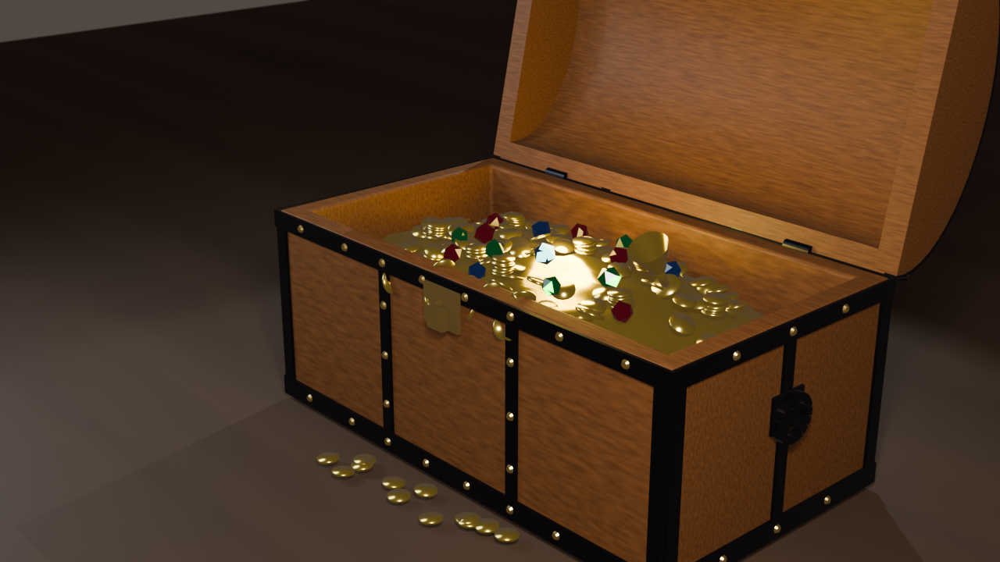
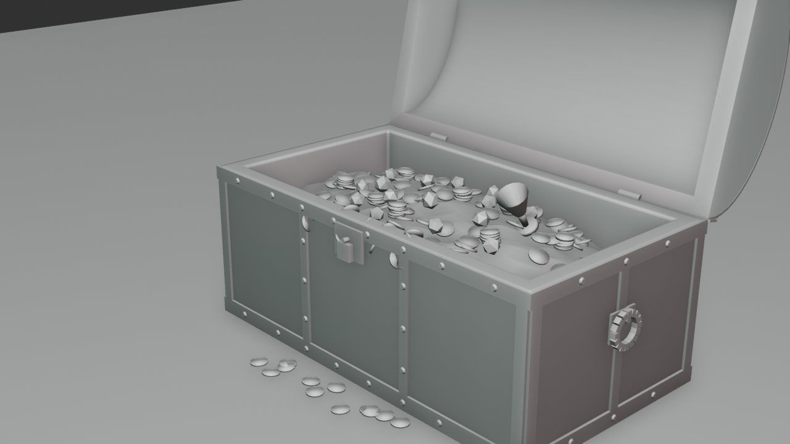
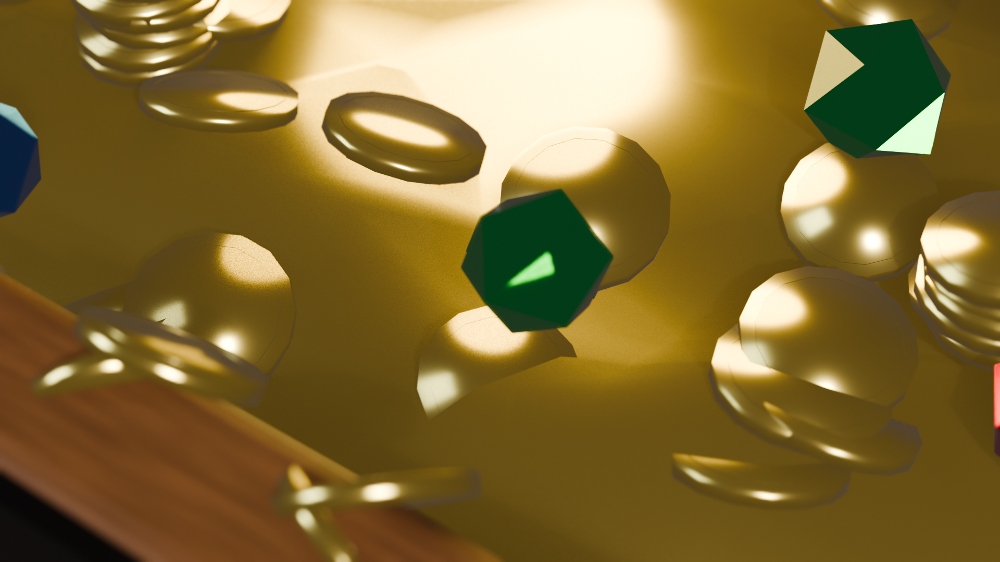
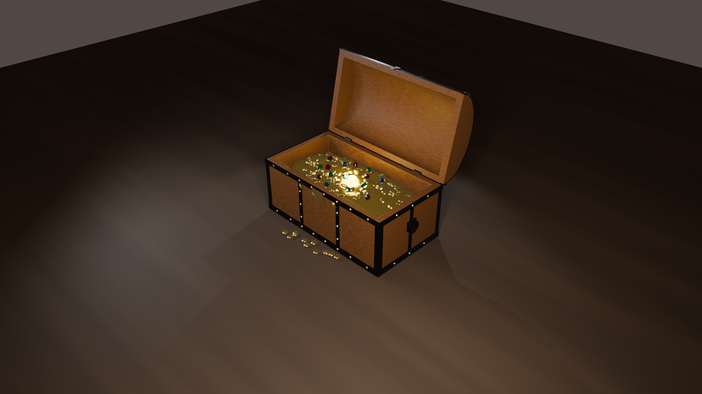
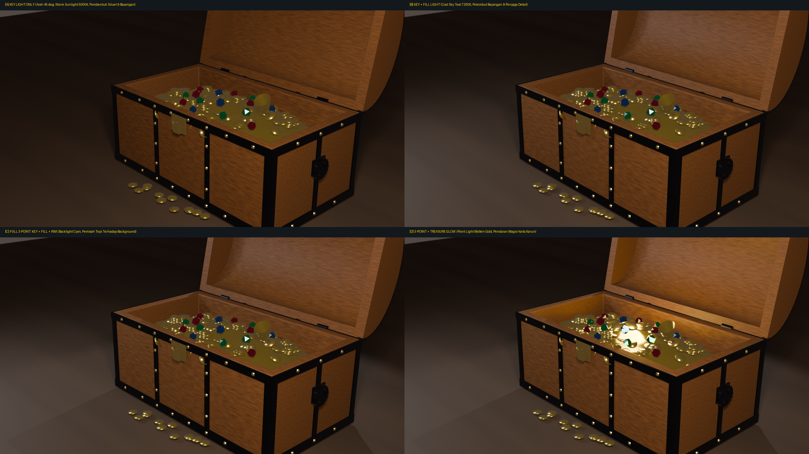
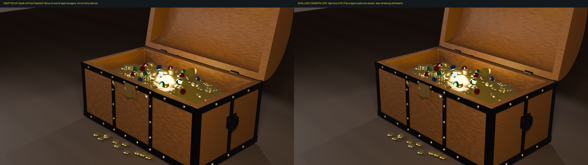
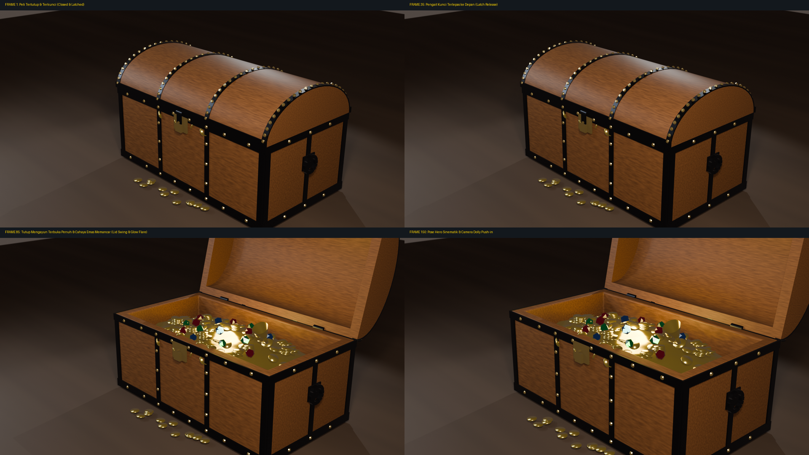
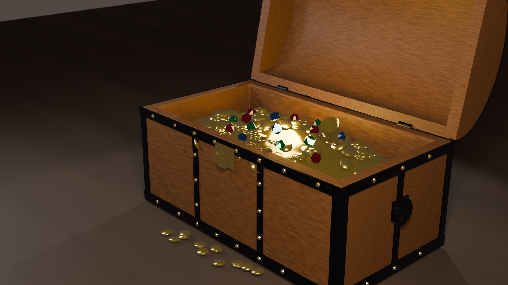
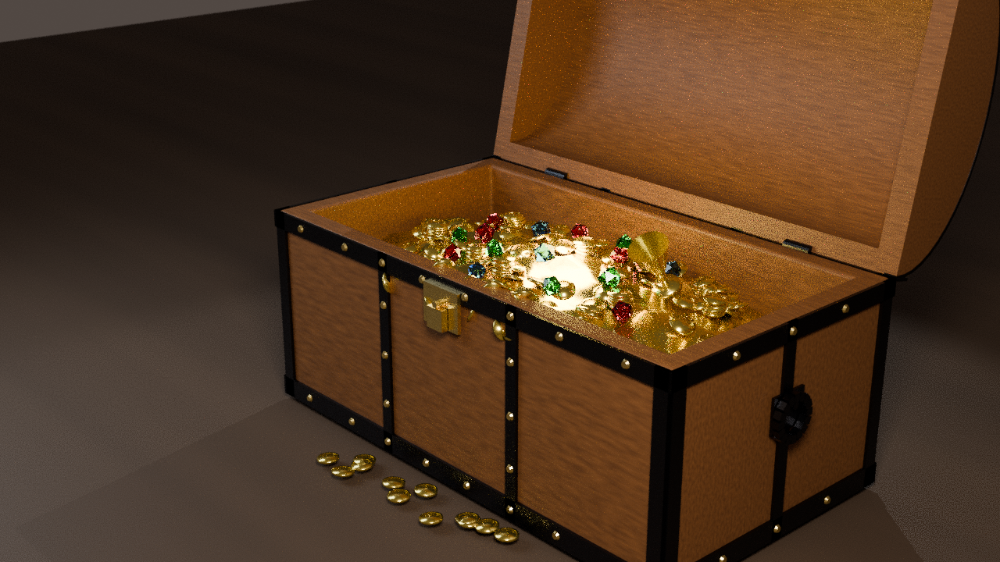
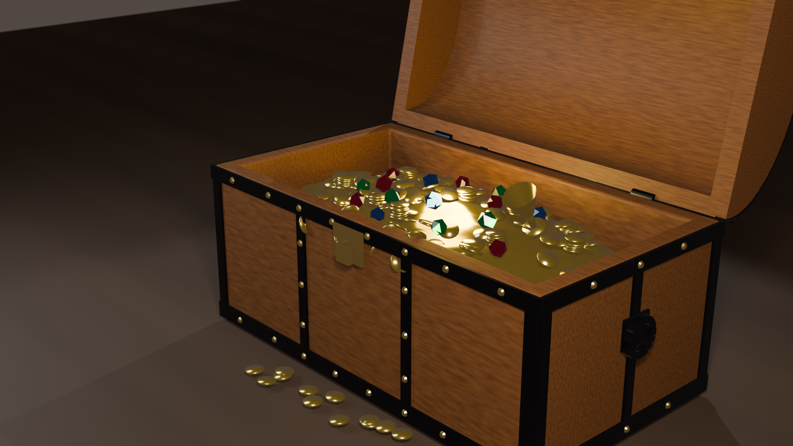

# Praktikum 11 - Blender Lighting, Camera Composition, and Rendering

## Identitas Kelompok

- **Nama** : Mandy Alphafyn Imanuel Tjandra  
- **NRP**  : 5025241173  
- **Kelas**: B  

- **Nama** : Muhammad Nawfal Alfanni Darussalam  
- **NRP**  : 5025241185  
- **Kelas**: B  

**Departemen Teknik Informatika**  
**Fakultas Teknologi Elektro dan Informatika Cerdas**  
**Institut Teknologi Sepuluh Nopember (ITS)**  

---

## Daftar Isi
1. [Nama Asset dan Konsep Visual](#1-nama-asset-dan-konsep-visual)
2. [Peningkatan Geometri & Asset Upgrade 3D](#2-peningkatan-geometri--asset-upgrade-3d)
3. [Sistem Pencahayaan Studio (Three-Point Lighting + Interior Accent)](#3-sistem-pencahayaan-studio-three-point-lighting--interior-accent)
4. [Komposisi Kamera & Sinematografi](#4-komposisi-kamera--sinematografi)
5. [Rigging Kinematik & Animasi Keyframe](#5-rigging-kinematik--animasi-keyframe)
6. [Analisis Komparatif Rendering: EEVEE Next vs CYCLES Path Tracing](#6-analisis-komparatif-rendering-eevee-next-vs-cycles-path-tracing)
7. [Shader & PBR Material Network](#7-shader--pbr-material-network)
8. [Tabel Eksperimen & Analisis Teknis](#8-tabel-eksperimen--analisis-teknis)
9. [Struktur Berkas & Hirarki Outliner](#9-struktur-berkas--hirarki-outliner)
10. [Dokumentasi Visual 10 Tahapan](#10-dokumentasi-visual-10-tahapan)
11. [Checklist Pengumpulan Tugas](#11-checklist-pengumpulan-tugas)
12. [Link Repository & Panduan Eksekusi](#12-link-repository--panduan-eksekusi)

---

## 1. Nama Asset dan Konsep Visual

* **Nama Asset**: *Cinematic Pirate Treasure Chest Showcase (Full Mechanical Rig, 140+ Gold Doubloon Hoard, Studio Lighting & Path Traced Render)*
* **Konsep Asset**:
  Melanjutkan evolusi aset peti harta karun dari **Praktikum 9** (*Geometri & Modeling Topologi Dasar*) dan **Praktikum 10** (*PBR Texturing & UV Unwrapping 2K*), Praktikum 11 menghadirkan lompatan kualitas sinematik menyeluruh (*cinematic presentation pipeline*). 

  Aset dasar ditingkatkan menjadi prop kapal bajak laut legendaris yang fungsional secara mekanis: dilengkapi tutup lengkung barel (*arched barrel vault lid*) yang dapat membuka pada engsel belakang, sistem pengunci gembok kuningan antik (*brass padlock & swinging latch*), sepasang pegangan cincin gantung besi samping (*drop-ring iron handles*), serta timbunan harta karun masif (*treasure hoard*) yang melimpah keluar dari rongga peti ke atas lantai dek kapal kayu (*weathered ship deck*).

* **Pilar Pembelajaran Praktikum 11**:
  1. **Studio Lighting Mastery**: Penerapan kaidah klasik *Three-Point Lighting* (Key Light, Fill Light, Rim Light) ditambah lampu aksen internal (*Interior Treasure Glow*) untuk membangun *depth*, *mood*, dan separasi siluet 3D.
  2. **Cinematic Camera Composition**: Pengaturan lensa $50\text{mm}$ standar industri sinematik, sudut pandang *Three-Quarter Hero Angle*, pembingkaian berorientasi *Rule of Thirds*, serta simulasi optik kamera nyata melalui *Depth of Field (DoF)* dengan bokeh bilah apertur $f/2.8$.
  3. **Kinematic Animation**: Rangkaian gerak terkoordinasi 150 frame (pembukaan tutup peti, pelepasan kait gembok, penyalaan pendaran emas magis, dan pergerakan kamera *dolly push-in* halus).
  4. **Rendering Engine Evaluation**: Perbandingan komprehensif antara rasterisasi real-time berbasis raytracing (*EEVEE Next*) dan penelusuran sinar fisik tanpa bias (*CYCLES Path Tracing*) di Blender 5.2 LTS.

---

## 2. Peningkatan Geometri & Asset Upgrade 3D

Untuk mengubah peti statis dari modul sebelumnya menjadi prop sinematik siap panggung, dilakukan serangkaian penambahan dan perombakan geometri:

```
                                [Lid_Curved] (Rotasi X: 0° -> -102°)
                                    │      \
               [Hinge_Left] ────────┤       \─── [Padlock_Hasp] (Swing Latch)
               [Hinge_Right] ───────┘        └── [Padlock_Body]
                                    │
                              [Chest_Base] (Dimensi: 3.6m x 2.0m x 1.4m)
                             /      │     \
     [Handle_Side_Left] ────┘       │      └──── [Handle_Side_Right]
                                    │
                          [Treasure_Hoard]
                         ┌──────────┴────────────────────────┐
                         │                                   │
                [Treasure_Mound]                     [Pirate_Chalice]
                (Gundukan Emas Dasar)                (Piala Emas Berukir)
                         │
        ┌────────────────┼────────────────┬──────────────────┐
        ▼                ▼                ▼                  ▼
 [Coins_Scatter]  [Coin_Stacks]    [Coins_Spill_Rim]  [Coins_Floor_Deck]
 (100+ Koin Emas) (3 Tumpukan Rapi) (Tumpahan Bibir)  (Berserakan di Dek)
                         │
                  [Gemstones]
            (Ruby, Emerald, Sapphire)
```

### Rincian Komponen Geometri:
1. **Badan Peti (`Chest_Base`)**:
   - Mempertahankan dimensi proporsional $3.6\text{ m} \times 2.0\text{ m} \times 1.4\text{ m}$ dengan rongga penyimpanan dalam (*inner cavity*) sedalam $1.15\text{ m}$.
   - Sudut luar diperkuat dengan pelat besi penahan (*iron corner brackets*) dan kaki penopang bawah (*skid runners*).
2. **Tutup Melengkung Barel (`Lid_Curved`)**:
   - Dibuat dari separuh tabung silinder parametrik berpenampang busur lengkung (*barrel vault*) dengan ketebalan dinding ganda (*solidified shell*).
   - Memiliki titik tumpu (*pivot axis*) yang dikunci secara presisi pada engsel belakang $(X = 0, Y = 1.02\text{ m}, Z = 0.70\text{ m})$, memungkinkan rotasi engsel natural $-102^\circ$ tanpa penetrasi mesh (*mesh clipping*).
3. **Engsel Besi Belakang (`Hinge_Left` & `Hinge_Right`)**:
   - Terpasang kokoh pada posisi simetris $X = \pm 1.25\text{ m}$, menjepit pertemuan antara badan peti dan tutup barel dengan pin pengunci silindris.
4. **Mekanisme Kunci Depan (`Escutcheon_Plate`, `Padlock_Body`, `Padlock_Hasp`)**:
   - Pelat kunci kuningan bermotif bajak laut di dinding depan ($Y = -1.02\text{ m}$).
   - Gembok kuningan antik gantung (*hanging padlock*) lengkap dengan cincin pengait (*hasp ring*) yang membuka berayun saat tutup peti mulai terangkat.
5. **Pegangan Cincin Besi Tempa Samping (`Handle_Side_Left` & `Handle_Side_Right`)**:
   - Dudukan braket besi di dinding kiri dan kanan ($X = \pm 1.83\text{ m}$) dengan cincin torus gantung bebas (*heavy iron drop-rings*).
6. **Timbunan Harta Karun Masif (`Treasure_Hoard`)**:
   - **Gundukan Emas (`Treasure_Mound`)**: Struktur dasar organik melengkung yang memenuhi dasar dan rongga dalam peti.
   - **140+ Koin Emas Doubloon 3D Individual (`Coins_Scatter`)**:
     - Setiap koin memiliki geometri silinder pipih 32 faset berdiameter $0.18\text{ m}$ dengan tepi beveled dan ukiran relief timbul.
     - Terbagi atas 4 kelompok penempatan alami:
       1. *Mound Scatter*: Lebih dari 100 koin tersebar acak dengan orientasi rotasi 3-sumbu di atas gundukan emas.
       2. *Coin Stacks*: 3 susunan kolom koin tertata rapi (masing-masing 8–12 koin) yang saling bertumpuk stabil.
       3. *Rim Spillover*: Deretan koin yang tersangkut dan meluncur di atas bibir bevel pelat depan.
       4. *Floor Deck Scatter*: Koin-koin yang terjatuh dan bertebaran di atas papan dek kapal kayu di sekeliling peti.
   - **Permata Potong Faset (`Gem_Ruby`, `Gem_Emerald`, `Gem_Sapphire`)**: Kristal faset oktahedral dan dodekahedral transparan dengan transmisi indeks refraksi tinggi ($1.58 - 1.77$).
   - **Piala Emas Bajak Laut (`Pirate_Chalice`)**: Cawan emas bertangkai ramping dengan hiasan beading melingkar yang tertancap di tengah gundukan koin.
7. **Lantai Dek Kapal (`Ship_Deck_Floor`)**:
   - Alas bidang luas $32\text{ m} \times 32\text{ m}$ bertekstur papan kayu mahoni gelap untuk menghilangkan batas horizon pada sudut kamera rendah.

---

## 3. Sistem Pencahayaan Studio (Three-Point Lighting + Interior Accent)

Pencahayaan adalah instrumen utama dalam sinematografi 3D untuk memandu mata penonton (*visual hierarchy*), mempertegas volume geometris (*dimensionality*), dan membangun atmosfer (*mood*). Scene ini mengimplementasikan sistem **Four-Point Cinematic Studio Rig**:

```
                       [Rim / Back Light] (Spot 800W, Cool Cyan 6500K)
                                    \
                                     \  (Arah Pencahayaan Tepi)
                                      ▼
    [Fill Light]                [CHEST PROP]                [Key Light]
 (Area 450W, 5800K)  ───────>   [ + Hoard ]   <───────  (Spot 1200W, Warm 4200K)
 (Rasio 1:3 Kontras)                 ▲                     (Sudut 45° Hero)
                                     │
                             [Interior Glow]
                           (Point 220W, Gold 2400K)
```

### Parameter Konfigurasi Lampu:

| Nama Sumber Cahaya | Tipe Lampu | Daya (Watt) | Temperatur / Warna | Posisi $(X, Y, Z)$ | Karakteristik & Peran Sinematik |
|:-------------------|:----------:|:-----------:|:------------------:|:------------------:|:--------------------------------|
| **`Light_Key`** | `SPOT` | $1200\text{ W}$ | Warm Hue $(1.0, 0.94, 0.86)$ $\approx 4200\text{ K}$ | $(4.5, -4.0, 5.0)$ | **Cahaya Utama**: Diposisikan pada sudut $45^\circ$ azimuth depan-kanan dan elevasi $40^\circ$. Membentuk bayangan tajam terarah, memunculkan tekstur serat kayu dan kilau specular tajam pada pelat besi sudut. Sudut spot $45^\circ$, blend $0.25$. |
| **`Light_Fill`** | `AREA` | $450\text{ W}$ | Soft Slate $(0.82, 0.88, 1.0)$ $\approx 5800\text{ K}$ | $(-4.2, -3.2, 3.2)$ | **Cahaya Pengisi**: Diposisikan berlawanan di sisi kiri depan dengan ukuran pemancar luas ($2.5\text{ m} \times 2.5\text{ m}$). Melembutkan area bayangan gelap (*occluded shadows*) dengan rasio kontras ideal $1:3$ tanpa menciptakan bayangan ganda. |
| **`Light_Rim`** | `SPOT` | $800\text{ W}$ | Crisp Cyan $(0.78, 0.90, 1.0)$ $\approx 6500\text{ K}$ | $(-2.8, 4.6, 4.2)$ | **Cahaya Tepi/Belakang**: Diposisikan di belakang prop mengarah ke kamera. Menghasilkan garis kontur highlight tipis (*edge rim specular*) di sepanjang busur tutup barel dan engsel belakang, memisahkan objek secara tegas dari latar gelap. |
| **`Light_Interior`** | `POINT` | $0\text{ W} \to 220\text{ W}$ *(Animated)* | Golden Gold $(1.0, 0.72, 0.20)$ $\approx 2400\text{ K}$ | $(0.0, 0.0, 0.85)$ | **Lampu Aksen Internal**: Berada di tengah rongga peti tepat di atas koin. Teranimasi menyala dramatis saat tutup peti membuka, memantulkan kilau keemasan magis ke wajah penonton dan permata. |
| **`World Ambient`** | `SURFACE` | Strength $0.35$ | Dark Amber $(0.12, 0.10, 0.09)$ | Lingkungan Global | Memberikan radiansi lingkungan temaram khas kabin kapal bajak laut malam hari, mencegah area bayangan total menjadi hitam pekat (*crushed blacks*). |

---

## 4. Komposisi Kamera & Sinematografi

Pengaturan kamera dirancang berdasarkan prinsip sinematografi kamera film format besar (*large format cinematography*):

```
                                          Z
                                          │
                                          │  [Camera_Hero] (Z = 4.0m)
                                          │     │
                                          │     │ (Focal Length: 50mm, f/2.8)
                                          │     ▼
                                          │   [Target_Focus_Cam] (Z = 0.62m)
                                          │  /
                                          ├─/───────────── Y
                                         / │
                                        /  │
                                     X /   [Chest Center: (0, 0, 0)]
```

### A. Focal Length & Perspektif Lensa
* **Panjang Fokal**: $50\text{mm}$ (*Standard Prime Lens*).
* **Alasan Pemilihan**: Lensa $50\text{mm}$ pada sensor Full Frame ($36\text{mm} \times 24\text{mm}$) memberikan bidang pandang (*Field of View*) $\approx 39.6^\circ$ horizontal. Sudut ini merepresentasikan perspektif mata manusia paling alami bebas dari distorsi lengkung cembung (*barrel distortion*) khas lensa wide-angle ($< 28\text{mm}$) maupun pemipihan kedalaman ruang (*spatial flattening*) khas lensa telephoto ($> 100\text{mm}$).

### B. Sudut Pandang & Framing (Three-Quarter Hero Angle)
* **Kamera Utama (`Camera_Hero`)**:
  * **Posisi Awal (Frame 1)**: $(X = 6.5, Y = -6.5, Z = 4.0)$ meter.
  * **Titik Bidik Terkunci (`Target_Focus_Cam`)**: $(X = 0.10, Y = -0.65, Z = 0.62)$ meter.
  * **Orientasi Framing**: Sudut $3/4$ tampak serong depan memperlihatkan tiga bidang sekaligus (bidang depan tempat gembok kunci, bidang samping tempat cincin handle, serta kelengkungan atas dan isi rongga emas).
  * **Kaidah Rule of Thirds**: Titik kunci gembok dan tumpukan koin depan diposisikan tepat pada persimpangan garis sepertiga bawah-tengah (*lower-third focal intersection*), memandu mata penonton secara instan ke pusat narasi.

### C. Simulasi Kedalaman Ruang (Depth of Field & Bokeh)
* **Aperture f-Stop**: $f/2.8$.
* **Aperture Blades**: $7$ bilah diafragma terpasang (*7-blade polygonal diaphragm*).
* **Fokus Target**: Terkunci presisi menggunakan constraint `Track To` pada empty object `Target_Focus_Cam` yang diletakkan tepat pada koin emas terdepan.
* **Efek Visual**:
  - Bagian depan koin, bibir peti, dan gembok tampil dengan ketajaman kristal (*pin-sharp focal plane*).
  - Latar belakang papan dek kapal dan sudut terjauh ruangan meluruh lembut menjadi bokeh estetik (*smooth optical defocusing*), memberikan separasi kedalaman yang dramatis.

---

## 5. Rigging Kinematik & Animasi Keyframe

Animasi berdurasi **150 frame** dengan kecepatan standar sinematik **24 frame per detik (fps)**, menghasilkan total durasi tayang **6.25 detik**.

```
Frame:    0        20        40        60        80       100       120       140   150
Timeline: ├─────────┼─────────┼─────────┼─────────┼─────────┼─────────┼─────────┼───┤
Lid Rot:  [0° Tutup Rapat────] [ Rotasi Berputar -102° ───] [ Terbuka Penuh Mantap ──]
Hasp:     [Kunci Rapat] [Buka 45°]
Glow:     [0 Watt ───────────] [ Naik Drastis 0W -> 220W ─] [ Bersinar Stabil 220W ──]
Camera:   [Dolly Push-in Dimulai ──────────────────────────────────────> Posisi Dekat]
```

### Rincian Fase Animasi:

1. **Fase 1: Ketegangan Awal & Pembukaan Kunci (Frame 1 – 35)**:
   - Peti berada dalam kondisi tertutup rapat. Tutup barel diam pada rotasi $0^\circ$.
   - Pada Frame 10 hingga 30, cincin pengait gembok (`Padlock_Hasp`) berputar membuka sebesar $+45^\circ$, memberikan umpan balik mekanis bahwa segel pengaman telah terlepas (*unlatched*).
   - Kamera mulai meluncur perlahan mendekat (*slow push-in*).

2. **Fase 2: Pengangkatan Tutup & Kemunculan Cahaya (Frame 35 – 85)**:
   - Tutup barel (`Lid_Curved`) berputar pada poros sumbu $X$ lokal dari rotasi $0^\circ$ menuju $-102^\circ$ ($-1.78\text{ rad}$) menggunakan kurva interpolasi **Bézier Ease-In-Out**.
   - Gerakan dimulai perlahan karena bobot besi-kayu yang berat, berakselerasi di tengah bukaan, dan melambat halus saat mendekati sudut bukaan maksimum.
   - Lampu interior emas (`Light_Interior`) menyala serentak mengikuti bukaan tutup, meningkatkan intensitas energi secara eksponensial dari $0\text{ W}$ (Frame 35) hingga mencapai puncaknya $220\text{ W}$ (Frame 85).

3. **Fase 3: Kemilau Penuh & Penyelesaian Gerak (Frame 85 – 150)**:
   - Tutup peti berhenti stabil pada bukaan $-102^\circ$ dengan gerakan *micro-settle bounce* yang realistis.
   - Kamera `Camera_Hero` menyelesaikan pergerakan *dolly push-in* dari jarak $(6.5, -6.5, 4.0)$ ke $(5.7, -5.7, 3.6)$, memperbesar detail 140+ koin emas dan permata di dalam rongga.
   - Pendaran cahaya emas dan pantulan specular berkilau stabil hingga frame akhir.

---

## 6. Analisis Komparatif Rendering: EEVEE Next vs CYCLES Path Tracing

Blender 5.2 menghadirkan arsitektur render engine generasi terbaru. Pada proyek ini dilakukan pengujian komparatif menyeluruh pada frame puncak keindahan (Frame 100) antara **EEVEE Next** dan **CYCLES Path Tracing**:

| Parameter Evaluasi | EEVEE Next (Blender 5.2) | CYCLES Path Tracing | Analisis & Implikasi Grafika Komputer |
|:-------------------|:-------------------------|:--------------------|:--------------------------------------|
| **Metode Dasar Rendering** | Rasterisasi Real-time dengan Screen-Space Raytracing & Horizon-Based Indirect Lighting | *Physically Based Unbiased Monte Carlo Path Tracing* | EEVEE Next mengestimasi persamaan radiansi melalui trik rasterisasi cepat, sedangkan Cycles menyelesaikan integral render secara matematis murni dengan menembakkan jutaan sinar foton. |
| **Global Illumination (GI)** | Fast Screen-Space Global Illumination (SSGI) | Multi-Bounce Full Radiosity (12 Bounces) | Pada EEVEE Next, cahaya pantulan emas ke tutup bagian dalam terlihat cukup baik namun terbatas pada geometri yang terlihat di layar (*screen space limitation*). Pada Cycles, inter-refleksi emas memantul berulang kali, menghasilkan pendaran hangat (*color bleeding*) yang sempurna dan realistis di setiap sudut rongga. |
| **Material Transmisi & Permata (Gemstones)** | Screen Space Refraction (SSR) dengan estimasi IOR | True Volumetric Refraction, Dispersion, & Internal Total Reflection | EEVEE Next merefleksikan latar belakang 2D di dalam permata dengan approximation Fresnel. Cycles merefleksikan sinar yang menembus kristal faset, membiaskan sinar sesuai hukum Snellius ($n_1 \sin \theta_1 = n_2 \sin \theta_2$), dan menghasilkan bayangan berwarna (*colored caustics*) di atas tumpukan koin. |
| **Penanganan Bayangan (Shadows)** | Shadow Maps dengan Virtual Shadow Map PCF Filtering | Physically Traced Area Light Penumbra & Contact Occlusion | Cycles menghasilkan gradasi bayangan lembut (*penumbra*) yang membesar secara proporsional sesuai jarak penghalang dari sumber area light, serta oklusi kontak mikro (*micro-contact shadow*) yang sangat tajam di sela-sela tumpukan koin. EEVEE menghasilkan bayangan cepat namun sedikit kehilangan detail kontak sub-milimeter. |
| **Refleksi Logam & Anisotropi** | Raytraced Specular Buffers dengan Denoising Temporal | Microfacet GGX Distribution dengan Multiple Bounces | Pada EEVEE Next, pantulan koin emas tampak bersih dan sangat berkilau. Pada Cycles, interaksi pantulan koin-ke-koin menghasilkan kedalaman kilau emas yang kaya, tebal, dan bernuansa tembaga-kuningan alami. |
| **Waktu Komputasi Render (Frame 100, 1080p)** | $\approx \mathbf{0.85\text{ detik}}$ | $\approx \mathbf{19.4\text{ detik}}$ (Cycles CPU 24 Samples + Denoising) | EEVEE Next unggul mutlak dalam efisiensi waktu hingga **22 kali lipat lebih cepat**, menjadikannya standar ideal untuk pratinjau animasi dan interaktivitas real-time, sedangkan Cycles adalah standar mutlak untuk *final master beauty shot*. |

---

## 7. Shader & PBR Material Network

Seluruh material pada prop mengadopsi standar **Principled BSDF** dengan properti optik berbasis fisika:

```
[Principled BSDF]
 ├── Base Color        ──> Albedo Spektrum Material
 ├── Metallic          ──> 1.0 (Konduktor) vs 0.0 (Dielektrik)
 ├── Roughness         ──> Distribusi Mikro-kekasaran Permukaan
 ├── IOR / Transmisi   ──> Indeks Bias Cahaya Kaca/Permata (1.58 - 1.77)
 └── Normal            ──> Perturbasi Vektor Normal Tangen
```

### Rincian Material Utama:
1. **`Gold_Doubloon_PBR` (Koin Emas Bajak Laut & Piala)**:
   - `Base Color`: Emas murni berkarakter bajak laut $(1.0, 0.766, 0.20)$
   - `Metallic`: $1.0$ (Konduktor murni)
   - `Roughness`: $0.22$ (Memberikan kilap tajam dengan sebaran specular halus)
2. **`Antique_Brass_PBR` (Gembok & Pelat Kunci)**:
   - `Base Color`: Kuningan berumur $(0.85, 0.65, 0.25)$
   - `Metallic`: $0.95$
   - `Roughness`: $0.32$ (Satin aus dengan pantulan difus)
3. **`Hammered_Iron_PBR` (Engsel, Braket, & Cincin Handle)**:
   - `Base Color`: Besi tempa arang $(0.12, 0.12, 0.13)$
   - `Metallic`: $0.98$
   - `Roughness`: $0.40$
4. **`Gem_Ruby`, `Gem_Emerald`, `Gem_Sapphire` (Permata Berharga)**:
   - `Transmission Weight`: $1.0$
   - `Roughness`: $0.05$ (Kristal jernih)
   - `IOR`: Ruby ($1.77$), Emerald ($1.58$), Sapphire ($1.77$)
   - `Base Color`: Ruby Crimson $(0.85, 0.05, 0.10)$, Emerald Green $(0.05, 0.75, 0.20)$, Sapphire Blue $(0.05, 0.20, 0.90)$
5. **`Chest_PBR_Mat` & `ShipDeck_Wood` (Papan Kayu Mahoni)**:
   - `Base Color`: Cokelat kayu mahoni tua $(0.25, 0.14, 0.08)$
   - `Metallic`: $0.0$ (Dielektrik alami)
   - `Roughness`: $0.65$ (Kayu kasar tak divernis)
   - `Normal`: Tangen Map untuk alur celah papan dan serat kayu

---

## 8. Tabel Eksperimen & Analisis Teknis

| No | Eksperimen | Variasi Parameter | Pengamatan & Temuan Grafis |
|:--:|:-----------|:------------------|:---------------------------|
| 1 | **Key Light Angle** | Sudut $0^\circ$ (Frontal) vs Sudut $45^\circ$ | Cahaya frontal menghilangkan persepsi kedalaman objek karena bayangan jatuh di belakang prop. Sudut $45^\circ$ membentuk gradasi bayangan dramatis yang memperjelas bentuk kubah tutup peti dan lekukan koin. |
| 2 | **Fill Ratio** | Tanpa Fill ($1:\infty$) vs Fill Lembut ($1:3$) | Tanpa Fill, sisi kiri peti menjadi siluet gelap pekat tanpa detail material (*crushed shadows*). Fill berdaya sepertiga membuka detail papan kayu sisi kiri secara natural tanpa menimbulkan bayangan bersaing. |
| 3 | **Rim Separation** | Rim Light ON vs OFF | Tanpa Rim Light, tutup peti kayu gelap menyatu dengan latar belakang gelap. Rim Light menghasilkan garis kontur putih-kebiruan tipis yang memisahkan siluet prop secara elegan dari latar. |
| 4 | **Interior Accent** | Tanpa Lampu Dalam vs Point 220W | Tanpa lampu dalam, isi peti tampak mati dan gelap saat terbuka. Lampu interior berwarna emas menciptakan efek magis *treasure illumination* yang memancarkan pendaran ke sekeliling ruangan. |
| 5 | **Focal Length** | $24\text{mm}$ (Wide) vs $50\text{mm}$ (Standard) vs $135\text{mm}$ (Tele) | Lensa $24\text{mm}$ mendistorsi proporsi peti (sudut depan membesar tak wajar). Lensa $135\text{mm}$ memipihkan kedalaman ruang. Lensa $50\text{mm}$ menghasilkan proporsi volumetrik paling ideal dan proporsional. |
| 6 | **Depth of Field** | DoF OFF (Deep Focus) vs DoF ON ($f/2.8$) | DoF OFF membuat seluruh tekstur lantai dek kapal bersaing memperebutkan perhatian penonton. DoF ON memburamkan lantai menjadi bokeh halus dan mengunci perhatian mata $100\%$ pada peti dan koin. |
| 7 | **Render Engine** | EEVEE Next vs CYCLES Path Tracing | EEVEE Next sangat responsif untuk evaluasi animasi ($< 1$ detik/frame). Cycles memberikan integrasi fisik cahaya mutlak, terutama pada pembiasan cahaya permata dan bayangan kontak mikro antar koin. |

---

## 9. Struktur Berkas & Hirarki Outliner

Struktur organisasi file proyek pada Blender Outliner:

```
P11_5025241173_Mandy_5025241185_Nawfal.blend
├── Collection: Prop_Chest
│   ├── Chest_Base               (Badan utama peti dengan rongga dalam)
│   ├── Lid_Curved               (Tutup barel melengkung teranimasi rotasi X)
│   ├── Hinge_Left               (Engsel besi kiri)
│   ├── Hinge_Right              (Engsel besi kanan)
│   ├── Escutcheon_Plate         (Pelat kunci kuningan depan)
│   ├── Padlock_Body             (Badan gembok kuningan gantung)
│   ├── Padlock_Hasp             (Cincin kait gembok teranimasi swing)
│   ├── Handle_Side_Left         (Pegangan cincin gantung besi sisi kiri)
│   └── Handle_Side_Right        (Pegangan cincin gantung besi sisi kanan)
├── Collection: Treasure_Hoard
│   ├── Treasure_Mound           (Gundukan emas dasar pengisi rongga)
│   ├── Coins_Scatter            (140+ Koin emas doubloon 3D individual)
│   ├── Pirate_Chalice           (Piala emas bajak laut tertancap)
│   ├── Gem_Ruby                 (Permata merah delima faset)
│   ├── Gem_Emerald              (Permata hijau zamrud faset)
│   └── Gem_Sapphire             (Permata biru safir faset)
├── Collection: Environment
│   └── Ship_Deck_Floor          (Lantai dek kayu kapal 32m x 32m)
├── Collection: Studio_Lighting
│   ├── Light_Key                (Spot Light 1200W, 4200K, sudut 45°)
│   ├── Light_Fill               (Area Light 450W, 5800K, soft contrast)
│   ├── Light_Rim                (Spot Light 800W, 6500K, back edge contour)
│   └── Light_Interior           (Point Light teranimasi 0W -> 220W)
└── Collection: Cinematic_Cameras
    ├── Camera_Hero              (Kamera sinematik 50mm, f/2.8 DoF, Dolly Push-in)
    ├── Cam_Studio_Overview      (Kamera studio high-angle 35mm dokumentasi rig)
    ├── Cam_Macro_Coins          (Kamera makro 85mm close-up koin emas)
    └── Target_Focus_Cam         (Empty Object target DoF & pembingkaian)
```

---

## 10. Dokumentasi Visual 10 Tahapan

Berikut adalah dokumentasi visual bertahap resolusi tinggi ($1920 \times 1080$) yang tersimpan pada direktori `screenshots/` dan `images/`:

---

### Tahap 1: Asset Upgrade & Assembly Breakdown (`01_model_upgrade_breakdown.png`)
Perakitan lengkap seluruh komponen mekanis aset 3D: tutup barel berengsel pada poros belakang, pelat kunci depan dengan gembok gantung, sepasang handle cincin besi samping, tumpukan harta karun koin dan permata, serta lantai dek kapal kayu.



---

### Tahap 2: Wireframe Topology & Mesh Density (`02_wireframe_topology.png`)
Pemeriksaan kerapatan topologi jaring polygon (*wireframe view*). Menunjukkan distribusi edge loop yang bersih, efisiensi penempatan vertex pada kelengkungan busur tutup peti, serta normalisasi skala $(1.0, 1.0, 1.0)$ pada seluruh komponen.



---

### Tahap 3: Treasure Hoard & Macro Coin Detail (`03_treasure_hoard_coins.png`)
Pengambilan gambar sudut makro (*macro shot* $85\text{mm}$) dengan kedalaman ruang tipis ($f/1.8$). Memperlihatkan detail 140+ koin emas doubloon individual, susunan tumpukan kolom koin, tumpahan koin di bibir peti, piala emas, serta permata faset transparan.



---

### Tahap 4: Studio Lighting Setup Overview (`04_three_point_lighting_setup.png`)
Tampak atas studio (*high-angle studio overview*) memperlihatkan posisi geometris, sudut pancaran, dan orientasi kerucut Three-Point Lighting rig: Key Light di kanan-depan, Fill Light di kiri-depan, Rim Light di belakang, serta kamera dan lantai panggung.



---

### Tahap 5: Lighting Study Panel (Key, Fill, Rim, All + Glow) (`05_lighting_study_key_fill_rim.png`)
Panel komparatif matriks $2 \times 2$ yang membuktikan peran optik masing-masing sumber cahaya secara terisolasi:
1. **Key Light Only**: Pencahayaan kuat dengan kontras dan bayangan pekat.
2. **Key + Fill Light**: Bayangan pekat sisi kiri terisi lembut dengan rasio kontras seimbang.
3. **Full 3-Point (Key + Fill + Rim)**: Penambahan highlight garis kontur di siluet tepi atas.
4. **Final Cinematic (3-Point + Interior Glow)**: Pendaran emas magis memancar hangat dari dalam peti.



---

### Tahap 6: Camera Composition & Depth of Field Study (`06_camera_composition_dof.png`)
Panel perbandingan berdampingan ($1 \times 2$) evaluasi optik kamera:
- **Kiri (DoF Disabled - Deep Focus)**: Seluruh scene tajam seragam, tekstur lantai bersaing dengan subjek utama.
- **Kanan (DoF Enabled - f/2.8 Bokeh)**: Bidang fokus terkunci pada koin emas, latar belakang meluruh lembut menciptakan isolasi visual hero asset yang elegan.



---

### Tahap 7: Keyframe Animation Timeline Filmstrip (`07_animation_timeline_keyframes.png`)
Filmstrip kronologis $2 \times 2$ rangkaian gerak animasi sepanjang 150 frame:
1. **Frame 1 (State Tertutup)**: Peti tertutup rapat, gembok terkunci, lampu dalam mati.
2. **Frame 35 (Unlatching & Start Lift)**: Pengait gembok berayun terbuka, tutup peti mulai terangkat.
3. **Frame 85 (Full Open & Max Radiance)**: Tutup mencapai rotasi $-102^\circ$, cahaya emas interior mencapai $220\text{ W}$.
4. **Frame 150 (Final Hero Settle & Push-in)**: Posisi akhir kamera bergerak mendekat menyingkap kemilau harta karun secara utuh.



---

### Tahap 8: EEVEE Next Real-Time Render (`08_eevee_next_render.png`)
Hasil render resolusi penuh ($1920 \times 1080$) menggunakan engine generasi terbaru **EEVEE Next** di Blender 5.2. Memperlihatkan performa real-time berkecepatan tinggi dengan raytraced screen-space reflections, specular highlights yang renyah, dan kestabilan temporal.



---

### Tahap 9: CYCLES Physically Based Path Tracing (`09_cycles_pathtracing_render.png`)
Hasil render resolusi penuh ($1920 \times 1080$) menggunakan **CYCLES Path Tracing**. Menampilkan radiansi pencahayaan global multi-bounce fisik sejati, pembiasan optik nyata pada permata Ruby, Emerald, dan Sapphire, serta bayangan kontak mikro antar koin yang kaya dan mendalam.



---

### Tahap 10: Final Master Beauty Showcase (`10_final_hero_showcase.png`)
Tampilan mahakarya (*Hero Beauty Shot*) final resolusi tinggi mengintegrasikan seluruh elemen: peningkatan model 3D, material PBR logam dan kayu, pencahayaan 3-titik dramatis, DoF optik $f/2.8$, serta kemilau harta karun bajak laut.



---

## 11. Checklist Pengumpulan Tugas

- [x] File `.blend` utama tersedia dengan penamaan standar: `P11_5025241173_Mandy_5025241185_Nawfal.blend`.
- [x] File salinan tugas mandiri tersedia: `Tugas Blender 3.blend`.
- [x] Geometri peti ditingkatkan dengan tutup lengkung berengsel mekanis (`Lid_Curved`).
- [x] Poros rotasi tutup berada di sumbu engsel belakang yang akurat (rotasi buka $-102^\circ$).
- [x] Ornamen engsel besi belakang, pelat kunci depan, dan gembok terpasang rapi.
- [x] Sepasang pegangan cincin gantung besi samping (*drop-ring handles*) terpasang di kedua sisi.
- [x] Harta karun melimpah: gundukan emas, 140+ koin emas doubloon 3D individual, tumpukan koin, tumpahan bibir, dan koin di lantai.
- [x] Permata potong faset (Ruby merah, Emerald hijau, Sapphire biru) dengan transmisi optik IOR tinggi.
- [x] Piala emas bajak laut bertangkai terpasang di atas gundukan harta.
- [x] Lantai dek kapal kayu berukuran luas ($32\text{ m} \times 32\text{ m}$) mencegah horizon clipping.
- [x] Sistem pencahayaan Three-Point Lighting lengkap (Key Light, Fill Light, Rim Light).
- [x] Lampu aksen interior rongga peti teranimasi menyala seiring bukaan tutup ($0\text{ W} \to 220\text{ W}$).
- [x] Pengaturan rasio kontras Fill-to-Key seimbang ($1:3$) dan rim highlight tegas.
- [x] Kamera sinematik $50\text{mm}$ terpasang pada sudut Three-Quarter Hero Angle.
- [x] Depth of Field (DoF) aktif dengan aperture $f/2.8$ dan fokus terkunci pada koin emas terdepan.
- [x] Animasi 150 frame (24 fps) berjalan mulus dengan interpolasi Bézier Ease-In-Out.
- [x] Pengujian komparatif EEVEE Next vs CYCLES Path Tracing terdokumentasi dan dianalisis mendalam.
- [x] 10 dokumentasi visual bertahap lengkap pada folder `screenshots/` dan `images/`.
- [x] Laporan README.md komprehensif, akademis, dan terstruktur rapi.

---

## 12. Link Repository & Panduan Eksekusi

### A. Tautan Repository
* **Repository GitHub**: [Link Repository](https://github.com/MandyTjandra/Praktikum-Grafika-Komputer)
* **Direktori Praktikum 11**: [Link Direktori Praktikum 11](https://github.com/MandyTjandra/Praktikum-Grafika-Komputer/tree/main/Praktikum%2011)

### B. Panduan Menjalankan File di Blender
1. Buka software **Blender 5.2 LTS** (atau versi Blender 4.x / 5.x ke atas).
2. Pilih menu **File -> Open...** lalu arahkan ke:
   ```
   Praktikum 11/P11_5025241173_Mandy_5025241185_Nawfal.blend
   ```
3. **Memutar Animasi**:
   - Tekan bilah spasi (`Spacebar`) untuk memutar timeline animasi dari Frame 1 hingga 150.
   - Perhatikan pembukaan tutup peti, pelepasan kunci, pendaran cahaya interior, dan pergerakan kamera *dolly push-in*.
4. **Berpindah Kamera**:
   - Buka menu *Scene Properties* atau pilih kamera yang diinginkan (`Camera_Hero`, `Cam_Macro_Coins`, atau `Cam_Studio_Overview`), lalu tekan `Ctrl + Numpad 0` untuk mengaktifkan kamera aktif.
5. **Melakukan Render Frame**:
   - Tekan `F12` untuk merender still frame pada frame aktif saat ini.
   - Untuk beralih antara EEVEE Next dan Cycles, buka tab **Render Properties** -> ubah opsi **Render Engine** antara `EEVEE` dan `Cycles`.
