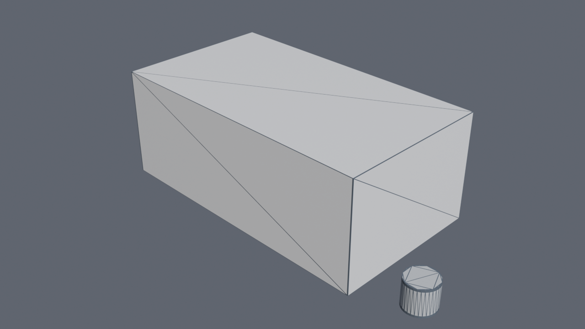
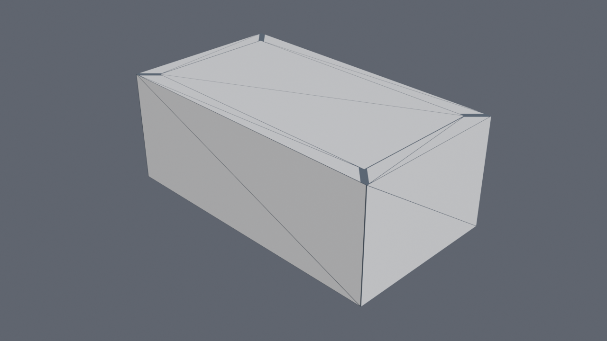
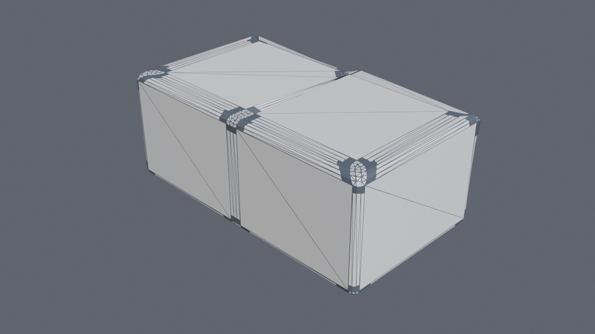
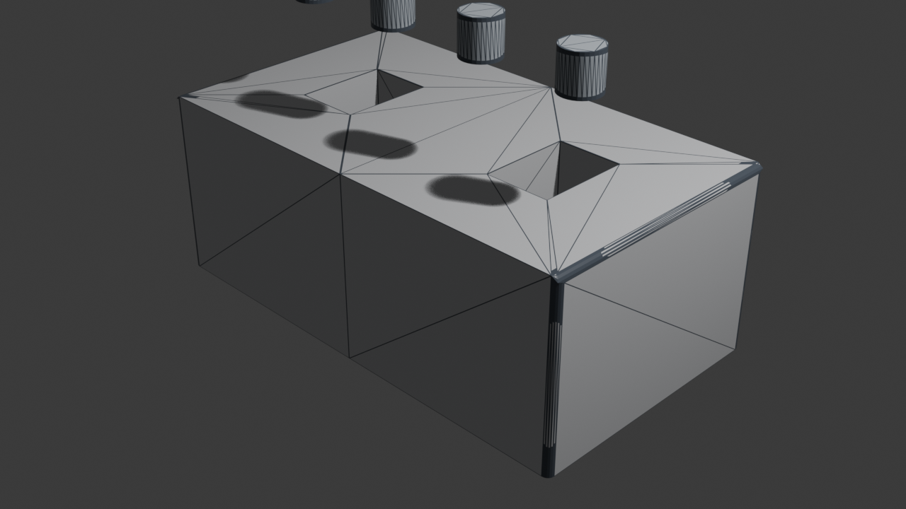
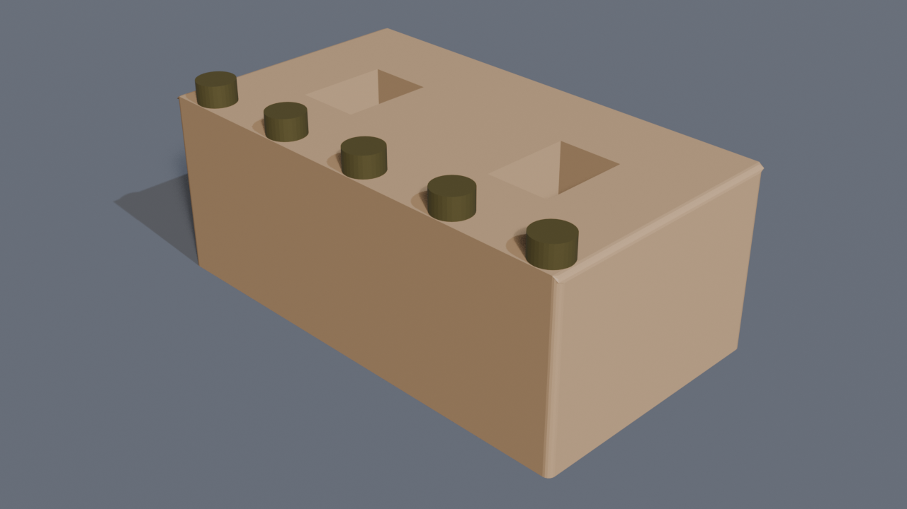

# Praktikum 9 - Pemodelan 3D Prop (Blender)

## Identitas Kelompok
* **Nama Kelompok**: 
* **Anggota Kelompok**:
  1. Nama:  (NIM: )
  2. Nama:  (NIM: )
  3. Nama:  (NIM: )
* **Kelas / Program Studi**: 

---

## 1. Nama Asset dan Konsep
* **Nama Asset**: *Stylized Chest Prop (Base Mesh & Rivet Assembly)*
* **Konsep Asset**:
  Asset ini merupakan model 3D bagian badan/dasar peti harta karun (*Chest Prop*) bergaya semi-stylized/low-to-mid poly yang dirancang untuk kebutuhan aset game atau scene lingkungan grafika komputer. Model mengedepankan siluet kokoh dan fungsional dengan rongga penyimpanan di bagian atas, sudut-sudut beveled untuk menangkap pencahayaan secara realistis, serta barisan paku keling (*rivets*) logam modular di sepanjang tepi atas peti.
* **Struktur File & Outliner**:
  Komponen diorganisasi secara rapi ke dalam koleksi khusus:
  * `Prop_Chest`:
    * `Chest_Base`: Badan utama peti harta karun (*Mesh*).
    * `Rivet_Array`: Barisan baut/paku keling penghias bibir peti (*Mesh + Modifier*).
  * `Collection`:
    * `Camera`: Kamera render perspektif (*Focal Length: 50mm*).
    * `Light`: Sumber pencahayaan utama (*Sun/Point Light*).

---

## 2. Primitive Awal
Model ini dibangun dari dua objek primitive dasar:
1. **Cube (Mesh Cube)**:
   * Digunakan sebagai dasar pembentukan badan peti (`Chest_Base`).
   * Dimensi awal default $(2 \times 2 \times 2\text{ m})$ kemudian ditransformasikan secara numerik menjadi $3.6\text{ m} \times 2.0\text{ m} \times 1.4\text{ m}$ ($X \times Y \times Z$).
2. **Cylinder (Mesh Cylinder)**:
   * Digunakan sebagai dasar pembuatan komponen paku keling (`Rivet_Baut`).
   * Memiliki 32 segmen melingkar (*vertices*) yang diskalakan mengecil menjadi paku keling silindris pipih.

---

## 3. Operasi Modeling yang Digunakan
* **Object Mode & Edit Mode**:
  * *Object Mode* digunakan untuk penataan lokasi keseluruhan, rotasi, scaling proporsional, serta penambahan dan pengaturan modifier.
  * *Edit Mode* digunakan untuk memanipulasi topologi secara langsung dengan pergantian mode seleksi:
    * **Vertex Selection** (`1`): Penyelarasan titik batas tengah pada sumbu simetri.
    * **Edge Selection** (`2`): Pemilihan tepian sudut luar untuk proses Bevel.
    * **Face Selection** (`3`): Pemilihan face atas untuk proses Inset dan Extrude.
* **Transformasi (G, R, S) & Axis Constraint**:
  * **Scale (S)** dengan *Axis Constraint*: Penskalaan objek kubus ke sumbu $X$ (`S -> X`), sumbu $Y$ (`S -> Y`), dan sumbu $Z$ (`S -> Z`).
  * **Transform Numerik**: Penentuan skala pasti pada sumbu $X = 1.8$, $Y = 1.0$, $Z = 0.7$ sebelum pemotongan simetri.
  * **Apply Scale (`Ctrl + A -> Scale`)**: Diterapkan pada `Chest_Base` agar transformasi skala kembali bernilai seragam $(1.0, 1.0, 1.0)$. Hal ini sangat krusial agar operasi *Inset* dan *Bevel* tidak mengalami distorsi/peregangan yang tidak merata.

---

## 4. Bagian yang Menggunakan Extrude, Inset, Loop Cut, dan Bevel
* **Inset (`I`)**:
  * **Bagian**: Permukaan atas (*top face*) kubus peti.
  * **Fungsi**: Membentuk garis batas dinding (*wall thickness*) dan bibir peti ke arah dalam sebesar margin tertentu sebelum dilakukan pembentukan ruang penyimpanan.
* **Extrude (`E`)**:
  * **Bagian**: Face hasil *Inset* pada bagian atas peti.
  * **Fungsi**: Mengekstrusi face ke arah dalam (sumbu $-Z$) untuk membentuk kompartemen rongga penyimpanan (*storage cavity*) di dalam peti.
* **Loop Cut (`Ctrl + R`)**:
  * **Bagian**: Pemotongan vertikal di sepanjang sumbu tengah model ($X = 0$).
  * **Fungsi**: Membelah kubus menjadi dua bagian simetris secara sempurna, sehingga separuh bagian dapat dihapus untuk kemudian digantikan oleh sistem *Mirror*.
* **Bevel (`Ctrl + B`)**:
  * **Bagian**: Seluruh tepian sudut luar (*outer edges & corners*) peti serta sudut pertemuan bibir rongga atas.
  * **Fungsi**: Menghilangkan ketajaman sudut ekstrem $90^\circ$ dengan membuat permukaan *chamfer / fillet* bersudut halus (multi-segmen), sehingga model mampu memantulkan highlight cahaya alami (*specular highlights*).

---

## 5. Modifier yang Digunakan
1. **Mirror Modifier** (pada objek `Chest_Base`):
   * **Sumbu**: Sumbu $X$ (`use_axis = X`).
   * **Fitur Tambahan**:
     * **Clipping**: Mengunci vertex yang berada di batas tengah agar tidak tembus/menyeberang melewati garis simetri saat digeser.
     * **Merge**: Secara otomatis menyatukan pasangan vertex di titik tengah ($X = 0$) dalam radius batas *merge threshold*.
2. **Array Modifier** (pada objek `Rivet_Array`):
   * **Tipe**: *Geometry Nodes / Array Generator*.
   * **Pengaturan**: Duplikasi linier dengan jumlah repetisi `Count = 5` buah baut secara terdistribusi rata di sepanjang bibir tepi peti.

---

## 6. Topology Cleanup
Untuk memastikan geometri model bersih, rapi, dan siap dilanjutkan ke tahap *UV Unwrapping* maupun *Texturing/Shading*:
1. **Merge by Distance (`M -> By Distance`)**:
   Membersihkan seluruh vertex duplikat (*overlapping vertices*) yang mungkin tidak sengaja tercipta saat ekstrusi atau operasi cancel.
2. **Pemeriksaan Normal / Face Orientation (`Shift + N`)**:
   Memastikan seluruh normal face menghadap ke arah luar (*consistent facing outside*), mencegah terjadinya shading error atau masalah rendering tembus pandang (*backface culling*).
3. **Pembersihan Face Internal (*Interior Faces*)**:
   Menghapus bidang face yang berada tepat di bidang potong simetri $X = 0$ sebelum digabungkan dengan Mirror Modifier, guna menghindari terbentuknya *non-manifold geometry* di dalam model.
4. **Pemeriksaan Siluet & Skala Proporsi**:
   Memastikan siluet peti terbaca tegas dan proporsi dimensi realistis terhadap aset modular lainnya.

---

## 7. Challenge yang Dikerjakan
Proyek ini menyelesaikan 2 opsi challenge yang ditentukan:
1. **Symmetric prop dengan Mirror**:
   * Membangun model peti dengan teknik pemodelan setengah bagian (*half-mesh*) yang dicerminkan menggunakan **Mirror Modifier** aktif pada sumbu $X$.
   * Memanfaatkan fitur **Clipping** dan **Merge** untuk menjamin sambungan tengah peti rapat, presisi, dan bebas celah (*seamless*).
2. **Repeated detail dengan Array**:
   * Menerapkan **Array Modifier** pada komponen detail paku keling (*rivet/bolt*) sehingga 5 buah rivet dapat diatur jarak offset dan repetisinya secara prosedural dan efisien tanpa perlu menduplikasi mesh secara manual.

---

## 8. Kendala dan Solusi
* **Kendala 1: Operasi Bevel Terdistorsi / Tidak Simetris**
  * *Penyebab*: Objek diubah ukurannya di Object Mode tanpa melakukan normalisasi skala, sehingga nilai skala objek pada sumbu $X, Y, Z$ tidak seragam ($1.0$).
  * *Solusi*: Selalu menjalankan perintah **Apply Scale** (`Ctrl + A -> Scale`) sebelum mengeksekusi operasi Bevel maupun Inset di Edit Mode.
* **Kendala 2: Bagian Tengah Model Berlubang atau Tumpang Tindih saat Mirror**
  * *Penyebab*: Vertex batas tengah bergeser keluar dari koordinat $X = 0$ atau opsi Clipping belum aktif.
  * *Solusi*: Mengaktifkan fitur **Clipping** pada Mirror Modifier dan menyelaraskan titik batas tengah dengan *Snap to Vertex* atau mengatur lokasi $X = 0$.
* **Kendala 3: Shading Hitam/Aneh pada Sambungan Geometri**
  * *Penyebab*: Terdapat *interior face* yang tertinggal di bidang simetri, atau orientasi normal terbalik ke dalam (*flipped normals*).
  * *Solusi*: Menghapus face dalam yang tidak terlihat dan menjalankan `Mesh -> Normals -> Recalculate Outside` (`Shift + N`).

---

## 9. Dokumentasi Proses
Berikut adalah dokumentasi visual bertahap yang menunjukkan perkembangan workflow pemodelan:

### Tahap 1: Primitive / Blockout
Inisialisasi bentuk dasar menggunakan primitive **Cube** dengan proporsi peti $(3.6 \times 2.0 \times 1.4)$ serta primitive **Cylinder** untuk komponen rivet.

---

### Tahap 2: Extrude + Inset
Penerapan operasi **Inset (`I`)** pada permukaan atas kubus untuk membuat ketebalan bibir peti, dilanjutkan dengan **Extrude Inward (`E`)** ke arah sumbu $-Z$ untuk membentuk rongga penyimpanan peti.

---

### Tahap 3: Loop Cut + Bevel
Penerapan **Loop Cut (`Ctrl + R`)** untuk pembagian segmen simetri serta pengaplikasian **Bevel (`Ctrl + B`)** pada tepian luar dan sudut-sudut rongga untuk menghaluskan sudut tajam.

---

### Tahap 4: Penerapan Modifier (Mirror & Array)
Pengaktifan **Mirror Modifier** di sumbu $X$ untuk menghasilkan badan peti yang utuh dan simetris, serta **Array Modifier** untuk menduplikasi detail paku keling (*rivets*) secara teratur.

---

### Tahap 5: Final Asset
Hasil akhir aset 3D peti (*Final Base Mesh Prop*) yang telah rapi, memiliki topologi bersih, pencahayaan terarah (*key & fill light*), dan siap untuk tahap *unwrapping* serta *texturing*.

---

## 10. Link Video Demo
* **Link Video Demo**: `[Masukkan Link Video Demo di Sini (YouTube / Google Drive)]`
