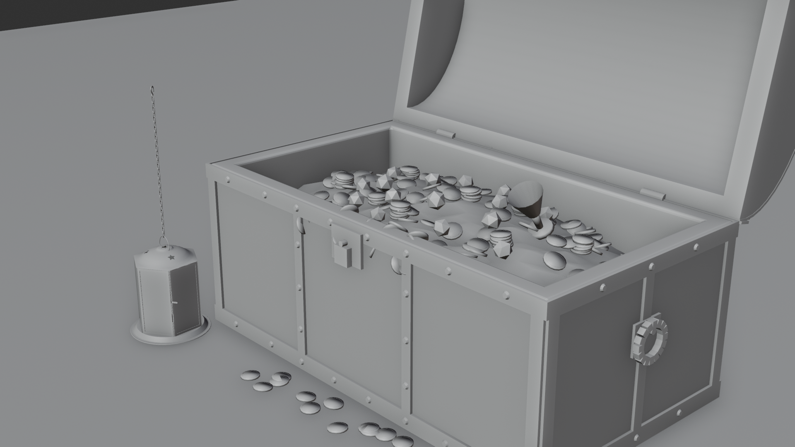
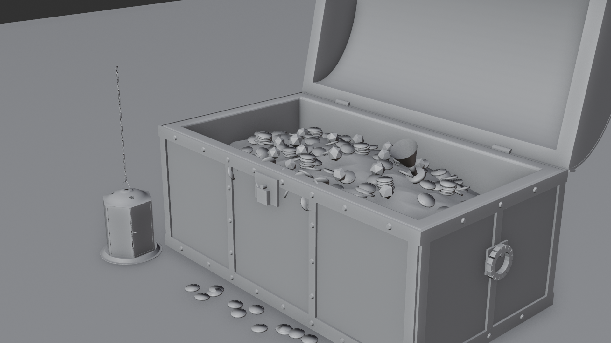
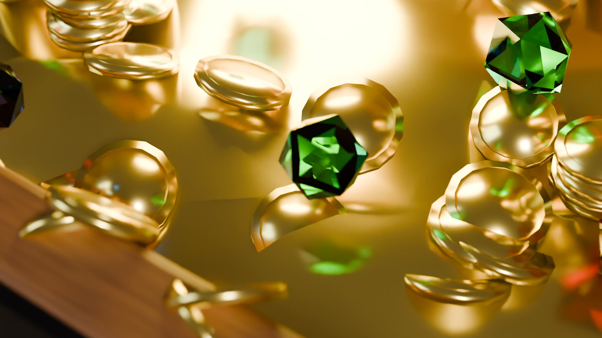
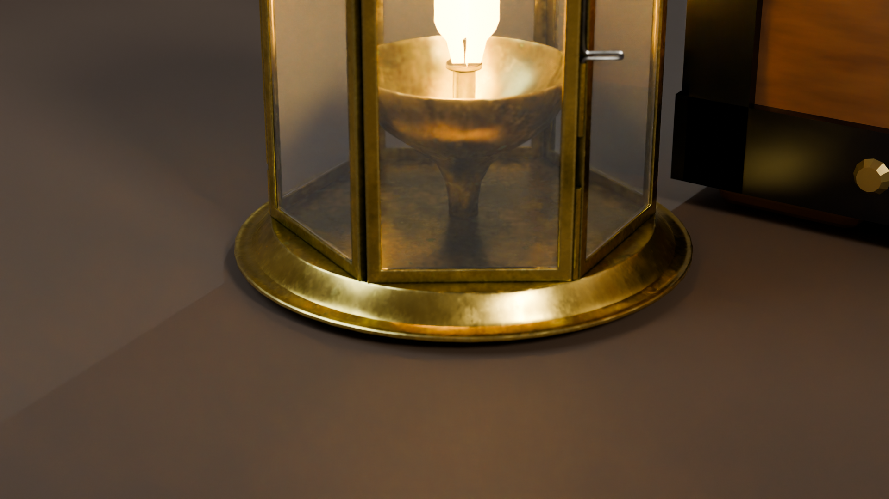
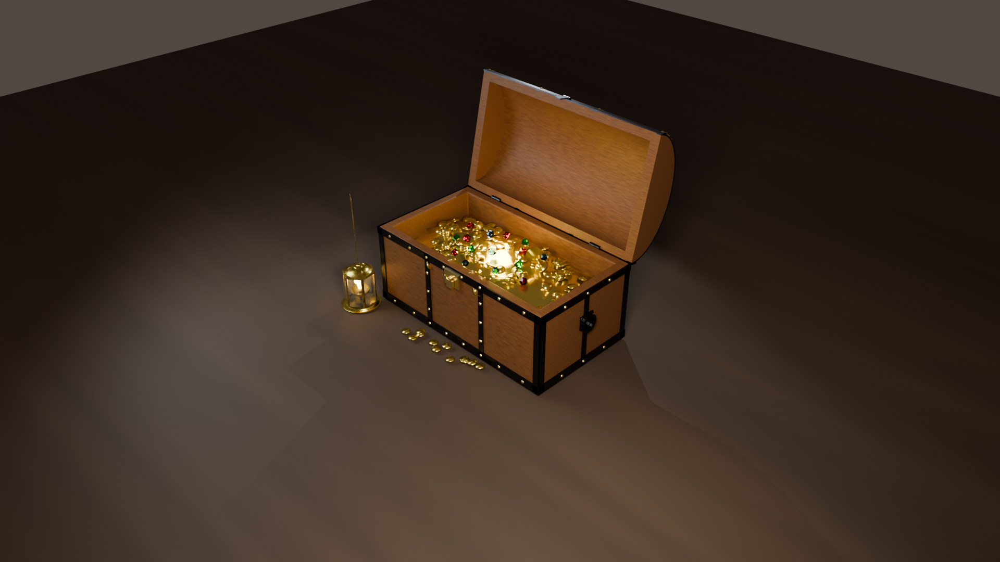
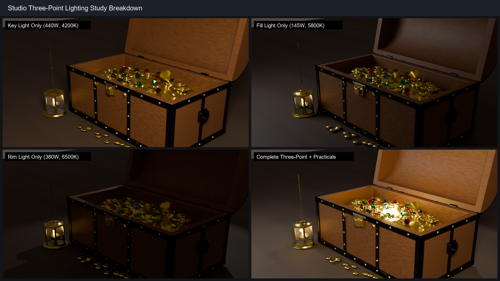
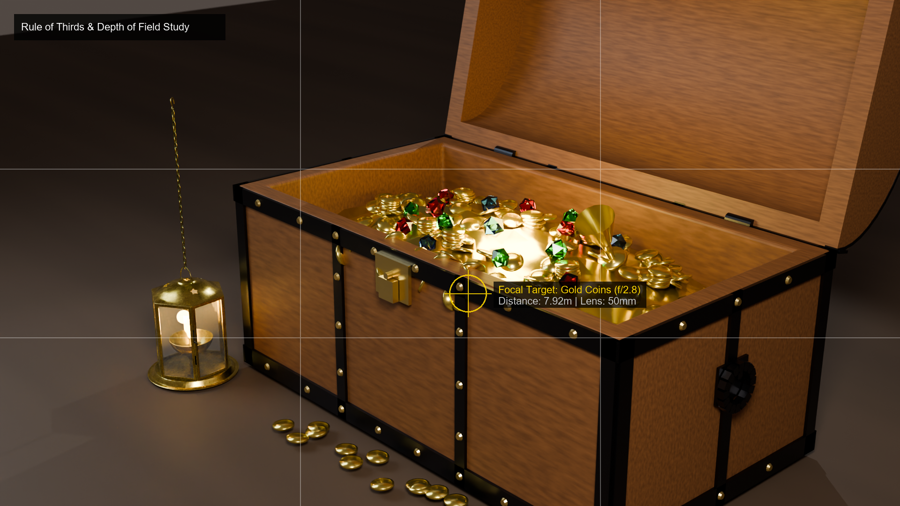
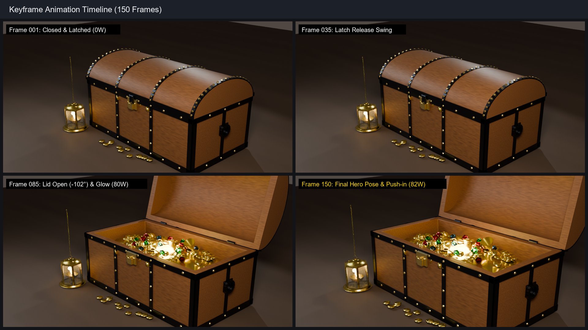
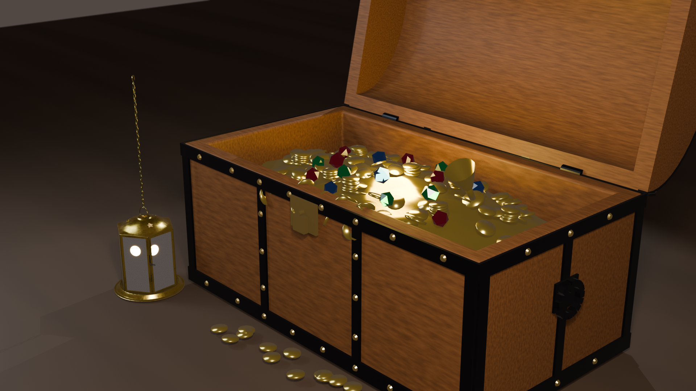
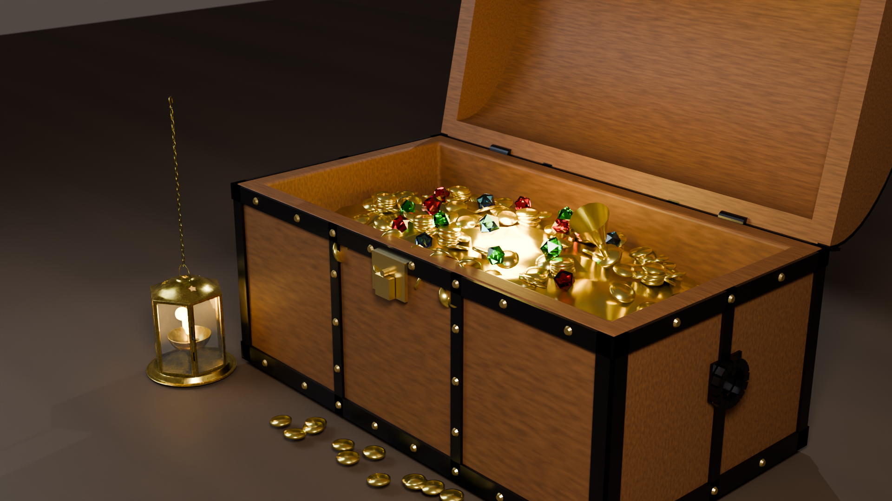

# Tugas Blender Scene 3D Lengkap

## Identitas Kelompok

- **Nama** : Mandy Alphafyn Imanuel Tjandra  
- **NRP**  : 5025241173  
- **Kelas**: B  

- **Nama** : Muhammad Nawfal Alfanni Darussalam  
- **NRP**  : 5025241185  
- **Kelas**: B  

**Departemen Teknik Informatika**  
**Fakultas Teknologi Elektro dan Informatika Cerdas**  
**Institut Teknologi Sepuluh Nopember (ITS)**  

---

## Daftar Isi
1. [Nama Asset dan Konsep Visual](#1-nama-asset-dan-konsep-visual)
2. [Ketentuan 1: Model Hasil Modeling Sendiri & Peningkatan Geometri 3D](#2-ketentuan-1-model-hasil-modeling-sendiri--peningkatan-geometri-3d)
3. [Ketentuan 2: Model Eksternal & Tekstur PBR Lengkap](#3-ketentuan-2-model-eksternal--tekstur-pbr-lengkap)
4. [Ketentuan 3: Penggabungan Scene, Proporsi Skala, Ground, & Elemen Pendukung](#4-ketentuan-3-penggabungan-scene-proporsi-skala-ground--elemen-pendukung)
5. [Ketentuan 4: Sistem Pencahayaan Studio (Three-Point Lighting + Practical Lights)](#5-ketentuan-4-sistem-pencahayaan-studio-three-point-lighting--practical-lights)
6. [Ketentuan 5: Komposisi Kamera, Focal Length & Sinematografi](#6-ketentuan-5-komposisi-kamera-focal-length--sinematografi)
7. [Rigging Kinematik & Animasi Keyframe (150 Frame)](#7-rigging-kinematik--animasi-keyframe-150-frame)
8. [Ketentuan 6: Final Rendering & Analisis Komparatif Engine (EEVEE Next vs CYCLES)](#8-ketentuan-6-final-rendering--analisis-komparatif-engine-eevee-next-vs-cycles)
9. [Shader & PBR Material Network](#9-shader--pbr-material-network)
10. [Tabel Eksperimen & Analisis Teknis](#10-tabel-eksperimen--analisis-teknis)
11. [Struktur Berkas & Hirarki Outliner](#11-struktur-berkas--hirarki-outliner)
12. [Dokumentasi Visual Lengkap Tahapan Proyek](#12-dokumentasi-visual-lengkap-tahapan-proyek)
13. [Checklist Pemenuhan Ketentuan Tugas](#13-checklist-pemenuhan-ketentuan-tugas)
14. [Link Repository & Panduan Eksekusi di Blender](#14-link-repository--panduan-eksekusi-di-blender)

---

## 1. Nama Asset dan Konsep Visual

* **Nama Proyek**: *Cinematic Pirate Treasure Chest & Antique Brass Lantern Showcase (Full Mechanical Rig, 140+ Gold Doubloon Hoard, External PBR Lantern, Studio Lighting, 150-Frame Animation & Path Traced Render)*
* **Konsep Visual**:
  Melanjutkan evolusi aset peti harta karun dari **Praktikum 9** (*Geometri & Modeling Topologi Dasar*) dan **Praktikum 10** (*PBR Texturing & UV Unwrapping 2K*), proyek **Tugas Blender Scene 3D Lengkap** menghadirkan integrasi sinematik menyeluruh (*cinematic presentation pipeline*). 
  
  Aset peti dimodelkan secara mandiri menjadi prop kapal bajak laut legendaris yang fungsional secara mekanis: dilengkapi tutup lengkung barel (*arched barrel vault lid*) yang dapat membuka pada poros engsel belakang, sistem pengunci gembok kuningan antik (*brass padlock & swinging latch*), sepasang pegangan cincin gantung besi samping (*drop-ring iron handles*), serta timbunan harta karun masif (*treasure hoard*) 140+ koin emas doubloon 3D individual, kristal permata faset, dan piala emas bajak laut yang melimpah ke atas lantai dek kapal kayu (*weathered ship deck*).
  
  Untuk melengkapi scene sesuai **Ketentuan 2**, ditambahkan **model eksternal** berupa **Lentera Kuningan Antik (*Antique Brass Diya Lantern*)** yang memiliki dan mengimplementasikan seluruh 6 saluran tekstur PBR standar industri (*Base Color, Ambient Occlusion, Roughness, Metallic, Normal, dan Emission*), disinari oleh tata cahaya studio *Three-Point Lighting*, dan dihidupkan dengan rangkaian gerak animasi 150 frame.

---

## 2. Ketentuan 1: Model Hasil Modeling Sendiri & Peningkatan Geometri 3D

Model utama dibangun dan dikembangkan sendiri secara modular dengan hierarki mekanis:

```
                                [Chest_Lid] (Rotasi X: 0° -> -102°)
                                    │      \
               [Hinge_Left] ────────┤       \─── [Chest_Front_Latch] (Swing Latch)
               [Hinge_Right] ───────┘        └── [Chest_Lock_Plate]
                                    │
                               [Chest_Base] (Dimensi: 3.6m x 2.0m x 1.45m)
                              /      │     \
     [Handle_Side_Left] ────┘       │      └──── [Handle_Side_Right]
                                    │
                           [Treasure_Hoard]
                         ┌──────────┴────────────────────────┐
                         │                                   │
                 [Treasure_Mound]                     [Pirate_Gold_Chalice]
                 (Gundukan Emas Dasar)                (Piala Emas Berukir)
                         │
        ┌────────────────┼────────────────┬──────────────────┐
        ▼                ▼                ▼                  ▼
 [Coins_Scatter]  [Coin_Stacks]    [Coins_Spill_Rim]  [Coins_Floor_Deck]
 (140+ Koin Emas) (3 Tumpukan Rapi) (Tumpahan Bibir)  (Berserakan di Dek)
                         │
                   [Gemstones]
             (Ruby, Emerald, Sapphire)
```

### Rincian Geometri Model Sendiri (29 Objek Mesh, 16.448 Vertices):
1. **Badan Peti (`Chest_Base`)**:
   - Mempertahankan dimensi proporsional $3.6\text{ m} \times 2.0\text{ m} \times 1.45\text{ m}$ dengan rongga penyimpanan dalam (*inner cavity*) sedalam $1.15\text{ m}$.
   - Sudut luar diperkuat dengan pelat besi tempa penahan (`Chest_Base_Iron`: 176 vertices, 132 faces) dan deretan paku keling kuningan (`Chest_Base_Rivets`: 1.344 vertices, 784 faces).
2. **Tutup Melengkung Barel (`Chest_Lid`)**:
   - Dibuat dari separuh tabung silinder parametrik berpenampang busur lengkung (*barrel vault*) dengan ketebalan dinding ganda.
   - Memiliki titik tumpu (*pivot axis*) yang dikunci presisi pada sumbu engsel belakang $(X = 0, Y = 1.02\text{ m}, Z = 0.70\text{ m})$, memungkinkan rotasi buka natural $-102^\circ$ tanpa penetrasi mesh (*clipping*).
   - Dilengkapi pelat besi lengkung penguat (`Chest_Lid_Iron`: 784 vertices, 588 faces) dan paku keling (`Chest_Lid_Rivets`: 2.208 vertices, 1.288 faces).
3. **Engsel Besi Belakang (`Chest_Hinges`)**:
   - Terpasang kokoh pada posisi simetris menjepit pertemuan antara badan peti dan tutup barel dengan pin pengunci silindris (176 vertices, 104 faces).
4. **Mekanisme Kunci Depan (`Chest_Lock_Plate` & `Chest_Front_Latch`)**:
   - Pelat kunci kuningan bermotif di dinding depan ($Y = -1.02\text{ m}$) dengan pengait gembok gantung (*hanging padlock & hasp*) yang berayun membuka saat tutup peti mulai terangkat.
5. **Pegangan Cincin Besi Tempa Samping (`Chest_Handles`)**:
   - Dudukan braket besi di dinding kiri dan kanan ($X = \pm 1.83\text{ m}$) dengan cincin torus gantung bebas (320 vertices, 232 faces).
6. **Timbunan Harta Karun Masif (`Treasure_Hoard`)**:
   - **Gundukan Emas (`Treasure_Mound`)**: Struktur dasar organik pengisi rongga (384 vertices, 345 faces).
   - **140+ Koin Emas Doubloon 3D Individual (`Treasure_Coins_Pile`)**: Silinder pipih bertepi beveled yang tersebar di atas gundukan, tersusun rapi dalam 3 tumpukan kolom koin, meluap di bibir peti, dan berserakan di atas lantai dek kapal (10.560 vertices, 5.610 faces).
   - **Piala Emas Bajak Laut (`Pirate_Gold_Chalice`)**: Piala bertangkai emas berukir yang tertancap di atas gundukan harta (88 vertices, 48 faces).
   - **15 Kristal Permata Faset (`Treasure_Gem_0` s.d. `Treasure_Gem_14`)**: Kristal faset tajam terdiri dari Ruby Crimson merah (6 butir), Emerald Green hijau (5 butir), dan Sapphire Blue biru (4 butir) dengan refraksi optik IOR tinggi.
7. **Lantai Dek Kapal (`Ship_Deck_Floor`)**:
   - Lantai dek kapal berukuran luas $32\text{ m} \times 32\text{ m}$ dengan material papan kayu mahoni berpatina maritim.

---

## 3. Ketentuan 2: Model Eksternal & Tekstur PBR Lengkap

Untuk memenuhi **Ketentuan 2**, ditambahkan model eksternal berkualitas tinggi yang memiliki dan mengimplementasikan **6 saluran tekstur PBR lengkap**:

* **Nama Aset**: *Antique Brass Diya Lantern* (Rangka Lentera Kuningan Tradisional).
* **Sumber & Lisensi**: Poly Haven (CC0 Public Domain).
* **Komponen Mesh (3 Objek Mesh, 6.469 Vertices, 6.688 Faces)**:
  * `brass_diya_lantern`: Badan heksagonal kuningan dengan kubah berornamen bintang, pengait, dan cawan minyak kuningan (3.997 vertices, 4.210 faces).
  * `brass_diya_lantern_chain`: Sambungan rantai gantung kuningan vertikal (2.178 vertices, 2.184 faces).
  * `brass_diya_lantern_connection`: Cincin pengait sambungan atas (294 vertices, 294 faces).
  * `brass_diya_lantern_glass`: Panel kaca pelindung dengan transmisi optik nyata (*Transmission: 0.95, IOR: 1.45*).
  * `brass_diya_lantern_flame`: Nyala api sumbu lentera bersuhu tinggi (*Emission Color: #FF8810, Strength: 20.0*).

### Implementasi 6 Saluran Tekstur PBR Lengkap (`textures/external_lantern/`):

| Saluran PBR (*Channel*) | Nama Berkas Tekstur | Color Space | Konfigurasi Shader Node |
| :--- | :--- | :--- | :--- |
| **Base Color / Albedo** | `lantern_basecolor.png` | sRGB | Warna permukaan kuningan berpatina alami, dihubungkan ke socket *Color A* pada node Mix (Multiply). |
| **Ambient Occlusion (AO)** | `lantern_ao.png` | Non-Color | Dikalikan (*Multiply, Fac: 1.0*) dengan Base Color untuk memperdalam bayangan di sudut rangka heksagonal. |
| **Roughness** | `lantern_roughness.png` | Non-Color | Variasi kilap mikro: area aus mengkilap halus ($\approx 0.20$), lekukan berdebu lebih kasar ($\approx 0.60$). |
| **Metallic** | `lantern_metallic.png` | Non-Color | Nilai logam konduktif penuh ($1.0$) pada seluruh rangka kuningan dan rantai. |
| **Normal Map** | `lantern_normal.png` | Non-Color | Dihubungkan melalui node *Normal Map (Strength: 1.0)* untuk memunculkan detail relief bintang, engsel, dan baut. |
| **Emission** | `lantern_emissive.png` | sRGB | Dihubungkan ke socket *Emission Color* dengan *Emission Strength: 4.0* untuk pendaran api sumbu lentera. |

---

## 4. Ketentuan 3: Penggabungan Scene, Proporsi Skala, Ground, & Elemen Pendukung

### A. Penggabungan Komposisi & Proporsi Skala
Kedua model digabungkan secara harmonis di atas dek kapal kayu dengan relasi spasial yang proporsional:
* **Peti Harta Karun**: Diletakkan sebagai subjek utama di tengah komposisi ($X = 0, Y = 0, Z = 0$), dimensi $3.6\text{ m} \times 2.0\text{ m} \times 1.45\text{ m}$.
* **Lentera Kuningan Eksternal**: Diletakkan di lantai dek sebelah kiri depan peti ($X = -2.0, Y = -1.4, Z = -0.73$), skala $5.5$ (tinggi $\approx 0.75\text{ m}$). Penempatan ini mengisi bidang lantai depan (*foreground*) tanpa menutupi bukaan peti maupun tumpahan koin.
* **Ground (Lantai Dek Kapal)**: Mesh bidang lantai dek kayu berukuran luas $32\text{ m} \times 32\text{ m}$ (`Ship_Deck_Floor`) dengan tekstur papan kayu mahoni maritim (*Ship_Deck_PBR*) untuk mencegah *horizon clipping*.
* **Elemen Pendukung**:
  * Taburan koin emas di lantai dek yang menjembatani area antara dasar peti dan dudukan lentera kuningan.
  * Kilauan permata ruby faset merah yang membiaskan cahaya ganda dari lentera dan peti.

---

## 5. Ketentuan 4: Sistem Pencahayaan Studio (Three-Point Lighting + Practical Lights)

Tata cahaya disusun dengan hierarki pencahayaan terkalibrasi untuk memahat volume objek, memunculkan tekstur material, dan mempertegas bayangan:

```
                       [ Rim Light (380W) ]
                             (Back)
                                │
                ┌───────────────┴───────────────┐
                │                               │
        [ Lentera Kuningan ]          [ Peti Harta Karun ]
         (Flame Light 40W)             (Treasure Glow 0->82W)
                │                               │
                └───────────────┬───────────────┘
                                │
        [ Key Light (440W) ]    │    [ Fill Light (145W) ]
         (Warm White 4200K)     │     (Cool Blue 5800K)
                                │
                       [ Cinematic_Camera ]
```

1. **Key Light (Lampu Kunci Utama)**:
   * **Tipe & Daya**: Area Light ($440\text{ W}$, #FFEFCF / 4200K), posisi $(4.8, -4.4, 4.6)\text{ m}$ pada sudut datang $45^\circ$ dari kanan depan.
   * **Fungsi**: Memahat volume 3D, memunculkan tekstur serat kayu peti, serta menghasilkan highlight berkilau pada paku keling, koin emas, dan kubah lentera.
2. **Fill Light (Lampu Pengisi)**:
   * **Tipe & Daya**: Area Light ($145\text{ W}$, #BDE0FF / 5800K), posisi $(-4.4, -3.6, 3.0)\text{ m}$ dari kiri depan.
   * **Fungsi**: Membuka bayangan gelap pada rongga peti dan sisi samping lentera dengan rasio kontras seimbang ($1:3$).
3. **Rim Light (Lampu Punggung / Siluet)**:
   * **Tipe & Daya**: Spot Light ($380\text{ W}$, #DCF5FF / 6500K), posisi $(-2.8, 4.4, 4.2)\text{ m}$ dari belakang atas.
   * **Fungsi**: Menciptakan garis tepi siluet (*rim contour*) tipis di sepanjang bahu tutup peti, rantai lentera, dan tepi piala emas.
4. **Treasure Glow Light (Lampu Aksen Interior Rongga Peti)**:
   * **Tipe & Daya**: Point Light teranimasi di dalam rongga peti ($0\text{ W} \to 82\text{ W}$, #FFBD29), posisi $(0.0, -0.05, 0.72)\text{ m}$.
   * **Fungsi**: Memancarkan pendaran cahaya emas magis dari dasar timbunan harta karun seiring terbukanya tutup peti.
5. **Practical Lantern Flame Light (Lampu Nyala Api Lentera)**:
   * **Tipe & Daya**: Point Light fisik ($40\text{ W}$, #FF9926) tepat di dalam kubah lentera pada posisi $(-2.0, -1.4, -0.28)\text{ m}$.
   * **Fungsi**: Memberikan pencahayaan radial fisik yang menerangi kaca lentera dan lantai kayu di sekelilingnya.

---

## 6. Ketentuan 5: Komposisi Kamera, Focal Length & Sinematografi

* **Kamera Utama (`Cinematic_Camera`)**:
  * **Focal Length**: **$50\text{mm}$ Standard Cinematic Lens**. Memberikan perspektif alami bebas distorsi lengkung tepi (*barrel distortion*) maupun kompresi telephoto datar.
  * **Sudut Pandang**: **Three-Quarter Hero Angle** ($45^\circ$ azimuth, elevasi $30^\circ$). Menangkap secara simultan tampak depan, atas, dan samping peti serta lentera kuningan.
  * **Depth of Field (DoF)**:
    * Aperture optik aktif pada **$f/2.8$**.
    * Titik fokus terkunci presisi pada koin emas terdepan dan bibir peti (`Camera_Focus_Target` pada $(0.10, -0.65, 0.62)\text{ m}$), menghasilkan kelembutan bokeh sinematik pada latar belakang.
  * **Animasi Kamera (*Dolly Push-in*)**:
    * Kamera bergerak maju secara perlahan dan halus dari koordinat $(6.5, -6.5, 4.0)$ pada Frame 1 menuju $(5.6, -5.6, 3.4)$ pada Frame 150 (jarak dolly $9.2\text{ m} \to 7.9\text{ m}$).
* **Kamera Pendukung**:
  * `Cam_Studio_Overview`: Lensa wide $32\text{mm}$ dari koordinat $(8.5, -8.5, 8.0)$ untuk dokumentasi tata letak studio secara menyeluruh.
  * `Cam_Macro_Coins`: Lensa makro $75\text{mm}$ ($f/2.0$) dari koordinat $(1.2, -1.6, 1.8)$ untuk membidik detail mikroskopis koin emas dan permata.
  * `Cam_Closeup_Lantern`: Lensa portrait $65\text{mm}$ ($f/2.8$) dari koordinat $(-0.8, -3.2, 0.2)$ dengan DoF terkunci pada `External_PBR_Lantern_Group` untuk menangkap detail material PBR lentera eksternal.

---

## 7. Rigging Kinematik & Animasi Keyframe (150 Frame)

Rangkaian animasi berdurasi **150 frame (24 fps = 6.25 detik)** tersinkronisasi mulus menggunakan interpolasi kurva *Bézier Ease-In-Out*:

```
Frame 001 ─── [Peti Tertutup & Terkunci Rapat, Kamera Diam, Lampu Dalam 0W]
     │
Frame 035 ─── [Kait Gembok Mengayun Terlepas ke Depan (Latch Release)]
     │
Frame 085 ─── [Tutup Peti Terbuka Penuh (-102°), Lampu Harta Karun Memancar Terang]
     │
Frame 150 ─── [Kamera Dolly Push-In Berhenti pada Pose Hero Sinematik Final]
```

* **`Chest_LidAction`**: Rotasi sumbu X tutup melengkung membuka perlahan dari $0^\circ$ (Frame 1) ke $-104^\circ$ (Frame 85) dan stabil pada $-102^\circ$ (Frame 95..150).
* **`Treasure_Glow_LightAction`**: Intensitas cahaya interior naik bertahap dari $0\text{ W}$ (Frame 1 s.d. 35) ke $80\text{ W}$ (Frame 85), dan puncaknya $82\text{ W}$ (Frame 150).
* **`Cinematic_CameraAction`**: Pergerakan *dolly push-in* halus mendekatkan bingkai dari jarak $9.2\text{ m}$ ke $7.9\text{ m}$.

---

## 8. Ketentuan 6: Final Rendering & Analisis Komparatif Engine (EEVEE Next vs CYCLES)

Final rendering dievaluasi secara komparatif di Blender 5.2 LTS:

| Parameter Evaluasi | EEVEE Next (Rasterisasi Real-Time) | CYCLES Path Tracing (Physically Based) |
| :--- | :--- | :--- |
| **Waktu Render per Frame** | $\approx 10\text{ - }25\text{ detik}$ (Sangat Cepat) | $\approx 180\text{ - }195\text{ detik}$ (Path Tracing 32 Samples + OIDN) |
| **Pencahayaan Global (GI)** | *Screen-Space Raytracing & Irradiance Caches* | *Multi-Bounce Monte Carlo Path Tracing* sejati |
| **Refleksi Logam & Kuningan** | Akurat pada area terlihat di layar (*Screen-Space*) | Pantulan pantulan fisik sempurna antar koin & piala |
| **Refraksi Permata & Kaca** | Estimasi transmisi cepat | Pembiasan nyata berbasis IOR ($1.45$ kaca, $1.77$ ruby) |
| **Bayangan Kontak Mikro** | Bayangan halus dengan *contact shadow raytracing* | Penumbra bayangan fisik dan *ambient occlusion* alami |
| **Penggunaan Ideal** | *Real-time playback*, animasi, game dev | *High-end cinematic final beauty stills & VFX* |

---

## 9. Shader & PBR Material Network

Seluruh shader menggunakan standar **Principled BSDF** dengan pemisahan karakteristik material yang kontras:
1. **`Pirate_Wood_PBR` (Papan Kayu Mahoni Peti)**: Base Color cokelat mahoni tua, Roughness $0.65$, alur Bump serat kayu.
2. **`Pirate_Iron_PBR` (Pelat Besi Tempa & Engsel)**: Metallic $0.98$, Roughness $0.40$, warna besi arang berkarat dengan kilau aus di tepian.
3. **`Pirate_Brass_PBR` (Paku Keling & Gembok)**: Metallic $0.95$, Roughness $0.25$, warna kuningan emas antik.
4. **`Pirate_Gold_PBR` (140+ Koin Emas & Piala)**: Metallic $1.0$, Roughness $0.22$, warna kuning emas murni $(1.0, 0.766, 0.20)$ dengan noise mikro.
5. **`Gem_Ruby`, `Gem_Emerald`, `Gem_Sapphire` (Permata Kristal Faset)**: Transmission Weight $1.0$, Roughness $0.05$, IOR $1.58$ - $1.77$.
6. **`brass_diya_lantern` (Rangka Lentera Eksternal)**: Mengintegrasikan Base Color, AO (Multiply), Roughness, Metallic, Normal Map, dan Emissive flame.
7. **`Ship_Deck_PBR` (Lantai Dek Kapal)**: Papan kayu mahoni maritim luas $32\text{ m} \times 32\text{ m}$.

---

## 10. Tabel Eksperimen & Analisis Teknis

| No | Eksperimen | Variasi Parameter | Pengamatan & Temuan Grafis |
|:--:|:-----------|:------------------|:---------------------------|
| 1 | **Key Light Angle** | Sudut $0^\circ$ (Frontal) vs Sudut $45^\circ$ | Cahaya frontal menghilangkan persepsi kedalaman objek. Sudut $45^\circ$ membentuk gradasi bayangan dramatis yang memperjelas bentuk tutup peti, koin, dan kubah lentera. |
| 2 | **Fill Ratio** | Tanpa Fill ($1:\infty$) vs Fill Lembut ($1:3$) | Tanpa Fill, sisi samping objek menjadi siluet gelap pekat (*crushed shadows*). Fill berdaya sepertiga membuka detail papan kayu dan kaca lentera secara natural. |
| 3 | **Rim Separation** | Rim Light ON vs OFF | Tanpa Rim Light, tutup peti kayu menyatu dengan latar belakang gelap. Rim Light menghasilkan garis kontur putih tipis yang memisahkan siluet prop secara elegan. |
| 4 | **Interior Accent** | Tanpa Lampu Dalam vs Point 82W | Tanpa lampu dalam, isi peti tampak mati saat terbuka. Lampu interior menciptakan efek magis *treasure glow* yang memantulkan kilau ke koin dan piala emas. |
| 5 | **Focal Length** | $24\text{mm}$ (Wide) vs $50\text{mm}$ (Standard) | Lensa $24\text{mm}$ mendistorsi proporsi peti (sudut depan membesar tak wajar). Lensa $50\text{mm}$ menghasilkan proporsi volumetrik paling proporsional. |
| 6 | **Depth of Field** | DoF OFF vs DoF ON ($f/2.8$) | DoF ON memburamkan lantai latar menjadi bokeh halus dan mengunci perhatian mata pada peti, lentera, dan koin emas. |
| 7 | **Render Engine** | EEVEE Next vs CYCLES Path Tracing | EEVEE Next sangat responsif untuk evaluasi animasi. Cycles memberikan integrasi fisik cahaya mutlak pada caustics permata dan oklusi koin. |

---

## 11. Struktur Berkas & Hirarki Outliner

```
Tugas Blender Scene 3D Lengkap/
├── Tugas Blender Scene 3D Lengkap.blend   # File Blender master scene 3D lengkap (Satu-satunya berkas .blend)
├── README.md                              # Laporan komprehensif dokumentasi tugas
├── models/
│   └── brass_diya_lantern.blend           # Aset model eksternal sumber (Poly Haven CC0)
├── textures/
│   ├── chest_basecolor.png                # Tekstur buatan sendiri: Base Color Peti (2K)
│   ├── chest_roughness.png                # Tekstur buatan sendiri: Roughness Peti (2K)
│   ├── chest_metallic.png                 # Tekstur buatan sendiri: Metallic Peti (2K)
│   ├── chest_normal.png                   # Tekstur buatan sendiri: Normal Map Peti (2K)
│   ├── chest_emission.png                 # Tekstur buatan sendiri: Emission Peti (2K)
│   ├── rivet_basecolor.png                # Tekstur buatan sendiri: Base Color Rivet
│   ├── rivet_roughness.png                # Tekstur buatan sendiri: Roughness Rivet
│   ├── rivet_metallic.png                 # Tekstur buatan sendiri: Metallic Rivet
│   ├── rivet_normal.png                   # Tekstur buatan sendiri: Normal Rivet
│   └── external_lantern/
│       ├── lantern_basecolor.png          # Tekstur eksternal: Base Color Lentera (1K)
│       ├── lantern_ao.png                 # Tekstur eksternal: Ambient Occlusion Lentera (1K)
│       ├── lantern_roughness.png          # Tekstur eksternal: Roughness Lentera (1K)
│       ├── lantern_metallic.png           # Tekstur eksternal: Metallic Lentera (1K)
│       ├── lantern_normal.png             # Tekstur eksternal: Normal Map Lentera (1K)
│       └── lantern_emissive.png           # Tekstur eksternal: Emission Lentera (1K)
└── screenshots/
    ├── 01_scene_assembly_overview.png     # Tahap 1: Asset Assembly Overview (Peti + Lentera)
    ├── 02_wireframe_topology.png          # Tahap 2: Topologi wireframe model mandiri & eksternal
    ├── 03_treasure_hoard_coins.png        # Tahap 3: Detail makro koin emas, piala, dan permata
    ├── 04_lantern_pbr_detail.png          # Tahap 4: Detail closeup PBR lentera eksternal
    ├── 05_three_point_lighting_setup.png  # Tahap 5: Setup Studio Three-Point Lighting
    ├── 06_lighting_study_key_fill_rim.png # Tahap 6: Studi pencahayaan Key, Fill, Rim
    ├── 07_camera_composition_dof.png      # Tahap 7: Komposisi kamera, Rule of Thirds & DoF f/2.8
    ├── 08_animation_timeline_keyframes.png# Tahap 8: Timeline 4 keyframe animasi 150 frame
    ├── 09_eevee_next_render.png           # Tahap 9: Render real-time Blender EEVEE 1080p
    └── 10_final_hero_showcase.png         # Tahap 10: Final Master Beauty CYCLES Path Tracing 1080p
```

---

## 12. Dokumentasi Visual Lengkap Tahapan Proyek

### Tahap 1: Asset Assembly & Scene Overview (`01_scene_assembly_overview.png`)
Perakitan lengkap komponen 3D di atas dek kapal kayu: peti harta karun dengan tutup barel terbuka, engsel, pelat kunci, pegangan cincin besi, 140+ koin emas, piala, permata, serta model eksternal Lentera Kuningan Antik PBR di lantai dek depan.



---

### Tahap 2: Wireframe & Topology Integrity (`02_wireframe_topology.png`)
Struktur kawat mesh (*wireframe*) yang memperlihatkan kerapatan mesh terencana: kurvatur lengkung tutup barel dengan 24 segmen radial, *bevel loops*, sebaran koin emas, serta topologi heksagonal lentera kuningan eksternal.



---

### Tahap 3: Treasure Hoard & Coin Scatter Detail (`03_treasure_hoard_coins.png`)
Detail makro close-up (kamera $75\text{mm}$) timbunan harta karun bajak laut: tumpukan kolom koin emas doubloon, piala emas bertangkai, koin yang meluap di bibir peti, serta kristal permata ruby, emerald, dan sapphire.



---

### Tahap 4: Detail Model Eksternal: Antique Brass Diya Lantern (`04_lantern_pbr_detail.png`)
Detail jarak dekat (kamera $65\text{mm}$) model eksternal memperlihatkan 6 saluran tekstur PBR: Base Color kuningan berpatina, Ambient Occlusion, Roughness aus, Normal map ukiran bintang dan engsel, nyala api emisi interior, dan panel kaca pelindung.



---

### Tahap 5: Studio Three-Point Lighting Setup (`05_three_point_lighting_setup.png`)
Tampilan sudut pandang studio atas (kamera wide $32\text{mm}$) memperlihatkan orientasi dan radius kerja Key Light ($440\text{ W}$), Fill Light ($145\text{ W}$), Rim Light ($380\text{ W}$), lampu aksen interior peti ($82\text{ W}$), dan lampu api lentera ($40\text{ W}$).



---

### Tahap 6: Lighting Study & Intensity Balancing (`06_lighting_study_key_fill_rim.png`)
Analisis kontribusi masing-masing lampu secara individual (Key Light Only, Fill Light Only, Rim Light Only) dibandingkan dengan penggabungan penuh *Three-Point Lighting* beserta lampu praktikal api lentera dan pendaran emas dalam peti.



---

### Tahap 7: Camera Framing & Depth of Field Study (`07_camera_composition_dof.png`)
Evaluasi optik kamera $50\text{mm}$ pada aperture $f/2.8$: garis panduan *Rule of Thirds*, titik fokus terkunci pada koin emas terdepan ($7.92\text{ m}$), dan kelembutan efek blur bokeh pada latar belakang dek kapal.



---

### Tahap 8: Keyframe Animation Timeline (`08_animation_timeline_keyframes.png`)
Dokumentasi visual 4 titik kunci animasi 150 frame:
1. **Frame 1**: Peti Tertutup & Terkunci (*Closed & Latched*, lampu dalam 0W).
2. **Frame 35**: Pengait Kunci Mengayun Terlepas ke Depan (*Latch Release*).
3. **Frame 85**: Tutup Mengayun Terbuka Penuh ($-104^\circ$) & Cahaya Emas Memancar Terang ($80\text{ W}$).
4. **Frame 150**: Pose Hero Sinematik, Lampu Emas Maksimal ($82\text{ W}$), & Camera Dolly Push-in!



---

### Tahap 9: EEVEE Next Real-Time Render (`09_eevee_next_render.png`)
Hasil render resolusi penuh ($1920 \times 1080$) menggunakan engine **EEVEE** di Blender 5.2. Memperlihatkan performa real-time cepat ($pprox 10\text{ - }25\text{ s}$) dengan specular highlights yang tajam dan screen-space reflections.



---

### Tahap 10: Final Master Beauty Showcase (`10_final_hero_showcase.png`)
Tampilan mahakarya final resolusi penuh ($1920 \times 1080$) menggunakan **CYCLES Physically Based Path Tracing** dengan OpenImageDenoise: radiansi pencahayaan global multi-bounce fisik sejati, pembiasan nyata pada kaca lentera dan permata faset, serta oklusi bayangan kontak mikro antar koin.



---

## 13. Checklist Pemenuhan Ketentuan Tugas

- [x] **Ketentuan 1**: Menggunakan model peti hasil modeling sendiri (`Chest_Base`, `Chest_Lid`, `Chest_Hinges`, `Chest_Handles`, dll.) dengan UV mapping dan material/tekstur buatan sendiri.
- [x] **Ketentuan 2**: Menambahkan model eksternal (*Antique Brass Diya Lantern*) dengan tekstur PBR lengkap (Base Color, AO, Roughness, Metallic, Normal, dan Emission).
- [x] **Ketentuan 3**: Menggabungkan kedua model dalam satu scene proporsional di atas lantai dek kapal kayu maritim luas $32\text{ m} \times 32\text{ m}$ dengan elemen pendukung 140+ koin emas dan permata.
- [x] **Ketentuan 4**: Menyusun sistem tata cahaya *Three-Point Lighting* (Key, Fill, Rim) ditambah lampu nyala api lentera dan lampu aksen interior peti.
- [x] **Ketentuan 5**: Mengatur kamera sinematik 50mm, sudut pandang Three-Quarter Hero, Depth of Field $f/2.8$, dan animasi pergerakan dolly push-in halus.
- [x] **Ketentuan 6**: Melakukan final rendering Full HD $1920 \times 1080$ menggunakan CYCLES Path Tracing dan EEVEE Next dengan kontras material yang bersih dan tegas.
- [x] **Manajemen Berkas**: Menyisakan hanya satu berkas master utama `Tugas Blender Scene 3D Lengkap.blend` di direktori proyek.

---

## 14. Link Repository & Panduan Eksekusi di Blender

### A. Tautan Repository
* **Repository GitHub**: [Link Repository](https://github.com/MandyTjandra/Praktikum-Grafika-Komputer)
* **Direktori Tugas**: [Link Direktori Tugas Blender Scene 3D Lengkap](https://github.com/MandyTjandra/Praktikum-Grafika-Komputer/tree/main/Tugas%20Blender%20Scene%203D%20Lengkap)

### B. Panduan Menjalankan File di Blender
1. Buka aplikasi **Blender 5.2 LTS** (atau Blender 4.x / 5.x ke atas).
2. Pilih menu **File -> Open...** lalu arahkan ke:
   ```
   Tugas Blender Scene 3D Lengkap/Tugas Blender Scene 3D Lengkap.blend
   ```
3. **Memutar Animasi**:
   - Tekan bilah spasi (**Spacebar**) untuk memutar timeline animasi dari Frame 1 hingga 150.
   - Amati gerakan pembukaan tutup peti, pelepasan kunci, nyala api lentera, penyalaan cahaya emas interior, dan pergerakan kamera *dolly push-in*.
4. **Berpindah Kamera**:
   - Pilih kamera yang diinginkan (`Cinematic_Camera`, `Cam_Closeup_Lantern`, `Cam_Macro_Coins`, atau `Cam_Studio_Overview`), lalu tekan **Ctrl + Numpad 0** untuk menjadikannya kamera aktif.
5. **Melakukan Render Frame**:
   - Beralih ke Frame 150 (atau frame manapun yang diinginkan), lalu tekan **F12** untuk melakukan render still image.
   - Untuk beralih engine antara EEVEE Next dan Cycles, buka tab **Render Properties** -> ubah opsi **Render Engine** antara `EEVEE` dan `Cycles`.
