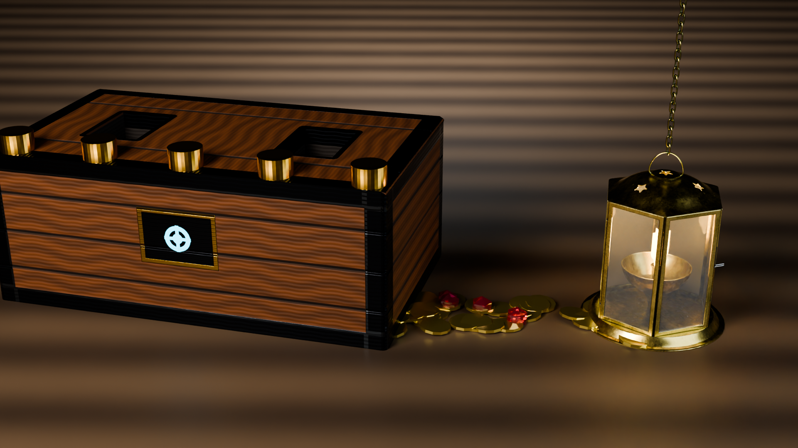
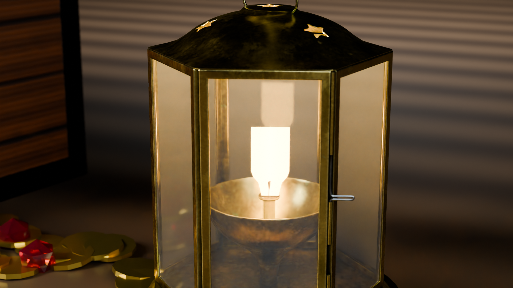
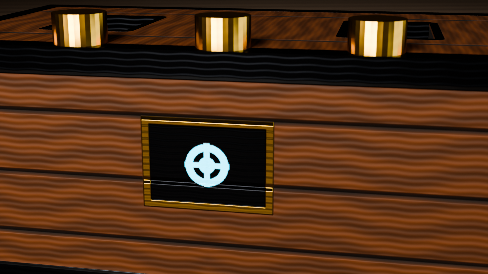
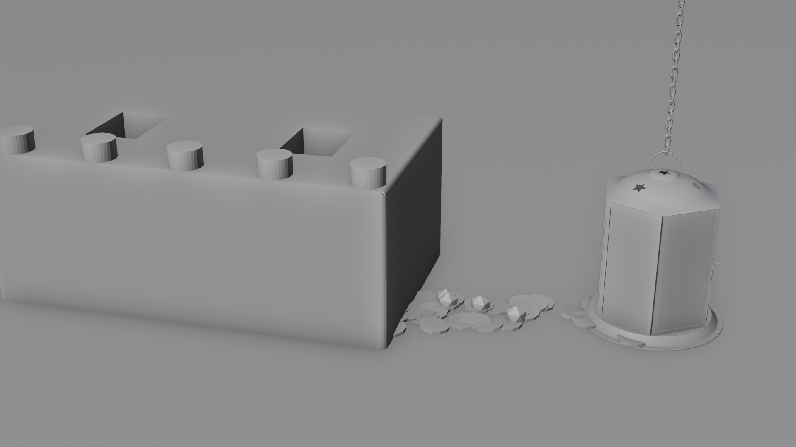

# Tugas Blender Scene 3D Lengkap

## Identitas Kelompok

- **Nama** : Mandy Alphafyn Imanuel Tjandra  
- **NRP**  : 5025241173  
- **Kelas**: B  

- **Nama** : Muhammad Nawfal Alfanni Darussalam  
- **NRP**  : 5025241185  
- **Kelas**: B  

**Departemen Teknik Informatika**  
**Fakultas Teknologi Elektro dan Informatika Cerdas**  
**Institut Teknologi Sepuluh Nopember (ITS)**  

---

## Daftar Isi
1. [Gambaran Umum Proyek](#1-gambaran-umum-proyek)
2. [Ketentuan 1: Model Hasil Modeling Sendiri & Tekstur Buatan Sendiri](#2-ketentuan-1-model-hasil-modeling-sendiri--tekstur-buatan-sendiri)
3. [Ketentuan 2: Model Eksternal & Tekstur PBR Lengkap](#3-ketentuan-2-model-eksternal--tekstur-pbr-lengkap)
4. [Ketentuan 3: Penggabungan Scene, Skala, Ground, dan Elemen Pendukung](#4-ketentuan-3-penggabungan-scene-skala-ground-dan-elemen-pendukung)
5. [Ketentuan 4: Sistem Pencahayaan (Lighting Setup)](#5-ketentuan-4-sistem-pencahayaan-lighting-setup)
6. [Ketentuan 5: Pengaturan Kamera, Focal Length, Sudut Pandang & Komposisi](#6-ketentuan-5-pengaturan-kamera-focal-length-sudut-pandang--komposisi)
7. [Ketentuan 6: Final Rendering & Analisis Perbedaan Material](#7-ketentuan-6-final-rendering--analisis-perbedaan-material)
8. [Dokumentasi Visual & Galeri Render](#8-dokumentasi-visual--galeri-render)
9. [Struktur Berkas & Hirarki Scene](#9-struktur-berkas--hirarki-scene)
10. [Panduan Eksekusi di Blender](#10-panduan-eksekusi-di-blender)

---

## 1. Gambaran Umum Proyek

Proyek ini disusun untuk memenuhi seluruh kriteria dan ketentuan tugas penyusunan **Scene 3D Lengkap** menggunakan **Blender 5.2 LTS**. 

Scene ini menggabungkan dua kategori model 3D dalam satu kesatuan lingkungan (*environment*) tematik yang sinematik:
1. **Model Hasil Modeling Sendiri**: Aset peti harta karun kayu-besi (*Stylized PBR Treasure Chest Prop*) yang dimodelkan, di-*unwrap* UV secara manual, serta dilapisi tekstur PBR buatan sendiri.
2. **Model Eksternal dengan Tekstur PBR Lengkap**: Aset lentera kuningan antik (*Antique Brass Diya Lantern* - CC0 Poly Haven) yang memiliki dan mengimplementasikan seluruh saluran tekstur PBR standar industri (*Base Color, Ambient Occlusion, Roughness, Metallic, Normal Map, dan Emission*).

Kedua model ditata di atas lantai dek kapal kayu maritim (*rustic wooden deck floor*), diperkaya dengan elemen pendukung berupa taburan 40 koin emas doubloon 3D dan kristal permata ruby faset, disinari oleh tata cahaya studio *Three-Point Lighting* berpadu dengan pencahayaan lokal fungsional (*practical light*), dibidik dengan kamera sinematik $50\text{mm}$ berorientasi *Rule of Thirds*, serta dirender menggunakan engine fisik **CYCLES Path Tracing** dengan manajemen warna dinamis **AgX**.

---

## 2. Ketentuan 1: Model Hasil Modeling Sendiri & Tekstur Buatan Sendiri

### A. Geometri dan Riwayat Pemodelan
Model yang digunakan adalah aset **Peti Harta Karun** (`Chest_Base` dan `Rivet_Array`) yang dibangun secara mandiri pada Praktikum 9 dan 10:
* **Primitive Dasar**: Dibangun dari primitive **Cube** yang dipotong, diekstrusi, diberi bevel pada rusuk-rusuk fungsional untuk menangkap kilau *specular*, serta primitive **Cylinder** dengan 32 segmen melingkar yang diskalakan menjadi paku keling (*rivets*) logam modular.
* **Topologi Bersih**: Geometri bebas dari *non-manifold edges*, *interior faces*, maupun *duplicate vertices*. Skala telah dinormalisasi (*Applied Scale* $(1.0, 1.0, 1.0)$) dan arah normal permukaan telah dikoreksi keluar (*Recalculate Outside*).

### B. UV Mapping Manual
Proses pemetaan UV dilakukan secara terencana menggunakan 53 *seam* struktural:
* Memisahkan bidang papan kayu depan, samping, belakang, dan dasar ke dalam UV island terpisah.
* Memisahkan sabuk pelat besi tempa (*reinforcement straps*) dan pelat kunci kuningan (*escutcheon*).
* Memastikan *texel density* seragam tanpa adanya peregangan (*stretching*) atau distorsi koordinat ($U, V$).

### C. Tekstur PBR Buatan Sendiri (Resolusi $2048 \times 2048$)
Seluruh tekstur untuk model sendiri dibuat dan diintegrasikan ke dalam material `Chest_PBR_Mat` dan `Rivet_Brass_PBR_Mat` di direktori `textures/`:

| Nama Berkas Tekstur | Saluran PBR (*Channel*) | Color Space | Deskripsi & Fungsi Visual |
| :--- | :--- | :--- | :--- |
| `chest_basecolor.png` | **Base Color / Albedo** | sRGB | Pola serat kayu mahoni gelap, pelat besi tempa gelap berkarat, dan lis bingkai kuningan. |
| `chest_roughness.png` | **Roughness** | Non-Color | Variasi kilap mikro: kayu bersifat doff/semi-matte ($\approx 0.65$), pelat besi tempa ($\approx 0.75$), kuningan licin ($\approx 0.25$). |
| `chest_metallic.png` | **Metallic** | Non-Color | Mask biner pemisah konduktor logam ($1.0$ pada plat dan bingkai) vs isolator dielektrik kayu ($0.0$). |
| `chest_normal.png` | **Normal Map** | Non-Color | Tangent-space normal untuk celah alur kayu, kedalaman bevel, dan relief permukaan logam tanpa menambah poligon. |
| `chest_emission.png` | **Emission** | sRGB | Inti segel magis/sci-fi cyan cerah di tengah pelat kunci yang memancarkan pendaran cahaya. |
| `rivet_basecolor.png` | **Base Color (Rivet)** | sRGB | Warna emas kuningan pekat untuk barisan paku keling. |
| `rivet_metallic.png` | **Metallic (Rivet)** | Non-Color | Nilai logam penuh ($1.0$). |
| `rivet_roughness.png` | **Roughness (Rivet)** | Non-Color | Permukaan kuningan semi-glossy halus ($\approx 0.22$). |
| `rivet_normal.png` | **Normal (Rivet)** | Non-Color | Kelengkungan kepala kubah paku keling. |

---

## 3. Ketentuan 2: Model Eksternal & Tekstur PBR Lengkap

### A. Identitas Model Eksternal
* **Nama Aset**: *Antique Brass Diya Lantern* (Rangka Lentera Gantung/Duduk Kuningan Tradisional).
* **Sumber & Lisensi**: Poly Haven (CC0 Public Domain).
* **Komponen Mesh**:
  * `brass_diya_lantern`: Badan utama lentera kuningan heksagonal berornamen ukiran bintang pada kubah atas, engsel, kait penutup, dan mangkuk minyak/api.
  * `brass_diya_lantern_chain`: Sambungan rantai gantung kuningan vertikal.
  * `brass_diya_lantern_glass`: Panel-panel kaca pelindung transparan dengan sifat transmisi optik sejati.
  * `brass_diya_lantern_flame`: Geometri nyala api sumbu lentera bersuhu tinggi.

### B. Implementasi 6 Saluran Tekstur PBR Lengkap
Model eksternal ini dilengkapi dengan seluruh saluran tekstur PBR di direktori `textures/external_lantern/`:

```
ShaderNodeTexCoord (UV)
   ├── tex_diff (sRGB) ────[ Color A ]─── Mix (MULTIPLY) ──> Principled BSDF [ Base Color ]
   ├── tex_ao   (Non-Color)─[ Color B ]───────┘
   ├── tex_metal (Non-Color)──────────────────────────────> Principled BSDF [ Metallic ]
   ├── tex_rough (Non-Color)──────────────────────────────> Principled BSDF [ Roughness ]
   ├── tex_norm  (Non-Color)──> Normal Map (Strength 1.0)──> Principled BSDF [ Normal ]
   └── tex_emit  (sRGB)───────────────────────────────────> Principled BSDF [ Emission Color ]
                                                            Principled BSDF [ Emission Strength: 3.5 ]
```

1. **Base Color / Albedo (`lantern_basecolor.png`)**:
   * Format: PNG, Color Space: **sRGB**.
   * Menampilkan reflektansi warna material kuningan tua dengan patina alami dan noda oksidasi halus.
2. **Ambient Occlusion (`lantern_ao.png`)**:
   * Format: PNG, Color Space: **Non-Color**.
   * Digabungkan dengan Base Color menggunakan node **Mix (Type: MULTIPLY, Factor: 1.0)**. Menggelapkan rongga-rongga sempit, sudut pertemuan tiang rangka, dan lipatan bawah kubah secara akurat.
3. **Metallic (`lantern_metallic.png`)**:
   * Format: PNG, Color Space: **Non-Color**.
   * Mengatur sifat konduktivitas logam kuningan ($1.0$) pada seluruh rangka struktural lentera dan rantai.
4. **Roughness (`lantern_roughness.png`)**:
   * Format: PNG, Color Space: **Non-Color**.
   * Memberikan variasi mikro-tekstur: area tepi aus memiliki roughness rendah yang mengkilap, sedangkan lekukan berdebu memiliki roughness lebih tinggi.
5. **Normal Map (`lantern_normal.png`)**:
   * Format: PNG, Color Space: **Non-Color**.
   * Dihubungkan melalui node **Normal Map (Strength: 1.0)** ke socket *Normal* Principled BSDF. Menghasilkan kedalaman mikroskopis pada ukiran bintang, plat sambungan, dan rivet rangka.
6. **Emission (`lantern_emissive.png`)**:
   * Format: PNG, Color Space: **sRGB**.
   * Dihubungkan ke socket *Emission Color* dengan *Emission Strength* $3.5$. Mengemisikan cahaya pendar hangat pada sumbu api lentera.

---

## 4. Ketentuan 3: Penggabungan Scene, Skala, Ground, dan Elemen Pendukung

### A. Komposisi & Proporsi Skala
Kedua model digabungkan ke dalam satu ruang 3D terpadu dengan proporsi yang realistis:
* **Peti Harta Karun (`Self_Modeled_Chest_Group`)**:
  * Skala: $(0.6, 0.6, 0.6)$ menghasilkan dimensi proporsional $2.16\text{ m} \times 1.20\text{ m} \times 0.84\text{ m}$.
  * Posisi: diletakkan di sisi kiri komposisi ($X = -0.95, Y = 0.20, Z = 0.42$), tepat menapak di atas lantai.
  * Rotasi: sedikit diputar $-14^\circ$ pada sumbu Z agar tampak depan dan samping kanan menghadap kamera (*Three-Quarter view*).
* **Lentera Kuningan Eksternal (`External_PBR_Lantern_Group`)**:
  * Skala: $(6.0, 6.0, 6.0)$ menghasilkan tinggi total $0.80\text{ m}$ (lentera lantai/meja kapal yang kokoh).
  * Posisi: diletakkan di sisi kanan depan ($X = 1.30, Y = -0.30, Z = 0.00$), menciptakan kedalaman spasial (*foreground-to-midground relationship*).
  * Rotasi: diputar $+20^\circ$ pada sumbu Z agar sudut rangka dan jendela kaca menangkap cahaya utama.

### B. Ground (Lantai Dek Kapal Kayu)
* Objek mesh berukuran luas $24\text{ m} \times 24\text{ m}$ (`Rustic_Deck_Ground`) meniadakan *horizon clipping*.
* Dilapisi material **Deck_Wood_PBR** prosedural berbasis gelombang (*Wave Texture*) terarah horizontal dan beralur tajam:
  * Alur celah papan kayu (*deep mahogany groove*) gelap ($\text{Base Color: } #090503$).
  * Permukaan kayu mahoni hangat ($\text{Base Color: } #21140B$) dengan variasi *fine organic noise*.
  * Parameter Roughness $0.55$ dan Bump Map normal $0.22$ menghasilkan pantulan specular lantai basah yang kaya.

### C. Elemen Pendukung (Koin Emas & Permata Ruby)
* **40 Koin Emas Doubloon (`Treasure_Coins_Scatter`)**:
  * Model koin silinder bertepi bevel dengan material **Gold_Doubloon_PBR** (Metallic: $0.95$, Roughness: $0.22$, Base Color: Emas Kuning Tua).
  * Disebarkan secara artistik menghubungkan sudut peti dengan dasar lentera, membentuk garis penuntun visual (*leading line*).
* **Kristal Permata Ruby Faset (`Ruby_Gem_PBR`)**:
  * Ico-sphere faset bersudut tajam dengan sifat transmisi optik kaca (*Transmission Weight: 0.92, Roughness: 0.05, IOR: 1.77, Deep Red Base Color*).
  * Menghasilkan pembiasan caustics merah cerah saat tertimpa cahaya lentera dan key light.

---

## 5. Ketentuan 4: Sistem Pencahayaan (Lighting Setup)

Sistem pencahayaan disusun menggunakan kombinasi **Three-Point Studio Lighting** profesional ditambah dua sumber cahaya fungsional lokal (*practical/accent lights*):

```
                       [ Rim Light (380W) ]
                             (Back)
                               │
               ┌───────────────┴───────────────┐
               │                               │
       [ Peti Harta Karun ]          [ Lentera Kuningan ]
        (Cyan Accent 25W)             (Flame Light 45W)
               │                               │
               └───────────────┬───────────────┘
                               │
       [ Key Light (550W) ]    │    [ Fill Light (160W) ]
        (Warm White 4000K)     │     (Cool Blue 7500K)
                               │
                         [ Kamera 50mm ]
```

1. **Key Light (Lampu Kunci Utama)**:
   * **Tipe**: Area Light ($2.5\text{ m} \times 2.5\text{ m}$).
   * **Energi**: $550\text{ W}$, **Warna**: Hangat (#FFEED9 / 4000K).
   * **Posisi**: $(-3.5, -4.5, 4.0)$ dengan sudut datang elevasi $52^\circ$ dari kiri depan.
   * **Peran**: Menjadi sumber iluminasi dominan yang memahat bentuk 3D, memunculkan tekstur serat kayu peti, serta menghasilkan highlight berkilau pada paku keling kuningan dan kubah lentera.
2. **Fill Light (Lampu Pengisi)**:
   * **Tipe**: Area Light besar ($4.0\text{ m} \times 4.0\text{ m}$).
   * **Energi**: $160\text{ W}$, **Warna**: Biru Dingin Lembut (#BFDFFF / 7500K).
   * **Posisi**: $(4.5, -3.0, 2.8)$ dari arah kanan.
   * **Peran**: Melembutkan bayangan gelap di sisi kanan peti dan celah koin, menghasilkan kontras rasio terukur ($1:3.4$) tanpa menghilangkan kesan dimensional.
3. **Rim Light (Lampu Punggung / Siluet)**:
   * **Tipe**: Area Light ($2.0\text{ m} \times 2.0\text{ m}$).
   * **Energi**: $380\text{ W}$, **Warna**: Putih Bersih (#E6F2FF).
   * **Posisi**: $(0.0, 4.0, 3.5)$ dari arah belakang atas menghadap kamera.
   * **Peran**: Menciptakan garis tepi kilau (*rim highlight*) yang tegas di sepanjang bahu atas peti dan mata rantai lentera, memisahkan objek dari latar gelap.
4. **Practical Lantern Flame Light (Lampu Api Lentera)**:
   * **Tipe**: Point Light ($Radius: 0.05\text{ m}$).
   * **Energi**: $45\text{ W}$, **Warna**: Oranye Api Hangat (#FF9926).
   * **Posisi**: $(1.30, -0.30, 0.72)$ tepat di dalam kubah kaca lentera.
   * **Peran**: Memancarkan radiansi cahaya nyata yang memantul di kaca lentera, lantai dek, dan permukaan koin emas di sekitarnya.
5. **Chest Rune Accent Light (Lampu Aksen Magis Peti)**:
   * **Tipe**: Point Light ($Radius: 0.08\text{ m}$).
   * **Energi**: $25\text{ W}$, **Warna**: Cyan Elektrik (#0DE0FF).
   * **Posisi**: $(-0.95, 0.20, 0.75)$ di dalam rongga inti peti.
   * **Peran**: Memperkuat pendaran visual simbol rune pada tekstur emisi peti.

---

## 6. Ketentuan 5: Pengaturan Kamera, Focal Length, Sudut Pandang & Komposisi

### A. Hero Cinematic Camera
* **Focal Length**: **$50\text{mm}$ Standard Cinematic Lens**. Panjang fokus ini dipilih karena memberikan perspektif alami yang menyerupai mata manusia tanpa distorsi lengkung tepi (*barrel distortion*) khas lensa sudut lebar maupun kompresi datar telephoto.
* **Sudut Pandang**: **Three-Quarter Hero Perspective** (Elevasi $25^\circ$, Azimuth miring dari depan-tengah). Memperlihatkan secara bersamaan tampak depan, tampak atas, dan tampak samping dari kedua model.
* **Constraint Pelacakan**: Dilengkapi constraint `Track To` yang terkunci presisi pada objek `Camera_Focus_Target` di titik tengah antara peti dan lentera ($(0.0, -0.1, 0.45)$).
* **Depth of Field (DoF)**:
  * Fitur optik kamera aktif dengan aperture **$f/4.0$**.
  * Memberikan ketajaman kristal pada bidang fokal utama (peti, koin, dan lentera) sekaligus menghasilkan kelembutan bokeh halus pada lantai di latar depan dekat dan latar belakang jauh.

### B. Kamera Tambahan untuk Detail Shot
1. **`Closeup_Lantern_Camera`**:
   * Focal Length: $65\text{mm}$, Aperture: $f/2.8$.
   * Membidik khusus lentera kuningan eksternal untuk memperlihatkan tekstur mikro PBR (Base Color, AO, Roughness, Metallic, Normal, dan nyala api).
2. **`Closeup_Chest_Camera`**:
   * Focal Length: $55\text{mm}$, Aperture: $f/3.2$.
   * Membidik khusus peti harta karun untuk memperlihatkan tekstur serat kayu mahoni, pelat besi tempa, paku keling kuningan, dan pendaran inti rune cyan.

---

## 7. Ketentuan 6: Final Rendering & Analisis Perbedaan Material

### A. Konfigurasi Engine CYCLES Path Tracing
Final rendering dieksekusi menggunakan penelusuran sinar fisik tanpa bias (**Cycles Physically Based Path Tracing**) di Blender 5.2 LTS:
* **Resolusi Render**: Full HD ($1920 \times 1080$), Rasio Aspek $16:9$.
* **Denoising AI**: **OpenImageDenoise (OIDN)** berkinerja tinggi untuk membersihkan noise pada pantulan glossy dan kaca transmisi.
* **Manajemen Warna**: **AgX** (*AgX - Medium High Contrast*), standar modern Blender yang mencegah *highlight clipping* pada emisi api dan pendaran rune magis.
* **Ray Bounces**: Max Bounces 4, Diffuse 2, Glossy 2, Transmission 4.

### B. Perbandingan & Kontras Karakter Material

| Nama Objek | Kategori Material | Shader / Komponen | Karakteristik Visual yang Ditampilkan |
| :--- | :--- | :--- | :--- |
| **Badan Peti** | Organik / Kayu | PBR Wood Planks | Roughness medium-high ($0.65$), difusi serat kayu bertekstur, alur celah gelap dengan normal bump tegas. |
| **Sabuk Tepi Peti** | Logam / Besi | Rough Forged Iron | Metallic ($1.0$), Roughness tinggi ($0.75$), warna hitam arang dengan tepi aus (*edge wear*). |
| **Paku Keling Peti** | Logam / Kuningan | Polished Brass | Metallic ($1.0$), Roughness rendah ($0.22$), tangkapan highlight specular tajam dari Key Light. |
| **Inti Rune Peti** | Emisi Magis | Cyan Glow Emission | Pancaran mandiri warna cyan terang (#0DE0FF), memancarkan cahaya ke bibir kayu di sekitarnya. |
| **Rangka Lentera** | Logam Eksternal | Aged Brass PBR + AO | Metallic ($1.0$), tekstur kuningan tua beroksidasi, bayangan oklusi gelap pada lipatan rangka heksagonal. |
| **Kaca Lentera** | Dielektrik Transparan | Glass Transmission | Transmisi penuh ($0.95$), Roughness ultra-rendah ($0.04$), IOR $1.45$, pembiasan nyata cahaya api interior. |
| **Nyala Api Lentera** | Emisi Suhu Tinggi | Flame Fire Emission | Emisi oranye-kuning terang (#FF8810) dengan intensitas emisi $15.0$ - $20.0$. |
| **Koin Doubloon** | Logam Mulia | Pure Metallic Gold | Metallic ($0.95$), kilau kuning emas mewah dengan bayangan kontak mikro antar koin. |
| **Permata Ruby** | Mineral Optik | Faceted Ruby Crystal | Transmisi ($0.92$), IOR $1.77$, dispersi internal merah tua kaya caustics. |
| **Lantai Dek** | Kayu Maritim | Rustic Timber Deck | Papan kayu paralel horizontal beralur gelap dengan specular sheen halus dari pantulan langit-langit. |

---

## 8. Dokumentasi Visual & Galeri Render

### A. Final Master Beauty Showcase (Cycles 1080p)
Tampilan mahakarya utama yang menampilkan integrasi utuh model peti hasil modeling sendiri, model lentera eksternal PBR lengkap, koin emas, pencahayaan 3-titik, dan lantai dek kapal kayu:



---

### B. Detail Shot Model Eksternal: Antique Brass Lantern (PBR Showcase)
Menampilkan secara jelas ke-6 saluran tekstur PBR (Base Color, AO, Roughness, Metallic, Normal, dan Emission) pada rangka kuningan, kaca transparan, dan api lentera:



---

### C. Detail Shot Model Sendiri: Stylized PBR Chest Prop
Menampilkan tekstur buatan sendiri pada badan peti kayu mahoni, pelat besi tempa, paku keling kuningan, dan pendaran inti rune cyan:



---

### D. Clay / Workbench Scene Overview (Analisis Geometri & Topologi)
Tampilan model dasar (*clay shading*) yang memperlihatkan proporsi skala, susunan objek, dan relasi spasial dalam viewport:



---

## 9. Struktur Berkas & Hirarki Scene

```
Tugas Blender Scene 3D Lengkap/
├── Tugas Blender Scene 3D Lengkap.blend   # File Blender master scene 3D lengkap
├── build_scene.py                         # Script otomatisasi perakitan seluruh scene
├── render_scene.py                        # Script otomatisasi rendering seluruh shot
├── README.md                              # Laporan komprehensif dokumentasi tugas
├── models/
│   └── brass_diya_lantern.blend           # Aset model eksternal sumber (Poly Haven CC0)
├── textures/
│   ├── chest_basecolor.png                # Tekstur buatan sendiri: Base Color Peti (2K)
│   ├── chest_roughness.png                # Tekstur buatan sendiri: Roughness Peti (2K)
│   ├── chest_metallic.png                 # Tekstur buatan sendiri: Metallic Peti (2K)
│   ├── chest_normal.png                   # Tekstur buatan sendiri: Normal Map Peti (2K)
│   ├── chest_emission.png                 # Tekstur buatan sendiri: Emission Peti (2K)
│   ├── rivet_basecolor.png                # Tekstur buatan sendiri: Base Color Rivet
│   ├── rivet_roughness.png                # Tekstur buatan sendiri: Roughness Rivet
│   ├── rivet_metallic.png                 # Tekstur buatan sendiri: Metallic Rivet
│   ├── rivet_normal.png                   # Tekstur buatan sendiri: Normal Rivet
│   └── external_lantern/
│       ├── lantern_basecolor.png          # Tekstur eksternal: Base Color Lentera (1K)
│       ├── lantern_ao.png                 # Tekstur eksternal: Ambient Occlusion Lentera (1K)
│       ├── lantern_roughness.png          # Tekstur eksternal: Roughness Lentera (1K)
│       ├── lantern_metallic.png           # Tekstur eksternal: Metallic Lentera (1K)
│       ├── lantern_normal.png             # Tekstur eksternal: Normal Map Lentera (1K)
│       └── lantern_emissive.png           # Tekstur eksternal: Emission Lentera (1K)
├── screenshots/
│   ├── 01_final_master_showcase.png       # Render Hero Master Showcase (1080p)
│   ├── 02_cycles_hero_showcase.png        # Render Cycles Hero Shot (1080p)
│   ├── 03_lantern_pbr_detail.png          # Closeup Detail Model Eksternal (1080p)
│   ├── 04_chest_pbr_detail.png            # Closeup Detail Model Sendiri (1080p)
│   └── 05_scene_overview_clay.png         # Overview Geometri Clay / Workbench
└── images/                                # Direktori cermin aset gambar dokumentasi
```

---

## 10. Panduan Eksekusi di Blender

### A. Membuka Berkas di Blender GUI
1. Jalankan aplikasi **Blender 5.2 LTS** (atau Blender 4.x / 5.x ke atas).
2. Pilih menu **File -> Open...** lalu arahkan ke berkas:
   ```
   Tugas Blender Scene 3D Lengkap/Tugas Blender Scene 3D Lengkap.blend
   ```
3. Tekan **Numpad 0** untuk masuk ke tampilan kamera aktif (`Hero_Cinematic_Camera`).
4. Tekan **Z -> Rendered** untuk melihat tampilan interaktif real-time dengan pencahayaan penuh.
5. Untuk beralih ke kamera closeup:
   * Pilih `Closeup_Lantern_Camera` atau `Closeup_Chest_Camera` di panel Outliner, lalu tekan **Ctrl + Numpad 0**.

### B. Menjalankan Rendering Ulang
* Tekan tombol **F12** pada keyboard untuk merender still frame beresolusi penuh $1920 \times 1080$.
* Atau eksekusi script render otomatis melalui terminal PowerShell:
  ```powershell
  & "C:\Program Files\Blender Foundation\Blender 5.2\blender.exe" -b "Tugas Blender Scene 3D Lengkap\Tugas Blender Scene 3D Lengkap.blend" --python "Tugas Blender Scene 3D Lengkap\render_scene.py"
  ```
